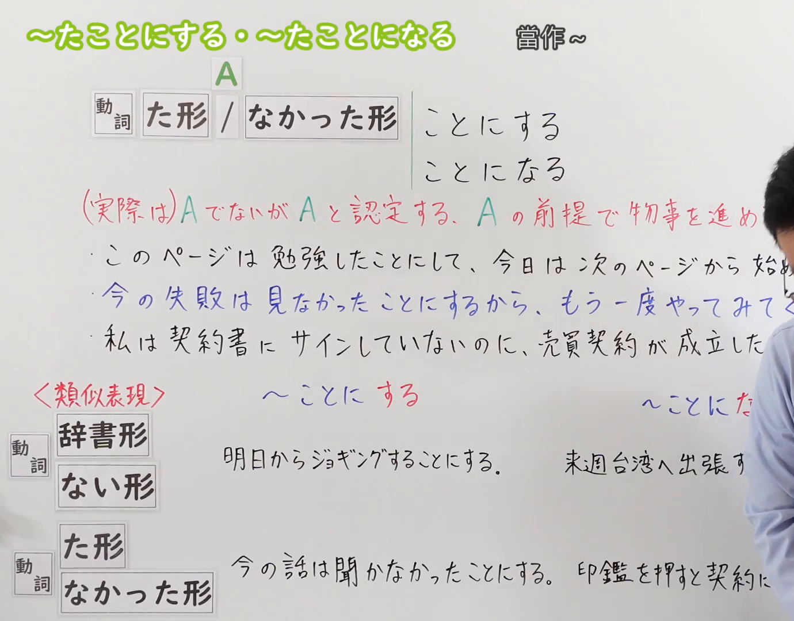
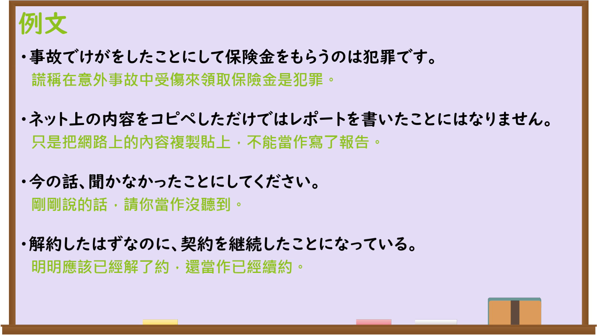

---
{
  "id": "N3-G-0112",
  "kind": "grammar",
  "level": "N3",
  "title": "〜たことにする・〜たことになる（当作……；就算是……）",
  "card_revision": 1,
  "schema_version": 1,
  "source": {
    "lesson": "N3 第112个语法",
    "material": "出口日語原视频板书、日语自动字幕与Hagoromo文型检索正文",
    "video": "https://www.youtube.com/watch?v=h2OGDEQvUBU",
    "screenshot": "assets/grammar/n3/N3-G-0112-connection.png",
    "screenshot_seconds": 1,
    "screenshot_crop": {
      "x": 0,
      "y": 0,
      "width": 1380,
      "height": 1080
    }
  },
  "tags": [
    "たことにする",
    "たことになる",
    "ことにする",
    "N3"
  ],
  "confusions": [
    "〜ことにする",
    "〜ことになる",
    "〜つもりだ"
  ]
}
---

# N3 第112个语法：〜たことにする・〜たことになる

# 视频学习资料整理

本课讲解 N3 语法形式「〜たことにする・〜たことになる」。

## 接续图（板书与讲解）

- 视频链接：[出口日語 N3 第112个语法](https://www.youtube.com/watch?v=h2OGDEQvUBU)
- 真实时间：00:01（1.00秒）
- 原图尺寸：1920×1080
- 裁切说明：选用 00:01 画面，左上方清晰显示语法标题「〜たことにする・〜たことになる」与中文释义「當作〜」，接续展示动词た形/なかった形接「ことにする」「ことになる」，并详细说明「(実際は)AでないがAと認定する、Aの前提で物事を進める」。固定左上角（0, 0），裁切区域为宽 1380、高 1080，裁去右侧讲师身躯。
- 图片：

## 例句图（视频例句）

- 视频链接：[出口日語 N3 第112个语法](https://www.youtube.com/watch?v=h2OGDEQvUBU)
- 真实时间：07:06（426.00秒）
- 原图尺寸：1920×1080
- 裁切说明：提取自视频 07:06 处的例句黑板页面。固定左上角（0, 0），裁切区域为宽 1920、高 1080，保留完整例句与中文释义。
- 图片：

# 核心

## 功能一：实际上并非如此，但主观上当作已发生/未发生的事实来认定或推进（主观当作……）

**最上位意味カテゴリー：**

- **たことにする：** 話し手の心的態度（说话人的心理态度）

**中位意味カテゴリー：**

- **たことにする：** 判断・主観的把握（判断与主观把握）

**意味：**

- **たことにする：** 仮定・みなし（假定与视同）

**くわしい意味記述：**

- **たことにする：** 実際にはそうではないが，事実とは異なる事態をあえて事実として扱い，その前提で物事を進めることを表す。板書説明：「(実際は)AでないがAと認定する、Aの前提で物事を進める」。（表示实际上并非如此，但主观上硬将其视作事实来对待，并以此为前提推进事务。）

### 例句

1. このページは勉強したことにして、今日は次のページから始めよう。

   （这一页就当作已经学过了，今天从下一页开始吧。）

2. 今の失敗は見なかったことにするから、もう一度やってみて。

   （刚才的失误我就当作没看见，你再试一次吧。）

3. 嫌なことは全部夢だったことにして、忘れよう。

   （把讨厌的事情全当成是一场梦，忘掉吧。）

4. 今日の欠席は、出席したことにしてください。

   （今天的缺席，请当作我已经出席来处理吧。）

## 功能二：根据客观规则、计算或结果，等同于认定了事实A（客观算作……；相当于……）

**最上位意味カテゴリー：**

- **たことになる：** ものごとの関係（事物之间的关系）

**中位意味カテゴリー：**

- **たことになる：** 結果・帰結（结果与归结）

**意味：**

- **たことになる：** 認定・帰結（认定与归结）

**くわしい意味記述：**

- **たことになる：** 客観的なルール，基準，計算などに基づき，事実上Aという結果や認定が下されることを表す。（表示根据客观规则、标准或计算，在事实层面上等同于得出了A的认定或结论。）

### 例句

1. 私は契約書にサインしていないのに、売買契約が成立したことになっている。

   （我明明没有在合同上签字，却被算作买卖合同已成立。）

2. 今回のテストで80点以上取れなければ、不合格になったことになる。

   （这次考试如果拿不到80分以上，就相当于成了不合格。）

3. 印鑑を押すと、内容をすべて承認したことになります。

   （一旦盖了章，就意味着认定了全部内容。）

4. 法律上は、18歳を迎えた時点で成人したことになる。

   （在法律层面上，年满18岁的那一刻起就算作已经成年。）

# 来源

- [出口日語原视频](https://www.youtube.com/watch?v=h2OGDEQvUBU)
- [日本語NET「〜たことにする」](https://nihongokyoshi-net.com/2019/06/25/jlptn3-grammar-takotonisuru/)（查询日期：2026-09-25）
