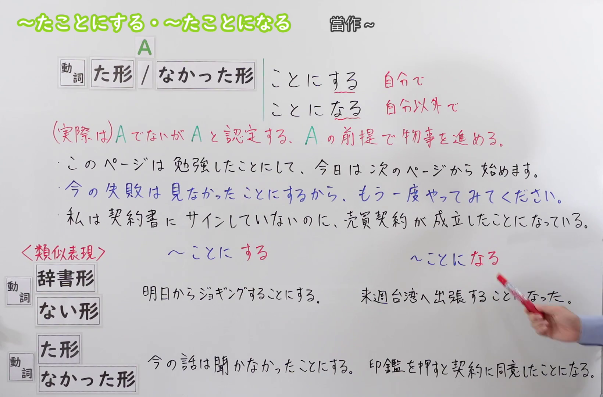
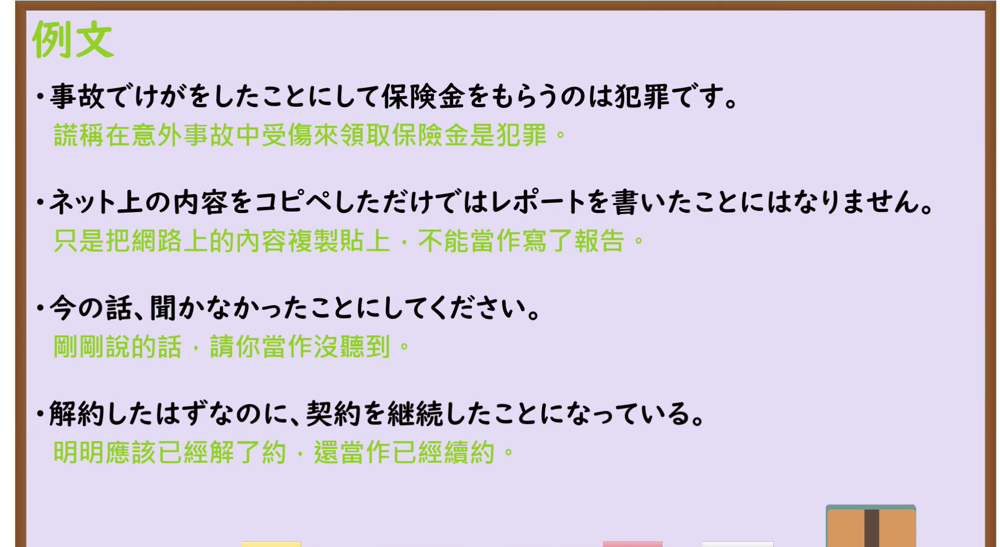

---
{
  "id": "N3-G-0112",
  "kind": "grammar",
  "level": "N3",
  "title": "～たことにする・～たことになる：将非事实认定为事实并据此推进",
  "status": "confirmed",
  "card_revision": 1,
  "schema_version": 1,
  "created_at": "2026-09-22",
  "updated_at": "2026-09-22",
  "next_review": "2026-09-29",
  "source": {
    "lesson": "N3 第112个语法",
    "material": "出口日語原视频板书、日语自动字幕与毎日のんびり日本語教師两篇正文",
    "video": "https://www.youtube.com/watch?v=h2OGDEQvUBU",
    "screenshot": "assets/grammar/n3/N3-G-0112-0360.png",
    "screenshot_seconds": 360,
    "screenshot_crop": {
      "x": 0,
      "y": 0,
      "width": 1640,
      "height": 1080
    }
  },
  "tags": [
    "たことにする",
    "たことになる",
    "認定",
    "反事实",
    "N3"
  ],
  "confusions": [
    "～ことにする",
    "～ことになる",
    "～たつもりで"
  ]
}
---

# N3 第112课｜～たことにする・～たことになる

# 视频学习资料整理

本次只整理第112课，无学习者个人原始输出。2026-09-22核对出口日語播放列表第112项：日语标题「【Ｎ３文法】～たことにする・～たことになる」，视频ID `h2OGDEQvUBU`，时长08:36。原视频红字说明这两个形式表示“（实际上）并非A，却认定为A；以A为前提推进事情”，并指出 `～たことにする` 是说话者自行认定，`～たことになる` 是由自己以外的人或包含自己的群体作出认定。本卡“核心”据此合并为一个实质功能，并分别保留两个形式的视角差异。

接续图取自[原视频06:00](https://www.youtube.com/watch?v=h2OGDEQvUBU&t=360s)，原帧1920×1080，固定左上角裁为(0,0,1640,1080)。00:01画面中人物遮住红字含义说明和中部板书，因此检查前段与中段时轴后改用06:00。画面完整保留课程标题、接续、`～たことにする`／`～たことになる` 的认定者差异、红字含义说明、三句本课板书例句，以及与普通 `～ことにする`／`～ことになる` 的类比；右下角仅有老师手部入镜，未遮挡文字。

例句图取自[原视频07:00](https://www.youtube.com/watch?v=h2OGDEQvUBU&t=420s)，原帧1920×1080，固定左上角裁为(0,0,1900,1040)。画面完整保留四句课程例句及其中文译文，只裁去右侧和底部少量边缘；本图与接续图内容不重复。

# 核心

## 功能一：（实际上）并非 A，却认定为 A；以 A 为前提推进事情

**くわしい意味記述：**

- **～たことにする：** 物事を事実とは反したようにみなす文法です。（把事物认定为与事实相反的状态。）
- **～たことになる：** 「～たことにする／たこととする」と同じく物事を事実とは反したようにみなす文法ですが、こちらは自分の意志とは関係のないことに対して使う客観的な表現です。（与 `～たことにする／たこととする` 一样，表示把事物认定为与事实相反的状态；但此形式用于与自己意志无关的事情，是客观表达。）

### 例句

1. 仕事を終わらせたことにしてさっさと帰ってきた。

   （假装工作已经做完，便赶紧回来了。）

2. 夫の不倫を見なかったことにする。

   （就当作没有看见丈夫出轨。）

3. その話は聞かなかったことにしましょう。

   （那件事就当作没有听见吧。）

4. ベランダに出て洗濯物を干したから、今日も一応外に出たことになっている。

   （因为到阳台晾了衣服，今天姑且也算出过门了。）

5. 移動を含めれば実際に降り立っていないが全都道府県に行ったこととなる。

   （如果把途中经过也算进去，虽然实际上并未在所有地方落脚，也可以算作去过日本全部都道府县。）

# 来源

- [出口日語原视频](https://www.youtube.com/watch?v=h2OGDEQvUBU)
- [毎日のんびり日本語教師「【Ｎ３文法】～たことにする／たこととする」](https://mainichi-nonbiri.com/grammar/n3-takotonisuru/)（意义说明与例句；查询日期：2026-09-22）
- [毎日のんびり日本語教師「【Ｎ３文法】～たことになる／たこととなる」](https://mainichi-nonbiri.com/grammar/n3-takotoninaru/)（意义说明与例句；查询日期：2026-09-22）
