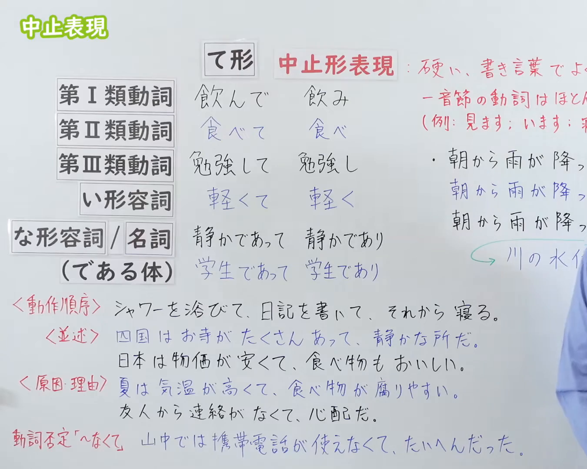
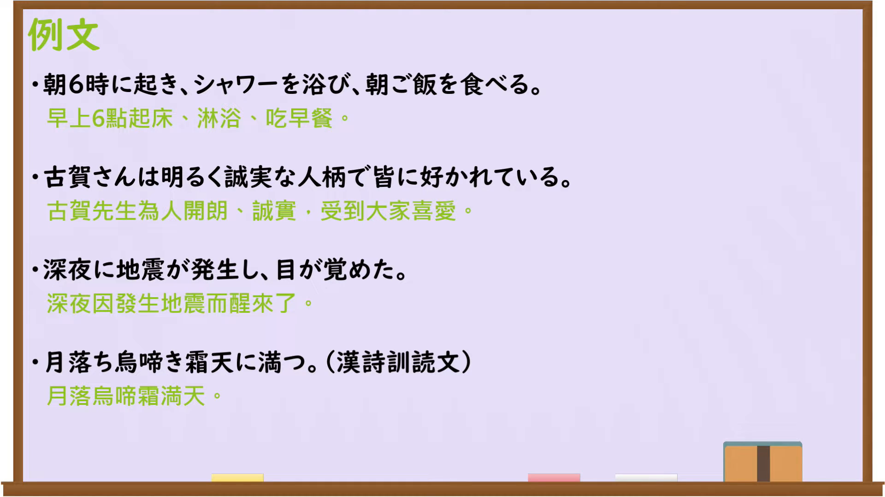

---
{
  "id": "N3-G-0113",
  "kind": "grammar",
  "level": "N3",
  "title": "中止表現（中止形：硬い書き言葉の中止表現）",
  "card_revision": 1,
  "schema_version": 1,
  "source": {
    "lesson": "N3 第113个语法",
    "material": "出口日語原视频板书、日语自动字幕与Hagoromo文型检索正文",
    "video": "https://www.youtube.com/watch?v=tiKUN1FSTLI",
    "screenshot": "assets/grammar/n3/N3-G-0113-connection.png",
    "screenshot_seconds": 1,
    "screenshot_crop": {
      "x": 0,
      "y": 0,
      "width": 1350,
      "height": 1080
    }
  },
  "tags": [
    "中止形",
    "中止表現",
    "連用形中止",
    "N3"
  ],
  "confusions": [
    "〜て",
    "〜ながら",
    "〜つつ"
  ]
}
---

# N3 第113个语法：中止表現（中止形）

# 视频学习资料整理

本课讲解 N3 语法形式「中止表現（中止形）」。

## 接续图（板书与讲解）

- 视频链接：[出口日語 N3 第113个语法](https://www.youtube.com/watch?v=tiKUN1FSTLI)
- 真实时间：00:01（1.00秒）
- 原图尺寸：1920×1080
- 裁切说明：选用 00:01 画面，左上方清晰显示语法标题「中止表現」，详细展示动词/形容词/名词的中止形变换规则（如「飲み」「食べ」「勉強し」「軽く」「静かであり」），并对比て形说明这是硬い書き言葉表现。固定左上角（0, 0），裁切区域为宽 1350、高 1080，裁去右侧讲师身躯。
- 图片：

## 例句图（视频例句）

- 视频链接：[出口日語 N3 第113个语法](https://www.youtube.com/watch?v=tiKUN1FSTLI)
- 真实时间：11:05（665.00秒）
- 原图尺寸：1920×1080
- 裁切说明：提取自视频 11:05 处的例句黑板页面。固定左上角（0, 0），裁切区域为宽 1920、高 1080，保留完整例句与中文释义。
- 图片：

# 核心

## 功能一：動作順序（动作先后顺序的中止连接）

**最上位意味カテゴリー：**

- **中止形（動作順序）：** 場所・時間（场所与时间）

**中位意味カテゴリー：**

- **中止形（動作順序）：** 時間的関係（时间关系）

**意味：**

- **中止形（動作順序）：** 継起（动作相继发生）

**くわしい意味記述：**

- **中止形（動作順序）：** 硬い書き言葉や改まったニュース報道等で，連続して行われる複数の動作の前後順序を簡潔に接続する。板書説明：「動作順序：シャワーを浴び、日記を書いて、それから寝る」。（在郑重的书面语或新闻报道中，简练连接先后连续发生的若干动作。）

### 例句

1. 朝早く起き、軽くジョギングをしてから朝食をとった。

   （清晨早起，轻轻慢跑之后吃了早餐。）

2. 資料に目を通し、必要な箇所に下線を引いた。

   （过目了资料，并在需要的地方划了下划线。）

3. 荷物をまとめ、急いで空港へ向かった。

   （收拾好行李，急忙赶往了机场。）

4. 手術は無事に終了し、患者は集中治療室へ移された。

   （手术顺利结束，患者被转移到了重症监护室。）

## 功能二：並述（事物特性的并列叙述）

**最上位意味カテゴリー：**

- **中止形（並述）：** ものごとの関係（事物之间的关系）

**中位意味カテゴリー：**

- **中止形（並述）：** 並列・添加（并列与添加）

**意味：**

- **中止形（並述）：** 並述（并列叙述）

**くわしい意味記述：**

- **中止形（並述）：** 事物の状態，性質，特徴などを対等に並べて叙述する。板書説明：「並述：日本は物価が安く、食べ物もおいしい」。（将事物的状态、性质或特征对等并列陈述。）

### 例句

1. 四国はお寺がたくさんあり、静かな所だ。

   （四国有很多寺庙，是个幽静的地方。）

2. 日本は治安が良く、交通も非常に便利だ。

   （日本治安良好，交通也非常便利。）

3. 兄は活発であり、弟は物静かな性格だ。

   （哥哥性格活泼，弟弟则性格沉静。）

4. この製品は操作が簡単であり、耐久性にも優れている。

   （该产品操作简便，耐久性也极其出色。）

## 功能三：原因・理由（原因与理由的中止连接）

**最上位意味カテゴリー：**

- **中止形（原因・理由）：** ものごとの関係（事物之间的关系）

**中位意味カテゴリー：**

- **中止形（原因・理由）：** 原因・理由（原因与理由）

**意味：**

- **中止形（原因・理由）：** 原因・理由（原因与理由）

**くわしい意味記述：**

- **中止形（原因・理由）：** 前節が後節の事態を引き起こす原因や理由になっていることを表す。板書説明：「原因・理由：夏は気温が高く、食べ物が腐りやすい」。（表示前项是引发后项事态的原因或理由。）

### 例句

1. 夏は気温が高く、食べ物が腐りやすいので注意が必要だ。

   （夏季气温偏高，食物容易变质，因而需要多加注意。）

2. 友人から何の連絡もなく、とても心配している。

   （朋友那里没有任何联络，令人十分担心。）

3. 台風が接近し、公共交通機関に大幅な乱れが生じた。

   （台风临近，导致公共交通出现了大幅度延误。）

4. 山中では携帯電話の電波が届かず、たいへん困った。

   （在深山里手机接收不到信号，感到非常伤脑筋。）

# 来源

- [出口日語原视频](https://www.youtube.com/watch?v=tiKUN1FSTLI)
- [日本語NET「〜中止形」](https://nihongokyoshi-net.com/2019/05/29/jlptn3-grammar-chuushikei/)（查询日期：2026-09-25）
