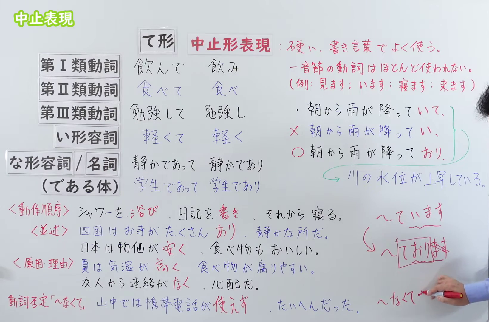
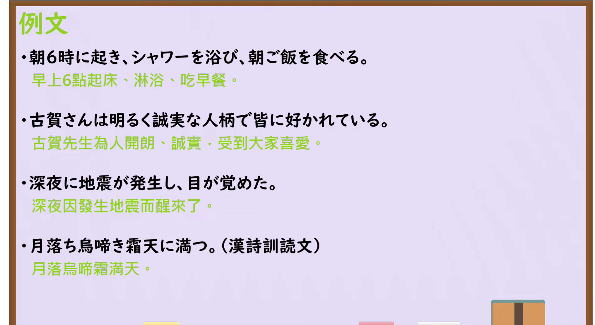

---
{
  "id": "N3-G-0113",
  "kind": "grammar",
  "level": "N3",
  "title": "中止表現（連用中止）：表达较生硬，常用于书面语",
  "status": "confirmed",
  "card_revision": 1,
  "schema_version": 1,
  "created_at": "2026-09-22",
  "updated_at": "2026-09-22",
  "next_review": "2026-09-29",
  "source": {
    "lesson": "N3 第113个语法",
    "material": "出口日語原视频板书、日语自动字幕与日本語NET正文",
    "video": "https://www.youtube.com/watch?v=tiKUN1FSTLI",
    "screenshot": "assets/grammar/n3/N3-G-0113-0610.png",
    "screenshot_seconds": 610,
    "screenshot_crop": {
      "x": 0,
      "y": 0,
      "width": 1640,
      "height": 1080
    }
  },
  "tags": [
    "中止表現",
    "連用中止",
    "書き言葉",
    "並列",
    "原因・理由",
    "N3"
  ],
  "confusions": [
    "～て形",
    "～ながら",
    "～たり～たりする"
  ]
}
---

# N3 第113课｜中止表現（連用中止）

# 视频学习资料整理

本次只整理第113课，无学习者个人原始输出。2026-09-22核对出口日語播放列表第113项：日语标题「【Ｎ３文法】中止表現」，视频ID `tiKUN1FSTLI`，时长12:26。原视频把本课称为「中止形表現」，红字说明为「硬い、書き言葉でよく使う。」；板书同时以动作顺序、并列、原因・理由三类关系展示用法，并补充动词否定形式的书面表达。本卡“核心”依据日本語NET实际条目的一个意义说明合并为一个功能。

接续图取自[原视频10:10](https://www.youtube.com/watch?v=tiKUN1FSTLI&t=610s)，原帧1920×1080，固定左上角裁为(0,0,1640,1080)。00:01画面中人物遮住右侧含义说明和例句，因此扩大粗筛并检查局部候选后改用10:10。画面保留课程标题、各词类的中止形示例、红字文体说明、动作顺序／并列／原因・理由例句、`～ており` 提示，以及动词否定例句；右侧仅有老师的少量头发和手部入镜，未遮挡板书文字。

例句图取自[原视频11:20](https://www.youtube.com/watch?v=tiKUN1FSTLI&t=680s)，原帧1920×1080，固定左上角裁为(0,0,1900,1040)。画面完整保留四句课程例句及其中文译文，只裁去右侧和底部少量边缘；本图与接续图内容不重复。

# 核心

## 功能一：表达较生硬，常用于书面语

**くわしい意味記述：**

- **連用中止：** 動詞文や、い形容詞文の接続のしかたの一つで、並列や理由を表す。行為の順序や対立する内容を表す際に使われる。「作り方」や「使い方」の説明でもよく使われる。書き言葉でよく使われる。（这是动词句和い形容词句的一种连接方式，表示并列或原因。用于表达行为顺序或相对立的内容，也常用于说明“制作方法”或“使用方法”，多见于书面语。）

### 例句

1. 本を読み、しばらく考える。

   （读完书后，思考一会儿。）

2. ふたを開け、お湯を入れ、３分待てばカップラーメンの出来上がりだ。

   （打开盖子，倒入热水，再等三分钟，杯面就做好了。）

3. この街は物価が安く、空気もよく、とても住みやすい。

   （这座城市物价低，空气也好，非常宜居。）

4. 人身事故があり、電車が遅れていた。

   （发生了人身事故，电车一直晚点。）

5. 木村は現在、外出しており、明日戻ってくる予定です。

   （木村现在外出了，预计明天回来。）

# 来源

- [出口日語原视频](https://www.youtube.com/watch?v=tiKUN1FSTLI)
- [日本語NET「【JLPT N3】文法・例文：連用中止」](https://nihongokyoshi-net.com/2018/12/06/jlptn3-grammar-renyoochuushi/)（意义说明与例句；查询日期：2026-09-22）
