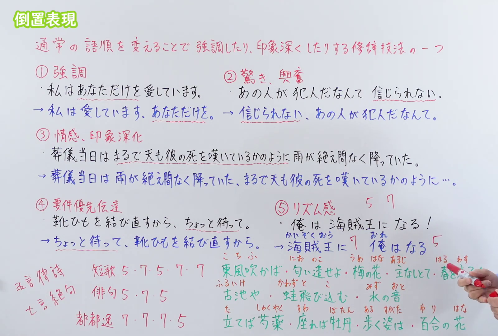
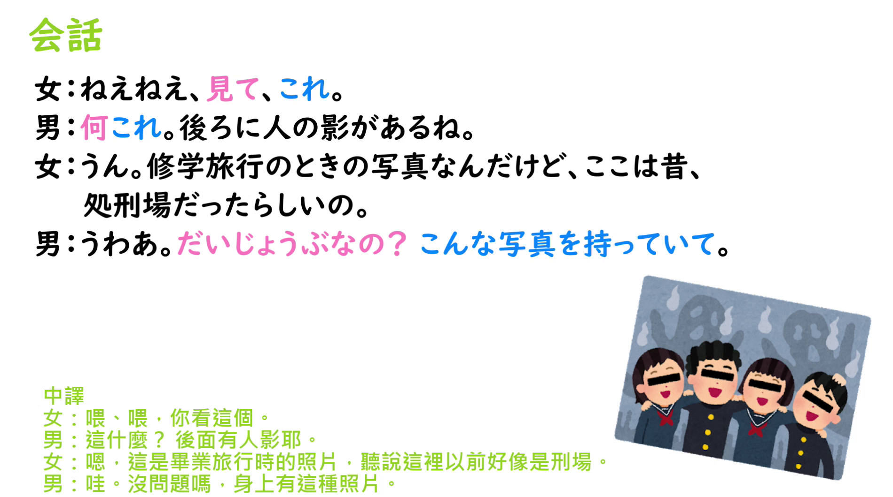

---
{
  "id": "N3-G-0114",
  "kind": "grammar",
  "level": "N3",
  "title": "倒置表現：通过改变通常语序来强调或加深印象的修辞手法",
  "status": "confirmed",
  "card_revision": 1,
  "schema_version": 1,
  "created_at": "2026-09-22",
  "updated_at": "2026-09-22",
  "next_review": "2026-09-29",
  "source": {
    "lesson": "N3 第114个语法",
    "material": "出口日語原视频板书、日语自动字幕与文章作成代行.jp正文",
    "video": "https://www.youtube.com/watch?v=uI9_1qQxsrY",
    "screenshot": "assets/grammar/n3/N3-G-0114-0443.png",
    "screenshot_seconds": 443,
    "screenshot_crop": {
      "x": 0,
      "y": 0,
      "width": 1600,
      "height": 1080
    }
  },
  "tags": [
    "倒置表現",
    "倒置法",
    "強調",
    "修辞技法",
    "語順",
    "N3"
  ],
  "confusions": [
    "通常語順",
    "体言止め",
    "省略表現"
  ]
}
---

# N3 第114课｜倒置表現

# 视频学习资料整理

本次只整理第114课，无学习者个人原始输出。2026-09-22核对出口日語播放列表第114项：日语标题「【Ｎ３文法】倒置表現」，视频ID `uI9_1qQxsrY`，时长9:51。原视频将倒置表現说明为「通常の語順を変えることで強調したり、印象深くしたりする修辞技法の一つ」，并以强調、驚き・興奮、情感・印象深化、要件優先伝達和リズム感展示其表达效果。本卡“核心”依据实际采用的「倒置法」解说页合并为一个功能。

接续图取自[原视频7:23](https://www.youtube.com/watch?v=uI9_1qQxsrY&t=443s)，原帧1920×1080，固定左上角裁为(0,0,1600,1080)。00:01画面中老师遮挡右侧板书，因此扩大粗筛后改用7:23；画面保留课程定义、五类表达效果及对应倒置前后例句，右缘仅有少量手部入镜，未遮挡主要板书。

例句图取自[原视频9:00](https://www.youtube.com/watch?v=uI9_1qQxsrY&t=540s)，原帧1920×1080，固定左上角裁为(0,0,1900,1060)。画面保留完整会话和中文译文，蓝字句末「こんな写真を持っていて」是把通常先出现的条件／理由部分后置的倒置表达；本图与接续图内容不重复。

# 核心

## 功能一：通过改变通常语序来强调或加深印象的一种修辞手法

**くわしい意味記述：**

- **倒置法：** 倒置法とは、文章の語順を、普通の順序とは逆にする表現技法です。（倒置法是一种把文章语序改为与通常顺序相反的表达技巧。）

### 例句

1. 私は信じている、あなたを。

   （我相信着——相信你。）

2. 私は会いたかった、あなたに。

   （我一直想见的，是你。）

3. そんな私をすっかり変えてしまったのです、この食物繊維たっぷりジュースが。

   （彻底改变了那样的我的，正是这款富含膳食纤维的果汁。）

4. 彼が乗った船は、水平線に向かって走っていった、どこまでも。

   （他乘坐的船朝着地平线驶去，一直驶向远方。）

5. 「資料を送ってくださいね、もっと早く」

   （“请把资料发过来，要再早一点。”）

# 来源

- [出口日語原视频](https://www.youtube.com/watch?v=uI9_1qQxsrY)
- [文章作成代行.jp「倒置法とは？3つの効果と注意点【例文つきで簡単解説】」](https://xn--3kq3hlnz13dlw7bzic.jp/inversion-method/)（意义说明与例句；查询日期：2026-09-22）
