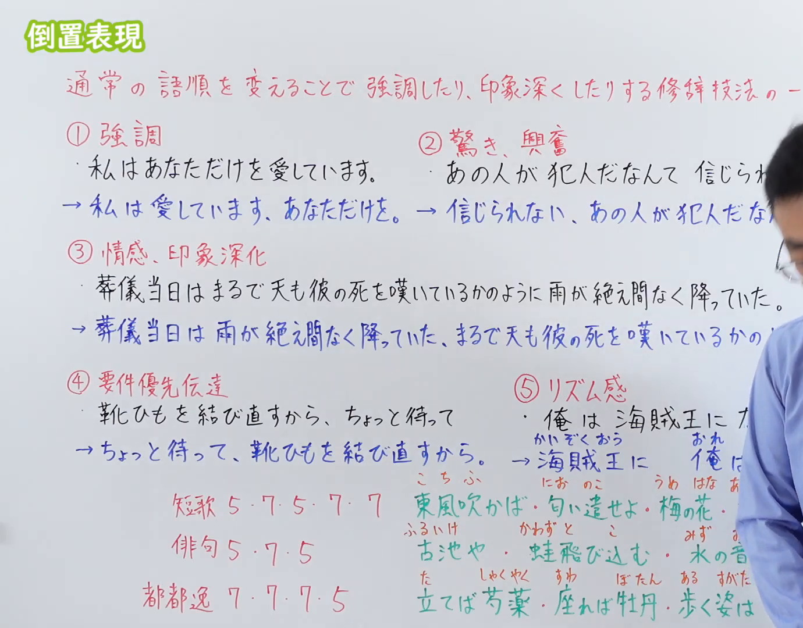
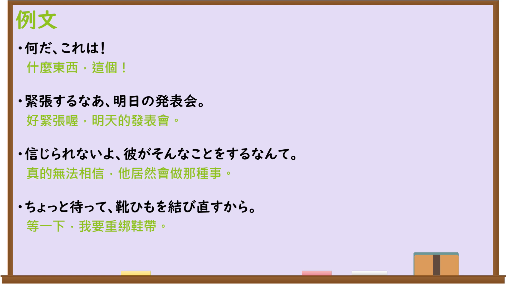

---
{
  "id": "N3-G-0114",
  "kind": "grammar",
  "level": "N3",
  "title": "倒置表現（倒置法：强调与深化的修辞技法）",
  "card_revision": 1,
  "schema_version": 1,
  "source": {
    "lesson": "N3 第114个语法",
    "material": "出口日語原视频板书、日语自动字幕与Hagoromo文型检索正文",
    "video": "https://www.youtube.com/watch?v=uI9_1qQxsrY",
    "screenshot": "assets/grammar/n3/N3-G-0114-connection.png",
    "screenshot_seconds": 1,
    "screenshot_crop": {
      "x": 0,
      "y": 0,
      "width": 1380,
      "height": 1080
    }
  },
  "tags": [
    "倒置表現",
    "倒置法",
    "N3"
  ],
  "confusions": [
    "〜こそ",
    "〜さえ",
    "〜すら"
  ]
}
---

# N3 第114个语法：倒置表現（倒置法）

# 视频学习资料整理

本课讲解 N3 语法形式「倒置表現（倒置法）」。

## 接续图（板书与讲解）

- 视频链接：[出口日語 N3 第114个语法](https://www.youtube.com/watch?v=uI9_1qQxsrY)
- 真实时间：00:01（1.00秒）
- 原图尺寸：1920×1080
- 裁切说明：选用 00:01 画面，左上方清晰显示语法标题「倒置表現」，详细说明修辞目的「通常の語順を変えることで強調したり、印象深くしたりする修辞技法の一つ」，板书列出①強調 ②驚き、興奮 ③情感、印象深化 ④要件優先伝達 ⑤リズム感。固定左上角（0, 0），裁切区域为宽 1380、高 1080，裁去右侧讲师身躯。
- 图片：

## 例句图（视频例句）

- 视频链接：[出口日語 N3 第114个语法](https://www.youtube.com/watch?v=uI9_1qQxsrY)
- 真实时间：08:33（513.00秒）
- 原图尺寸：1920×1080
- 裁切说明：提取自视频 08:33 处的例句黑板页面。固定左上角（0, 0），裁切区域为宽 1920、高 1080，保留完整例句与中文释义。
- 图片：

# 核心

## 功能一：強調・驚き・感情の優先伝達（强调焦点、惊叹与情绪的先发表达）

**最上位意味カテゴリー：**

- **倒置（強調・驚き）：** 話し手の心的態度（说话人的心理态度）

**中位意味カテゴリー：**

- **倒置（強調・驚き）：** 感嘆・強調（感叹与强调）

**意味：**

- **倒置（強調・驚き）：** 語順転換（语序转换）

**くわしい意味記述：**

- **倒置（強調・驚き）：** 通常の語順（SOV）をあえて逆転させ，述語や最も言いたい感情・驚きを文頭に出して強く印象付ける。板書説明：「①強調 ②驚き・興奮」。（刻意打破常规语序，将谓语或最想表达的情绪、惊异置于句首，以强化听觉冲击与情感表现。）

### 例句

1. 私は愛しています、あなただけを。

   （我深爱着，唯有你一人。）

2. 信じられない、あの人が犯人だなんて！

   （简直难以置信，那个人竟然是凶手！）

3. 綺麗ですね、今日の夕焼けは。

   （真美啊，今天的晚霞。）

4. 忘れないでください、私たちの約束を。

   （请千万不要忘记，我们的约定。）

## 功能二：情感・印象深化（描景与抒情的深层渲染）

**最上位意味カテゴリー：**

- **倒置（情感・深化）：** ものごとの様子（事物的样态）

**中位意味カテゴリー：**

- **倒置（情感・深化）：** 情景描写（情景描写）

**意味：**

- **倒置（情感・深化）：** 余韻・情緒（余韵与情绪）

**くわしい意味記述：**

- **倒置（情感・深化）：** 文末に比喩や状況描写の修飾句を後置することで，文全体に余韻や深い情緒を生み出す。板書説明：「③情感、印象深化」。（在句末后置比喻或情景修饰语，使整句话产生深远的余韵与丰富的情绪感染力。）

### 例句

1. 葬儀当日は雨が絶え間なく降っていた、まるで天も彼の死を嘆いているかのように。

   （葬礼当天雨水连绵不断，宛如上天也在哀悼他的离去。）

2. 街はすっかり静まり返っていた、まるで時間が止まってしまったかのように。

   （整座街道彻底沉寂了下来，就宛如时间已经停滞了一般。）

3. 彼は立ちすくんでいた、あまりの衝撃に言葉も出ないまま。

   （他僵立在原地，在巨大的震惊之中一句话也说不出来。）

4. 桜の花が美しく舞い散っていた、春の終わりの風に吹かれて。

   （樱花花瓣优美地漫天飘落，在暮春的微风吹拂之中。）

## 功能三：要件優先伝達（口语交流中优先传递紧急要件与行动要求）

**最上位意味カテゴリー：**

- **倒置（要件優先）：** 人との関係（人际关系）

**中位意味カテゴリー：**

- **倒置（要件優先）：** 伝達・要求（传达与要求）

**意味：**

- **倒置（要件優先）：** 緊急伝達（紧急传达）

**くわしい意味記述：**

- **倒置（要件優先）：** 日常の会話において，理由や前提を後回しにし，相手に一番伝えたい結論や要件を真っ先に発話する。板書説明：「④要件優先伝達」。（日常口语交流中暂将理由前提后置，最先说出最想让对方知晓的结论或行动要件。）

### 例句

1. ちょっと待って、靴ひもを結び直すから。

   （稍等一下，我重系一下鞋带。）

2. 早く傘をさして、風邪をひいちゃうから。

   （快打上伞，要感冒了。）

3. 手伝ってくれる？この荷物が重くて持てないの。

   （能帮我一下吗？这行李太重我拿不动。）

4. 気をつけて帰ってね、夜道は危ないから。

   （路上回去小心哦，因为夜路很危险。）

# 来源

- [出口日語原视频](https://www.youtube.com/watch?v=uI9_1qQxsrY)
- [出口日語文法解説「倒置表現」](https://www.youtube.com/watch?v=uI9_1qQxsrY)（查询日期：2026-09-25）
