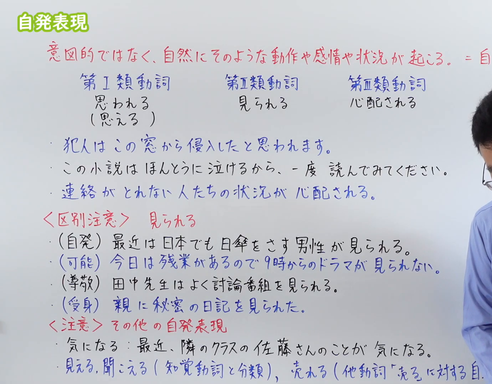
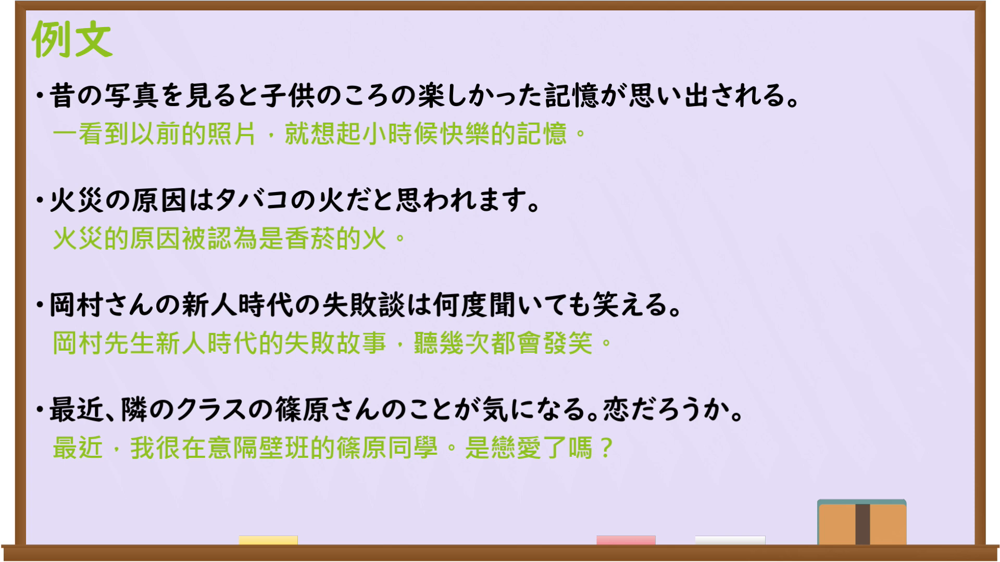

---
{
  "id": "N3-G-0115",
  "kind": "grammar",
  "level": "N3",
  "title": "自発表現（自发表现：自然流露的情感与推测）",
  "card_revision": 1,
  "schema_version": 1,
  "source": {
    "lesson": "N3 第115个语法",
    "material": "出口日語原视频板书、日语自动字幕与Hagoromo文型检索正文",
    "video": "https://www.youtube.com/watch?v=sZ7WDegvJI0",
    "screenshot": "assets/grammar/n3/N3-G-0115-connection.png",
    "screenshot_seconds": 1,
    "screenshot_crop": {
      "x": 0,
      "y": 0,
      "width": 1380,
      "height": 1080
    }
  },
  "tags": [
    "自発",
    "自発表現",
    "思われる",
    "感じられる",
    "N3"
  ],
  "confusions": [
    "受身",
    "可能",
    "使役"
  ]
}
---

# N3 第115个语法：自発表現

# 视频学习资料整理

本课讲解 N3 语法形式「自発表現」。

## 接续图（板书与讲解）

- 视频链接：[出口日語 N3 第115个语法](https://www.youtube.com/watch?v=sZ7WDegvJI0)
- 真实时间：00:01（1.00秒）
- 原图尺寸：1920×1080
- 裁切说明：选用 00:01 画面，左上方清晰显示语法标题「自発表現」，接续展示动词Ⅰ类「思われる（思える）」、Ⅱ类「見られる」、Ⅲ类「心配される」，并详细说明「意図的ではなく、自然にそのような動作や感情や状況が起こる」。固定左上角（0, 0），裁切区域为宽 1380、高 1080，裁去右侧讲师身躯。
- 图片：

## 例句图（视频例句）

- 视频链接：[出口日語 N3 第115个语法](https://www.youtube.com/watch?v=sZ7WDegvJI0)
- 真实时间：09:40（580.00秒）
- 原图尺寸：1920×1080
- 裁切说明：提取自视频 09:40 处的例句黑板页面。固定左上角（0, 0），裁切区域为宽 1920、高 1080，保留完整例句与中文释义。
- 图片：

# 核心

## 功能一：思索・感情・懸念の自然な自発（自然涌起的心情、顾虑与推测）

**最上位意味カテゴリー：**

- **自発（感情・思索）：** 話し手の心的態度（说话人的心理态度）

**中位意味カテゴリー：**

- **自発（感情・思索）：** 自発（自发）

**意味：**

- **自発（感情・思索）：** 自然発生（自然发生）

**くわしい意味記述：**

- **自発（感情・思索）：** 話し手の意図的な意志によるものではなく，ある刺激や状況によって自然と心の中に湧き上がる感情，推測，懸念を表す。板書説明：「意図的ではなく、自然にそのような動作や感情や状況が起こる」。（非出于说话人的主观刻意意志，而是由某种情境自然而然在内心深处涌现出的感情、推测或担忧。）

### 例句

1. 犯人はこの窓から侵入したと思われます。

   （推测犯人是从这扇窗户侵入的。）

2. 連絡がとれない被災地の人たちの状況が、深く心配される。

   （那些无法取得联系的灾区民众的状况，令人深感担忧。）

3. この小説は本当に泣けるから、ぜひ一度読んでみてください。

   （这本小说真的让人禁不住落泪，请务必读一读。）

4. 故郷の風景を見ると、幼い頃の思い出が自然と思い出される。

   （看到故乡的风景，儿时的回忆便自然而然地涌上心头。）

## 功能二：客観的事実・傾向の自発的観察（客观显现的事实与倾向表现「見られる」等）

**最上位意味カテゴリー：**

- **自発（客観観察）：** ものごとの様子（事物的样态）

**中位意味カテゴリー：**

- **自発（客観観察）：** 様相・現象（样相与现象）

**意味：**

- **自発（客観観察）：** 観察・傾向（观察与倾向）

**くわしい意味記述：**

- **自発（客観観察）：** 客観的な社会動向や自然現象として，そのような傾向や事実が自然と認められることを表す。受身・可能・尊敬との区別に注意。板書説明：「（自発）最近は日本でも日傘をさす男性が見られる」。（作为客观社会动向或自然现象，自然能够被观察到具有该倾向或事实。注意与被动、可能、尊敬相区别。）

### 例句

1. 最近は日本でも日傘をさす男性が多く見られるようになった。

   （最近在日本也能自然观察到不少撑太阳伞的男性了。）

2. 食生活の欧米化に伴い、生活習慣病の増加が見られる。

   （随着饮食生活的欧美化，能够观察到生活习惯病的增多。）

3. 景気の回復傾向が、各企業の売上数字にもはっきりと見られる。

   （经济复苏的倾向，在各企业的销售数据中也清晰显现出来。）

4. 今回の実験結果には、以前とは明らかな差異が見られた。

   （在这次的实验结果中，观察到了与以往明显的差异。）

# 来源

- [出口日語原视频](https://www.youtube.com/watch?v=sZ7WDegvJI0)
- [日本語NET「〜自発表現」](https://nihongokyoshi-net.com/2019/06/07/jlptn3-grammar-jihatsu/)（查询日期：2026-09-25）
