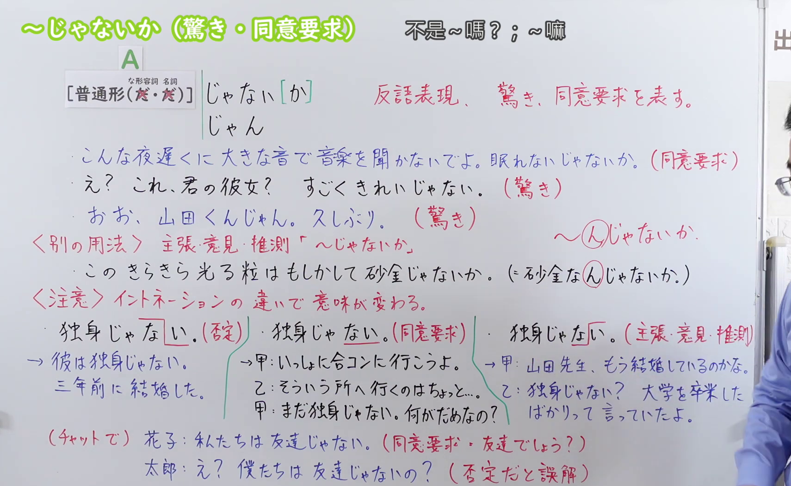
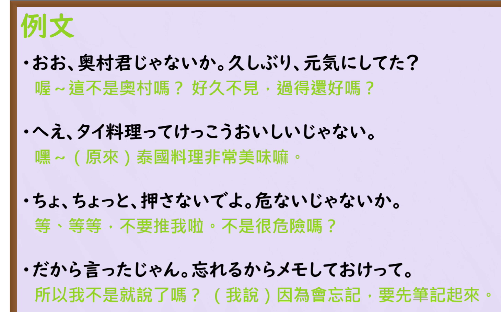

---
{
  "id": "N3-G-0116",
  "kind": "grammar",
  "level": "N3",
  "title": "～じゃないか（驚き・同意要求）：不是～吗？；～嘛",
  "status": "confirmed",
  "card_revision": 1,
  "schema_version": 1,
  "created_at": "2026-09-22",
  "updated_at": "2026-09-22",
  "next_review": "2026-09-29",
  "source": {
    "lesson": "N3 第116个语法",
    "material": "出口日語原视频板书、日语自动字幕与Hagoromo正文",
    "video": "https://www.youtube.com/watch?v=jk21IKHOXoA",
    "screenshot": "assets/grammar/n3/N3-G-0116-connection.png",
    "screenshot_seconds": 300,
    "screenshot_crop": {
      "x": 0,
      "y": 0,
      "width": 1710,
      "height": 1050
    }
  },
  "tags": [
    "じゃないか",
    "じゃん",
    "反語表現",
    "同意要求",
    "N3"
  ],
  "confusions": [
    "普通の否定「じゃない」とのイントネーションによる区別",
    "書きことば向けの「ではないか」",
    "推測の「んじゃないか」（動画内でN2扱い）"
  ]
}
---

# N3 第116个语法：～じゃないか（驚き・同意要求）

# 视频学习资料整理

原视频：[【Ｎ３文法】～じゃないか（驚き・同意要求）](https://www.youtube.com/watch?v=jk21IKHOXoA)（出口日語，2022-09-26 发布，时长 8 分 13 秒；视频 ID：jk21IKHOXoA）

**接续图（真实时间 05:00.0）**

- 来源画面：05:00.0 原帧，原图尺寸 1920×1080
- 裁切区域：固定左上角 (0, 0)，右下角收拢至 (1710, 1050)
- 替换原因：0:01 画面中讲师身体位于板书中部偏右，遮住第三组例句与红色「（同意要求）」标注，接续内容不完整；改用讲师退到画面最右侧的 05:00.0 清晰画面，全部板书文字完整可见
- 画面内容：本课板书，含接续「[普通形（な・名）] じゃない[か]／じゃん」、红色功能说明「反語表現、驚き、同意要求を表す。」、《別の用法》主張・意見・推測「～じゃないか」、《注意》イントネーションの違いで意味が変わる，以及三组板书例句；讲师仅占画面最右侧边缘，未遮挡文字
- 图片：

**例句图（真实时间 06:59.1）**

- 来源画面：06:59.1 原帧，原图尺寸 1920×1080
- 裁切区域：固定左上角 (0, 0)，右下角收拢至 (1460, 910)
- 画面内容：课末「例文」页，列出四条本课例句及中文翻译
- 图片：

# 核心

## 功能一：表示反问，强调惊讶、征求同意

**最上位意味カテゴリー：**

- **じゃないか（問いかけ・確認）：** 考え・感情（想法与感情）
- **ではないか（予想外の驚き）：** 考え・感情（想法与感情）

**中位意味カテゴリー：**

- **じゃないか（問いかけ・確認）：** 推量（推测）
- **ではないか（予想外の驚き）：** 主張・断定的評価（主张与断定性的评价）

**意味：**

- **じゃないか（問いかけ・確認）：** 問いかけ・確認（询问与确认）
- **ではないか（予想外の驚き）：** 主張（主张）

**くわしい意味記述：**

- **じゃないか（問いかけ・確認）：** 自分が考えていることについて，同意を求める言い方（就自己正在想的事情向对方征求同意的说法）
- **ではないか（予想外の驚き）：** 「予想外のことが起きて驚いている」という話し手の気持ちを表す。かたい表現で，書きことばでよく使う。（表示说话人「发生了意想不到的事情而感到惊讶」的心情。是较生硬的表现，多用于书面语。）

**派生語：**

- **じゃないか：** ではないか
- **ではないか：** じゃないか

### 例句

1. A:あの人、田中さんじゃない。↑ B：え、どの人？

   （A：那个人，不就是田中吗？ B：诶，哪个人？）

2. こんなところに古代の遺跡があったではないか。↓

   （没想到这种地方竟然有古代遗迹啊。）

3. それ、お父さんのやつじゃないか？

   （那个，不就是爸爸的东西吗？）

4. これじゃないか、１個前のやつ。

   （不就是这个吗，前一个那个。）

## 功能二：表示主张、意见、推测

**最上位意味カテゴリー：**

- **じゃないか（評価）：** 考え・感情（想法与感情）
- **ではないか（主張）：** 考え・感情（想法与感情）
- **じゃないか（主張・叱る・注意）：** 考え・感情（想法与感情）
- **ではないか（主張・叱る・注意）：** 考え・感情（想法与感情）

**中位意味カテゴリー：**

- **じゃないか（評価）：** 主張・断定的評価（主张与断定性的评价）
- **ではないか（主張）：** 主張・断定的評価（主张与断定性的评价）
- **じゃないか（主張・叱る・注意）：** 主張・断定的評価（主张与断定性的评价）
- **ではないか（主張・叱る・注意）：** 主張・断定的評価（主张与断定性的评价）

**意味：**

- **じゃないか（評価）：** 評価（评价）
- **ではないか（主張）：** 主張（主张）
- **じゃないか（主張・叱る・注意）：** 主張（主张）
- **ではないか（主張・叱る・注意）：** 主張（主张）

**くわしい意味記述：**

- **じゃないか（評価）：** 相手も認識していることを思い出させたり，気づかせたりするときに使う表現。確認の意味の「でしょ？」と似た意味を持つ。「じゃないですか」「ではないですか」「ではありませんか」という言い方や，会話では「じゃん」という言い方もある。（用于让对方想起或意识到对方自己也已知晓的事。与表示确认的「でしょ？」意思相近。也有「じゃないですか」「ではないですか」「ではありませんか」的说法，会话中说成「じゃん」。）
- **ではないか（主張）：** 相手も認識していることを思い出させたり，気づかせたりするときに使う表現。確認の意味の「でしょ？」と似た意味を持つ。「ではないですか」「じゃないですか」「ではありませんか」「ではあるまいか」という言い方や，会話では「じゃん」という言い方もある。（用于让对方想起或意识到对方自己也已知晓的事。与表示确认的「でしょ？」意思相近。也有「ではないですか」「じゃないですか」「ではありませんか」「ではあるまいか」的说法，会话中说成「じゃん」。）
- **じゃないか（主張・叱る・注意）：** 相手を叱ったり，注意したりする時に用いる。（用于责备或提醒对方。）
- **ではないか（主張・叱る・注意）：** 相手を叱ったり，注意したりする時に用いる。（用于责备或提醒对方。）

**派生語：**

- **じゃないか：** ではないか
- **ではないか：** じゃないか
- **じゃないか：** ではないか
- **ではないか：** じゃないか

### 例句

1. この案を考えたのは田中さんではありませんか。↑

   （想出这个方案的，不就是田中先生吗？）

2. 禁煙するって言ってたじゃない↓

   （你不是说过要戒烟的嘛。）

3. 歩きタバコは迷惑ではありませんか。

   （边走边抽烟不是给人添麻烦吗？）

4. え、初めて作ったの？おいしいじゃない↓

   （诶，第一次做的吗？这不挺好吃的嘛。）

5. 見方を変えれば、米国で保護主義の機運が高まるのは、貿易相手国の行動にも相当の責任があるのではないか。

   （换个角度想，美国的保护主义情绪高涨，难道不也是因为贸易伙伴国的做法有相当大的责任吗？）

# 来源

- [出口日語原视频「【Ｎ３文法】～じゃないか（驚き・同意要求）」](https://www.youtube.com/watch?v=jk21IKHOXoA)（视频 ID：jk21IKHOXoA）
- [Hagoromo「じゃないか」条目](https://hagoromo-text.work/lookup?vid=589)／[例句](https://hagoromo-text.work/get_reibun?vid=589)（查询日期：2026-09-22）
- [Hagoromo「ではないか」条目](https://hagoromo-text.work/lookup?vid=853)／[例句](https://hagoromo-text.work/get_reibun?vid=853)（查询日期：2026-09-22）
- [Hagoromo「じゃないか」（評価）条目](https://hagoromo-text.work/lookup?vid=590)／[例句](https://hagoromo-text.work/get_reibun?vid=590)（查询日期：2026-09-22）
- [Hagoromo「ではないか」（主張）条目](https://hagoromo-text.work/lookup?vid=852)／[例句](https://hagoromo-text.work/get_reibun?vid=852)（查询日期：2026-09-22）
- [Hagoromo「じゃないか」（相手を叱る・注意する）条目](https://hagoromo-text.work/lookup?vid=1932)／[例句](https://hagoromo-text.work/get_reibun?vid=1932)（查询日期：2026-09-22）
- [Hagoromo「ではないか」（相手を叱る・注意する）条目](https://hagoromo-text.work/lookup?vid=1949)／[例句](https://hagoromo-text.work/get_reibun?vid=1949)（查询日期：2026-09-22）
