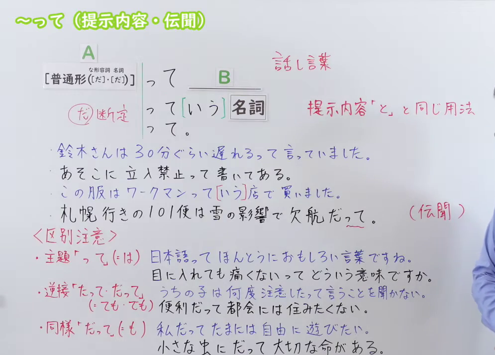
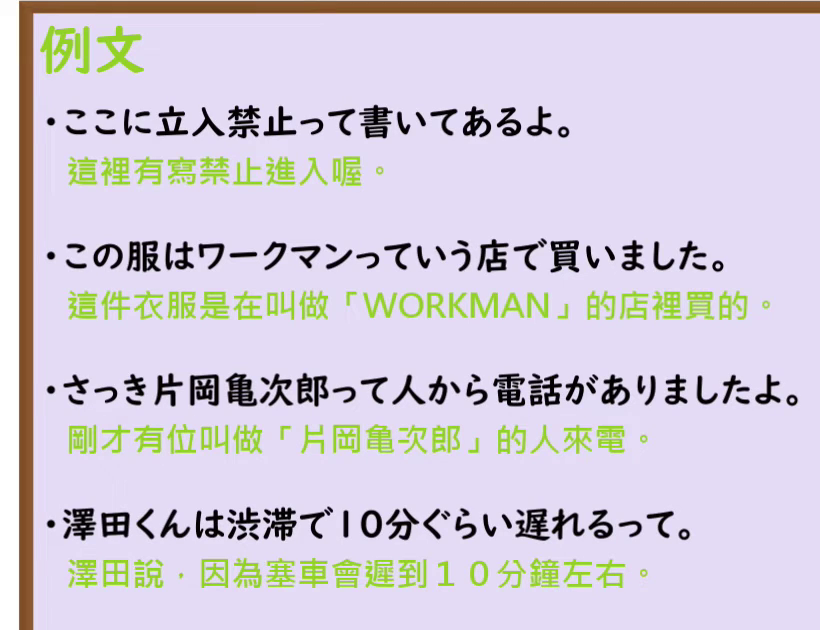

---
{
  "id": "N3-G-0117",
  "kind": "grammar",
  "level": "N3",
  "title": "～って（提示内容・伝聞）：提示内容（与「と」相同用法）与传闻",
  "status": "confirmed",
  "card_revision": 1,
  "schema_version": 1,
  "created_at": "2026-09-22",
  "updated_at": "2026-09-22",
  "next_review": "2026-09-29",
  "source": {
    "lesson": "N3 第117个语法",
    "material": "出口日語原视频板书、日语自动字幕、Hagoromo正文与毎日のんびり日本語教師正文",
    "video": "https://www.youtube.com/watch?v=hnjwiVjUKrg",
    "screenshot": "assets/grammar/n3/N3-G-0117-connection.png",
    "screenshot_seconds": 300,
    "screenshot_crop": {
      "x": 0,
      "y": 0,
      "width": 995,
      "height": 715
    }
  },
  "tags": [
    "って",
    "っていう",
    "伝聞",
    "引用",
    "話し言葉",
    "N3"
  ],
  "confusions": [
    "主題の「って（は）」（＝主題の「は」：日本語っておもしろい言葉ですね）",
    "逆接の「たって・だって」（＝ても・でも：何度注意したって聞かない）",
    "同様の「だって（も）」（＝も：私だって遊びたい）"
  ]
}
---

# N3 第117个语法：～って（提示内容・伝聞）

# 视频学习资料整理

原视频：[【Ｎ３文法】～って（提示内容・伝聞）](https://www.youtube.com/watch?v=hnjwiVjUKrg)（出口日語，2022-10-30 发布，时长 9 分 01 秒；视频 ID：hnjwiVjUKrg）

**接续图（真实时间 05:00.0）**

- 来源画面：05:00.0 原帧，原图尺寸 1280×720
- 裁切区域：固定左上角 (0, 0)，右下角收拢至 (995, 715)
- 替换原因：0:01 画面中讲师身体遮住接续框右侧的红色说明「話し言葉」「提示内容「と」と同じ用法」及第四条例句，板书不完整；改用讲师退到画面最右侧的 05:00.0 画面，全部板书文字完整可见（讲师衣角仍留在裁切右缘，未遮挡任何文字）
- 画面内容：本课板书，含接续「[普通形（だ・だ）] って B／って[いう] 名詞／って。」、红色说明「話し言葉」「提示内容「と」と同じ用法」、红色「（だ）断定」标注、四条例句及红色「（伝聞）」标注，以及〈区別注意〉列出的主題・逆接・同様三种其他用法
- 图片：

**例句图（真实时间 07:43.9）**

- 来源画面：07:43.9 原帧，原图尺寸 1280×720
- 裁切区域：固定左上角 (0, 0)，右下角收拢至 (820, 630)
- 画面内容：课末「例文」页，列出四条例句及中文翻译
- 图片：

# 核心

## 功能一：与表示提示内容的「と」用法相同

**最上位意味カテゴリー：**

- **って（伝聞・引用）：** ものごとの関係（事物之间的关系）
- **って（話題）：** ものごとの関係（事物之间的关系）

**中位意味カテゴリー：**

- **って（伝聞・引用）：** 伝聞・引用（传闻与引用）
- **って（話題）：** 話題（话题）

**意味：**

- **って（伝聞・引用）：** 引用（縮約形）（引用・缩略形）
- **って（話題）：** 主題（主题）

**くわしい意味記述：**

- **って（伝聞・引用）：** 伝聞・引用を表す。話し言葉的な表現。（表示传闻、引用。是口语化的表达。）
- **って（話題）：** 「NというN」のくだけた形。相手が知らないであろう名称を会話に導入する際に，「名称＋って＋種類」の形で使う。（「NというN」的随意说法。在把对方大概不知道的名称引入会话时，以「名称＋って＋种类」的形式使用。）

**派生語：** 未列出

### 例句

1. 田中さんが会いたいって言ってたよ。

   （田中说他（她）想见你哦。）

2. 部長：それをね人事部ではストーブリーグって言いましてね、桜の花の咲く頃にその辞令がおりる訳です。

   （部长：那个呀，人事部管它叫“热炉联赛（stove league）”，等樱花开的时节，那份调令就会下来。）

3. シジュウカラって鳥、みたことある？

   （山雀这种鸟，你见过吗？）

## 功能二：表示传闻

**くわしい意味記述：**

- **～んだって／んですって／～って（毎日のんびり日本語教師）：** 伝聞を表します。「～そうだ」と同じですが、「～んだって／んですって／って」はより口語的な表現です。（表示传闻。与「～そうだ」相同，但「～んだって／んですって／って」是更口语化的表达。）

### 例句

1. 彼、彼女ができたんだって。

   （听说他交到女朋友了。）

2. 明日はものすごい寒くなるんだってさ。

   （据说明天会变得非常冷。）

3. お隣さん、空き巣に入られたんですって。

   （听说邻居家被人趁没人的时候偷了。）

4. あの２人付き合っていたんだって？

   （听说那两个人以前在交往？）

# 来源

- [出口日語原视频「【Ｎ３文法】～って（提示内容・伝聞）」](https://www.youtube.com/watch?v=hnjwiVjUKrg)（视频 ID：hnjwiVjUKrg）
- [Hagoromo「って」（伝聞・引用）条目](https://hagoromo-text.work/lookup?vid=784)／[例句](https://hagoromo-text.work/get_reibun?vid=784)（查询日期：2026-09-22）
- [Hagoromo「って」（話題）条目](https://hagoromo-text.work/lookup?vid=785)／[例句](https://hagoromo-text.work/get_reibun?vid=785)（查询日期：2026-09-22）
- [毎日のんびり日本語教師「【Ｎ３文法】～んだって／んですって／～って」](https://mainichi-nonbiri.com/grammar/n3-ndatte/)（用途：传闻用法的日文解说与例句；Hagoromo「って」条目缺句末传闻用例，故采用本条目补足，查询日期：2026-09-22）
