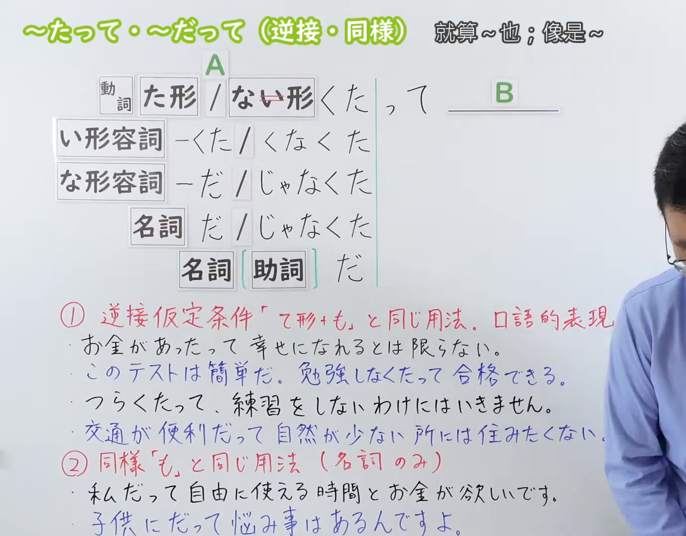
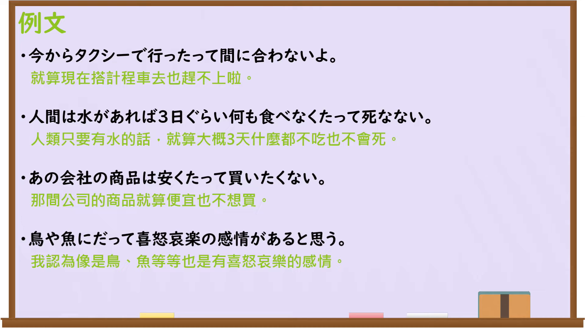

---
{
  "id": "N3-G-0118",
  "kind": "grammar",
  "level": "N3",
  "title": "〜たって・〜だって（就算……也……；即使……也……）",
  "card_revision": 1,
  "schema_version": 1,
  "source": {
    "lesson": "N3 第118个语法",
    "material": "出口日語原视频板书、日语自动字幕与Hagoromo文型检索正文",
    "video": "https://www.youtube.com/watch?v=BrNhiaMRJr8",
    "screenshot": "assets/grammar/n3/N3-G-0118-connection.png",
    "screenshot_seconds": 1,
    "screenshot_crop": {
      "x": 0,
      "y": 0,
      "width": 1380,
      "height": 1080
    }
  },
  "tags": [
    "たって",
    "だって",
    "N3"
  ],
  "confusions": [
    "〜ても",
    "〜でも",
    "〜としても"
  ]
}
---

# N3 第118个语法：〜たって・〜だって（逆接・同様）

# 视频学习资料整理

本课讲解 N3 语法形式「〜たって・〜だって（逆接・同様）」。

## 接续图（板书与讲解）

- 视频链接：[出口日語 N3 第118个语法](https://www.youtube.com/watch?v=BrNhiaMRJr8)
- 真实时间：00:01（1.00秒）
- 原图尺寸：1920×1080
- 裁切说明：选用 00:01 画面，左上方清晰显示语法标题「〜たって・〜だって（逆接・同様）」与中文释义「就算〜也；像是〜」，接续展示动词た形/形容词接「たって」，名词接「だって」，并详细说明①逆接假定条件（即使做A也B）与②同类举例（像是A也B）。固定左上角（0, 0），裁切区域为宽 1380、高 1080，裁去右侧讲师身躯。
- 图片：

## 例句图（视频例句）

- 视频链接：[出口日語 N3 第118个语法](https://www.youtube.com/watch?v=BrNhiaMRJr8)
- 真实时间：05:44（344.00秒）
- 原图尺寸：1920×1080
- 裁切说明：提取自视频 05:44 处的例句黑板页面。固定左上角（0, 0），裁切区域为宽 1920、高 1080，保留完整例句与中文释义。
- 图片：

# 核心

## 功能一：逆接仮定条件（口语中相当于「〜ても / 〜でも」，表示哪怕处于前项条件也依然如此）

**最上位意味カテゴリー：**

- **たって（逆接）：** ものごとの関係（事物之间的关系）

**中位意味カテゴリー：**

- **たって（逆接）：** 逆接（逆接）

**意味：**

- **たって（逆接）：** 逆接仮定条件（逆接假定条件）

**くわしい意味記述：**

- **たって（逆接）：** 話し言葉において「〜ても」「〜でも」のくだけた口語表現として用いる。「たとえ前項の事態が成り立っても，後項の事態には影響しない」という意を表す。板書説明：「①逆接仮定条件『て形＋も』と同じ用法」。（在口语中作为「〜ても」「〜でも」的随和形式使用，表示“哪怕前项成立，对后项也毫无影响”。）

### 例句

1. お金があったって、必ずしも幸せになれるとは限らない。

   （就算有钱，也未必就能获得幸福。）

2. このテストはとても簡単だから、勉強しなくたって合格できるよ。

   （这门测验非常简单，就算不复习也能及格哦。）

3. どんなにつらくたって、最後まで練習をやり抜くつもりだ。

   （不论多么艰辛，也打算坚持练习到最后一刻。）

4. 交通が便利だって、自然が全くない所には住みたくない。

   （就算交通再便利，完全没有自然绿化的地方我也不想住。）

## 功能二：同様（口语中接名词，相当于助词「も」，表示就连……也一样）

**最上位意味カテゴリー：**

- **だって（同様）：** ものごとの関係（事物之间的关系）

**中位意味カテゴリー：**

- **だって（同様）：** 添加・類推（添加与类推）

**意味：**

- **だって（同様）：** 同様（同样）

**くわしい意味記述：**

- **だって（同様）：** 名詞について，助詞「も」と同じ意味を表す砕けた口語。「〜のような立場や存在であっても同じである」という意を表す。板書説明：「②同様『も』と同じ用法（名詞のみ）」。（接名词后，口语中相当于助词「も」，表示“即便是……这般立场或存在，情况也是完全相同的”。）

### 例句

1. 私だって、たまには自由に使える時間とお金が欲しいですよ。

   （就连我也是，偶尔也想要能自由支配的时间和钱财呀。）

2. 子供にだって、大人には言えない悩み事があるんですよ。

   （就连小孩子，也是有着不能跟大人讲的烦恼事的呀。）

3. どんなに小さな虫にだって、かけがえのない大切な命がある。

   （就算是多么渺小的昆虫，也有着无可替代的宝贵生命。）

4. プロの選手だって、時にはミスをして負けることがある。

   （就连职业运动员，有时候也是会失误输掉比赛的。）

# 来源

- [出口日語原视频](https://www.youtube.com/watch?v=BrNhiaMRJr8)
- [日本語NET「〜たって」](https://nihongokyoshi-net.com/)（查询日期：2026-09-25）
