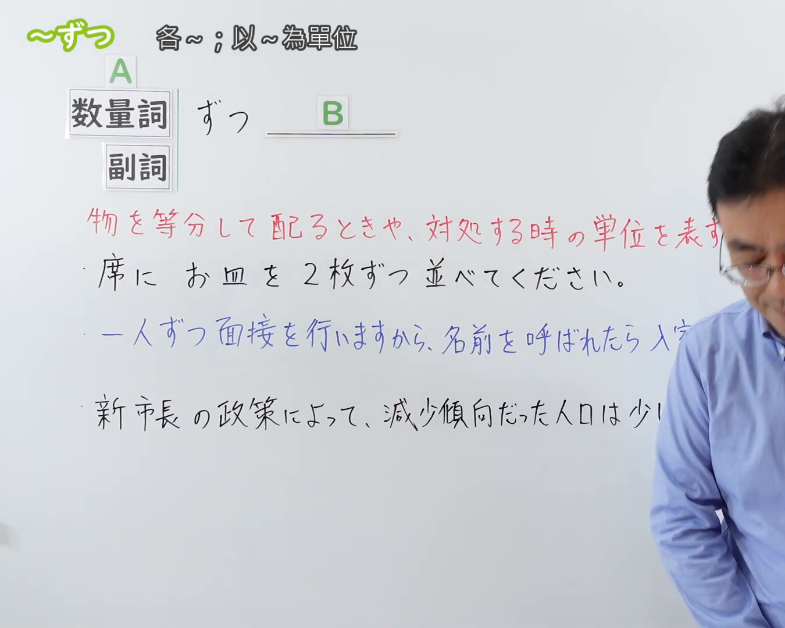
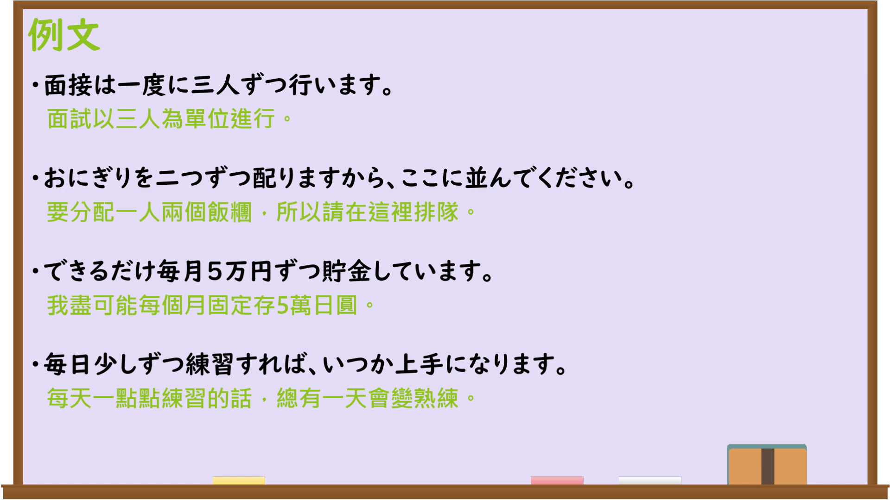

---
{
  "id": "N3-G-0119",
  "kind": "grammar",
  "level": "N3",
  "title": "〜ずつ（每……；各……）",
  "card_revision": 1,
  "schema_version": 1,
  "source": {
    "lesson": "N3 第119个语法",
    "material": "出口日語原视频板书、日语自动字幕与Hagoromo文型检索正文",
    "video": "https://www.youtube.com/watch?v=-odzLEIDa-A",
    "screenshot": "assets/grammar/n3/N3-G-0119-connection.png",
    "screenshot_seconds": 1,
    "screenshot_crop": {
      "x": 0,
      "y": 0,
      "width": 1350,
      "height": 1080
    }
  },
  "tags": [
    "ずつ",
    "N3"
  ],
  "confusions": [
    "〜ごとに",
    "〜おきに",
    "〜宛"
  ]
}
---

# N3 第119个语法：〜ずつ

# 视频学习资料整理

本课讲解 N3 语法形式「〜ずつ」。

## 接续图（板书与讲解）

- 视频链接：[出口日語 N3 第119个语法](https://www.youtube.com/watch?v=-odzLEIDa-A)
- 真实时间：00:01（1.00秒）
- 原图尺寸：1920×1080
- 裁切说明：选用 00:01 画面，左上方清晰显示语法标题「〜ずつ」与中文释义「各〜；以〜為單位」，接续展示数量词/副词接「ずつ」，并用红字详细说明「物を等分して配るときや、対処する時の単位を表す」。固定左上角（0, 0），裁切区域为宽 1350、高 1080，裁去右侧讲师身躯。
- 图片：

## 例句图（视频例句）

- 视频链接：[出口日語 N3 第119个语法](https://www.youtube.com/watch?v=-odzLEIDa-A)
- 真实时间：02:34（154.00秒）
- 原图尺寸：1920×1080
- 裁切说明：提取自视频 02:34 处的例句黑板页面。固定左上角（0, 0），裁切区域为宽 1920、高 1080，保留完整例句与中文释义。
- 图片：

# 核心

## 功能一：等分分配与处理基准单位（各……；每……份）

**最上位意味カテゴリー：**

- **ずつ（配分単位）：** ものごとの関係（事物之间的关系）

**中位意味カテゴリー：**

- **ずつ（配分単位）：** 数量・割合（数量与比例）

**意味：**

- **ずつ（配分単位）：** 均等配分（均等分配）

**くわしい意味記述：**

- **ずつ（配分単位）：** 数量詞について，同量・同数を均等に割り当てたり，一定のまとまりを基準単位として物事を処理したりする意を表す。板書説明：「物を等分して配るときや、対処する時の単位を表す」。（接数量词后，表示同量同数均等分配，或以固定的量为基准单位进行处理。）

### 例句

1. テーブルの席にお皿を2枚ずつ並べてください。

   （请在餐桌各座位上每处摆放2个盘子。）

2. 一人ずつ面接を行いますから、名前を呼ばれたら入室してください。

   （每次按一人逐个进行面试，叫到名字后请入室。）

3. 薬は朝昼晩、毎食後に1錠ずつ飲んでください。

   （药请在早中晚三餐后各服用1粒。）

4. 参加者全員に記念品を一つずつ配りました。

   （给全体参与者每人分发了一份纪念品。）

## 功能二：程度或数量循序渐进的持续推移（一点一点地……；逐步……）

**最上位意味カテゴリー：**

- **ずつ（漸進推移）：** ものごとの様子（事物的样态）

**中位意味カテゴリー：**

- **ずつ（漸進推移）：** 変化・進行（变化与进行）

**意味：**

- **ずつ（漸進推移）：** 漸進（渐进）

**くわしい意味記述：**

- **ずつ（漸進推移）：** 「少しずつ」「一歩ずつ」などの形で，事態や状態が一度にではなく，一定のわずかな量・歩調を保ちながら段階的に推移・変化していくことを表す。（以“少しずつ、一歩ずつ”等形式，表示事态非一蹴而就，而是以一定的微小步调逐步推进变化。）

### 例句

1. 新市長の政策によって、減少傾向だった人口は少しずつ回復してきた。

   （由于新市长的政策，此前呈减少趋势的人口开始一点一点恢复了。）

2. 毎日コツコツと勉強を続ければ、日本語は一歩ずつ確実に上達する。

   （每天坚持不懈学习的话，日语就会一步一步稳扎稳打地进步。）

3. 傷口の痛みは、日を追うごとに少しずつ和らいできた。

   （伤口的疼痛随着时间推移正在一点点缓解。）

4. 春が近づくにつれて、日が少しずつ長くなってきた。

   （随着春天临近，白昼开始一点一点变长了。）

# 来源

- [出口日語原视频](https://www.youtube.com/watch?v=-odzLEIDa-A)
- [日本語NET「〜ずつ」](https://nihongokyoshi-net.com/2019/07/25/jlptn4-grammar-zutsu/)（查询日期：2026-09-25）
