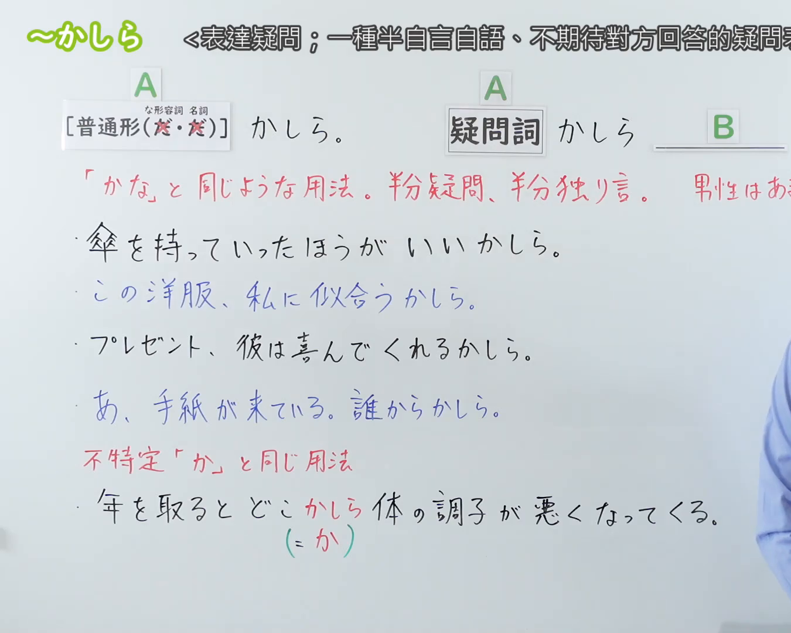
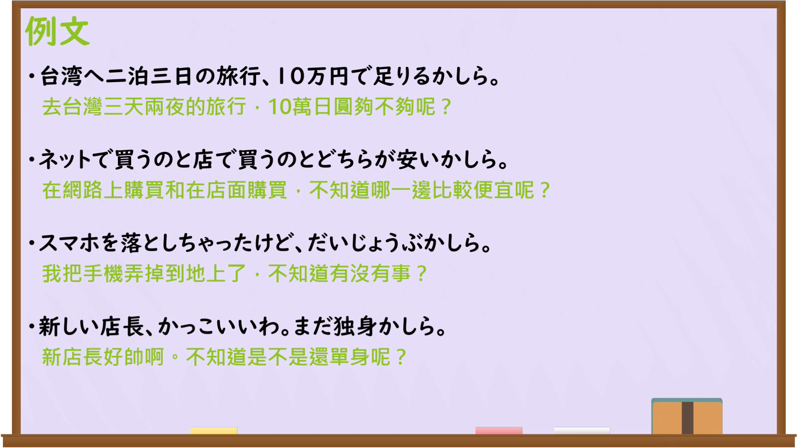

---
{
  "id": "N3-G-0120",
  "kind": "grammar",
  "level": "N3",
  "title": "〜かしら（我琢磨着……；不知是否……）",
  "card_revision": 1,
  "schema_version": 1,
  "source": {
    "lesson": "N3 第120个语法",
    "material": "出口日語原视频板书、日语自动字幕与Hagoromo文型检索正文",
    "video": "https://www.youtube.com/watch?v=S2FGLCEGr1A",
    "screenshot": "assets/grammar/n3/N3-G-0120-connection.png",
    "screenshot_seconds": 1,
    "screenshot_crop": {
      "x": 0,
      "y": 0,
      "width": 1350,
      "height": 1080
    }
  },
  "tags": [
    "かしら",
    "かしらね",
    "かな",
    "N3"
  ],
  "confusions": [
    "〜かな",
    "〜だろうか",
    "〜かしらね"
  ]
}
---

# N3 第120个语法：〜かしら

# 视频学习资料整理

本课讲解 N3 语法形式「〜かしら」。

## 接续图（板书与讲解）

- 视频链接：[出口日語 N3 第120个语法](https://www.youtube.com/watch?v=S2FGLCEGr1A)
- 真实时间：00:01（1.00秒）
- 原图尺寸：1920×1080
- 裁切说明：选用 00:01 画面，左上方清晰显示语法标题「〜かしら」与中文释义「表達疑問；一種半自言自語、不期待對方回答的疑問」，接续展示普通形（な形・名詞去だ）/疑问词接「かしら」，并详细说明自言自语半疑问用法及不特定用法（どこかしら）。固定左上角（0, 0），裁切区域为宽 1350、高 1080，裁去右侧讲师身躯。
- 图片：

## 例句图（视频例句）

- 视频链接：[出口日語 N3 第120个语法](https://www.youtube.com/watch?v=S2FGLCEGr1A)
- 真实时间：04:46（286.00秒）
- 原图尺寸：1920×1080
- 裁切说明：提取自视频 04:46 处的例句黑板页面。固定左上角（0, 0），裁切区域为宽 1920、高 1080，保留完整例句与中文释义。
- 图片：

# 核心

## 功能一：自言自语式的疑问或对前途的轻微探询（女性常用；不知……吗；我琢磨着……）

**最上位意味カテゴリー：**

- **かしら（独り言・疑問）：** 話し手の心的態度（说话人的心理态度）

**中位意味カテゴリー：**

- **かしら（独り言・疑問）：** 疑問・推量（疑问与推测）

**意味：**

- **かしら（独り言・疑問）：** 自問・独り言（自问与独白）

**くわしい意味記述：**

- **かしら（独り言・疑問）：** 主に女性によって用いられ，相手に返答を強く求めない独り言のような形で，自らの疑問や不確かな推量・心配を呟く表現。板書説明：「『かな』と同じような用法。半分疑問、半分独り言」。（主要由女性使用，以不强烈要求对方回答的独白口吻，喃喃自语表达自身疑问、不确定的推测或顾虑。）

### 例句

1. 午後から雨が降るそうだから、傘を持っていったほうがいいかしら。

   （听说下午开始下雨，我琢磨着是不是带把伞比较好呢。）

2. この洋服、私に似合うかしら。

   （这件衣服，不知穿在我身上合适吗？）

3. 誕生日プレゼント、彼は喜んでくれるかしら。

   （生日礼物，他收到会感到高兴吗？）

4. あ、手紙が来ている。いったい誰からかしら。

   （啊，来了一封信。究竟会是谁寄来的呢？）

## 功能二：与疑问词接续表示不特定（某处……；不知何故……）

**最上位意味カテゴリー：**

- **かしら（不特定）：** ものごとの関係（事物之间的关系）

**中位意味カテゴリー：**

- **かしら（不特定）：** 不特定（不特定）

**意味：**

- **かしら（不特定）：** 漠然（漠然）

**くわしい意味記述：**

- **かしら（不特定）：** 「どこかしら」「なぜかしら」のように疑問詞に後置され，不特定の助詞「か」と同様に，場所や理由を特定せず漠然と指し示す表現。板書説明：「不特定『か』と同じ用法（どこかしら＝どこか）」。（后置于疑问词，如“どこかしら、なぜかしら”，与不特定助词「か」相同，用于漠然指代不特定的地点或原因。）

### 例句

1. 年を取ると、どこかしら体の調子が悪くなってくるものだ。

   （人一上了年纪，身上总会有某个地方感觉不太舒服。）

2. 彼の話には、どこかしら不自然な点があるように感じられる。

   （他的这番话里，总觉得隐隐有某些不太自然的地方。）

3. なぜかしら、今日は朝からずっと胸騒ぎがしている。

   （不知何故，今天从早起就一直心绪不宁。）

4. いつかしら、またあの懐かしい故郷の海を見に行きたい。

   （不知何时，还想再去看看那片令人怀念的故乡之海。）

# 来源

- [出口日語原视频](https://www.youtube.com/watch?v=S2FGLCEGr1A)
- [日本語NET「〜かしら」](https://nihongokyoshi-net.com/)（查询日期：2026-09-25）
