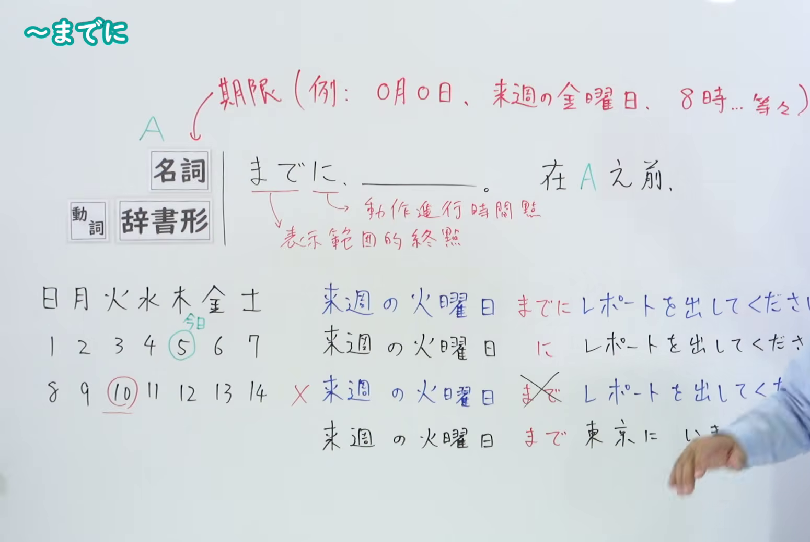
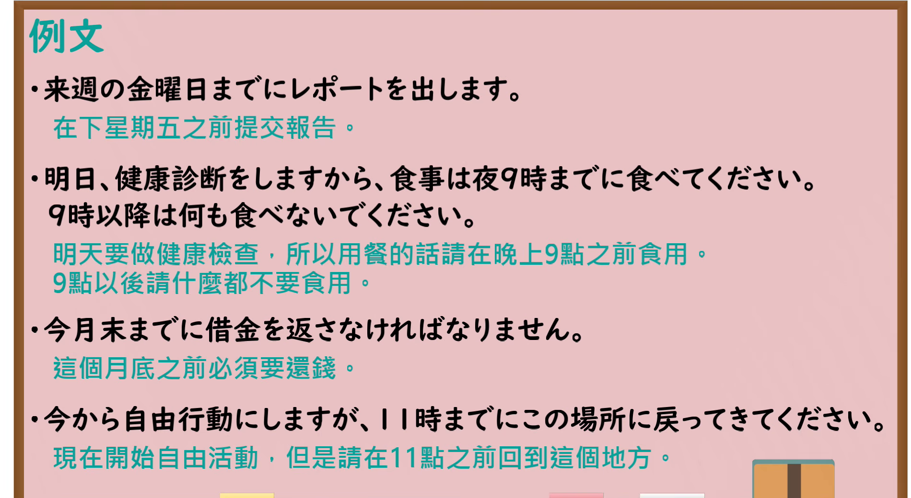

---
{
  "id": "N4-G-0001",
  "kind": "grammar",
  "level": "N4",
  "title": "～までに（在……之前）",
  "card_revision": 1,
  "schema_version": 1,
  "source": {
    "lesson": "N4 第1个语法",
    "material": "出口日語原视频板书、YouTube 原 WebVTT（中文为主、日语为辅）与Hagoromo文型检索正文",
    "video": "https://www.youtube.com/watch?v=tq7OQec7Dnc",
    "screenshot": "assets/grammar/n4/N4-G-0001-connection.png",
    "screenshot_seconds": 350.0,
    "screenshot_crop": {
      "x": 0,
      "y": 0,
      "width": 1550,
      "height": 1040
    }
  },
  "tags": [
    "までに",
    "期限",
    "N4"
  ],
  "confusions": [
    "～まで",
    "～に"
  ]
}
---

# N4 第1个语法：～までに

# 视频学习资料整理

- 课程：[出口日語「～までに」](https://www.youtube.com/watch?v=tq7OQec7Dnc)
- 视频 ID：`tq7OQec7Dnc`
- 视频时长：8分16秒

## 接续图

- 实际时间：5分50.00秒（350.00秒）
- 原图尺寸：1920×1080
- 裁切区域：左上角 `(0, 0)` 至右下角 `(1550, 1040)`；00:01 画面中接续形式虽已列出，但右侧板书例句尚不完整，且老师站位偏左部分遮挡板书右端；选用 05:50 画面，此时板书已完整写出接续规则、日历对比图示、四组例句及“動作進行的時間點／表示範圍的終點”红字辨析，老师让至画面右侧边缘。固定左上角 (0, 0)，裁切区域宽 1550、高 1040，保留完整板书与全部例句，裁去右侧人物主体及边缘多余画面，确保底部板书内容完整不缺失。

## 例句图

- 实际时间：7分0.85秒（420.85秒）
- 原图尺寸：1920×1080
- 裁切区域：左上角 `(0, 0)` 至右下角 `(1900, 1040)`；提取自视频 07:00 处的例句黑板页面。固定左上角 (0, 0)，裁切区域宽 1900、高 1040，去除右侧与底部多余画面，保留全部四条例句及中文翻译，确保底部第四条例句完整呈现。

# 核心

## 功能一：在 A 之前

**最上位意味カテゴリー：**

- **までに：** 場所・時間（场所与时间）

**中位意味カテゴリー：**

- **までに：** 起点・終点（起点与终点）

**意味：**

- **までに：** 限界（界限）

**くわしい意味記述：**

- **までに：** 物事が実現する期限，しめきりを表す。（表示事物实现的期限、截止时间。）

**派生語：** 未列出

### 例句

1. あしたは九時までに学校に来てください。

   （明天请在九点之前来学校。）

2. 三上文法は日本でも次第に理解し支持する人が増えていますが、まだ学校文法を書き変えるまでにはいたりません。

   （在日本理解并支持三上文法的人逐渐增多，但还远未达到要改写学校语法的程度。）

3. 一口に裁判所といっても、現在のような形におさまるまでにはいろいろな経緯があった。

   （虽说统称为法院，但在形成如今这种形态之前，经历过各种各样的曲折。）

# 来源

- [出口日語原视频](https://www.youtube.com/watch?v=tq7OQec7Dnc)
- [Hagoromo 文型検索「までに」](https://hagoromo-text.work/lookup?vid=1544)（查询日期：2026-09-25）
