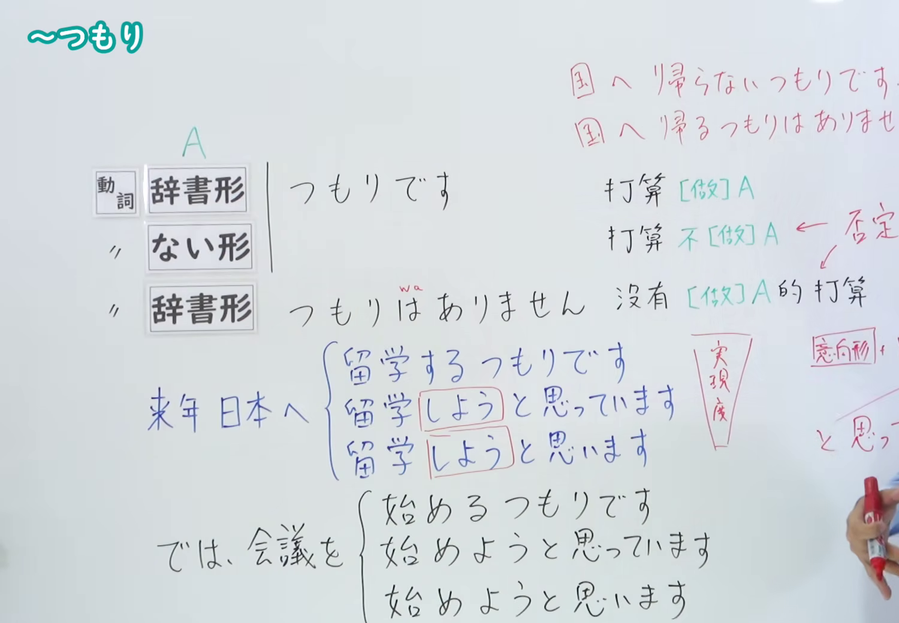
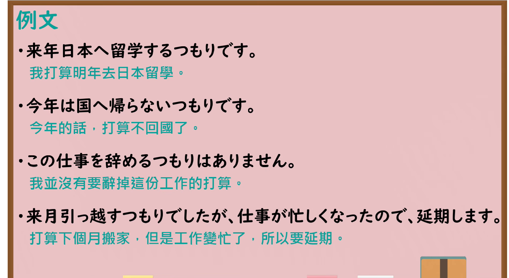

---
{
  "id": "N4-G-0002",
  "kind": "grammar",
  "level": "N4",
  "title": "～つもり（打算……）",
  "card_revision": 1,
  "schema_version": 1,
  "source": {
    "lesson": "N4 第2个语法",
    "material": "出口日語原视频板书、YouTube 原 WebVTT（中文为主、日语为辅）与Hagoromo文型检索正文",
    "video": "https://www.youtube.com/watch?v=T-t3Gv0JIyw",
    "screenshot": "assets/grammar/n4/N4-G-0002-connection.png",
    "screenshot_seconds": 240.0,
    "screenshot_crop": {
      "x": 0,
      "y": 0,
      "width": 1500,
      "height": 1040
    }
  },
  "tags": [
    "つもり",
    "意志",
    "N4"
  ],
  "confusions": [
    "〜（よ）うと思う",
    "〜予定だ"
  ]
}
---

# N4 第2个语法：～つもり

# 视频学习资料整理

- 课程：[出口日語「～つもり」](https://www.youtube.com/watch?v=T-t3Gv0JIyw)
- 视频 ID：`T-t3Gv0JIyw`
- 视频时长：10分20秒

## 接续图

- 实际时间：4分0.00秒（240.00秒）
- 原图尺寸：1920×1080
- 裁切区域：左上角 `(0, 0)` 至右下角 `(1500, 1040)`；00:01 画面中接续尚未完全展开；选用 04:00 画面，板书已完整书写「つもりです」「つもりはありません」、右上角两种否定形式「国へ帰らないつもりです／国へ帰るつもりはありません」及下方与「〜（よ）うと思っています」的对比板书，老师让出板书区域。固定左上角 (0, 0)，裁切区域宽 1500、高 1040，去除右侧人物与边缘空白，保留全部接续说明与对比板书，高度充分保留底部内容。

## 例句图

- 实际时间：9分18.00秒（558.00秒）
- 原图尺寸：1920×1080
- 裁切区域：左上角 `(0, 0)` 至右下角 `(1900, 1040)`；提取自视频 09:18 处的例句黑板页面。固定左上角 (0, 0)，裁切区域宽 1900、高 1040，去除右侧与底部粉笔槽多余画面，完整保留全部四条例句及中文翻译。

# 核心

## 功能一：打算做 A

**最上位意味カテゴリー：**

- **つもりだ：** 考え・感情（想法与感情）

**中位意味カテゴリー：**

- **つもりだ：** 意志（意志）

**意味：**

- **つもりだ：** 意志・予定（意志与预定）

**くわしい意味記述：**

- **つもりだ：** 「〜ようと思っている」「〜する予定だ」という意味を表す。将来行う，あるいは行わない，話し手の意志や予定を表す。（表示“打算……”“预定做……”之意。表示说话人预先持有的、在将来要做或不做的意志与预定。）

**派生語：** 未列出

### 例句

1. 私は将来医者になるつもりです。

   （我打算将来成为一名医生。）

2. 引越しをするつもりで、荷物を片付け始めています。

   （我打算搬家，已经开始收拾行李了。）

3. どんなにつらいことがあっても、私は耐えて行くつもりです。

   （无论发生多么痛苦的事，我都打算坚持忍耐下去。）

4. え、これから一体どうするつもりなんだい、お前。

   （哎，你今后到底打算怎么办啊。）

# 来源

- [出口日語原视频](https://www.youtube.com/watch?v=T-t3Gv0JIyw)
- [Hagoromo 文型検索「つもりだ」](https://hagoromo-text.work/lookup?vid=790)（查询日期：2026-09-25）
