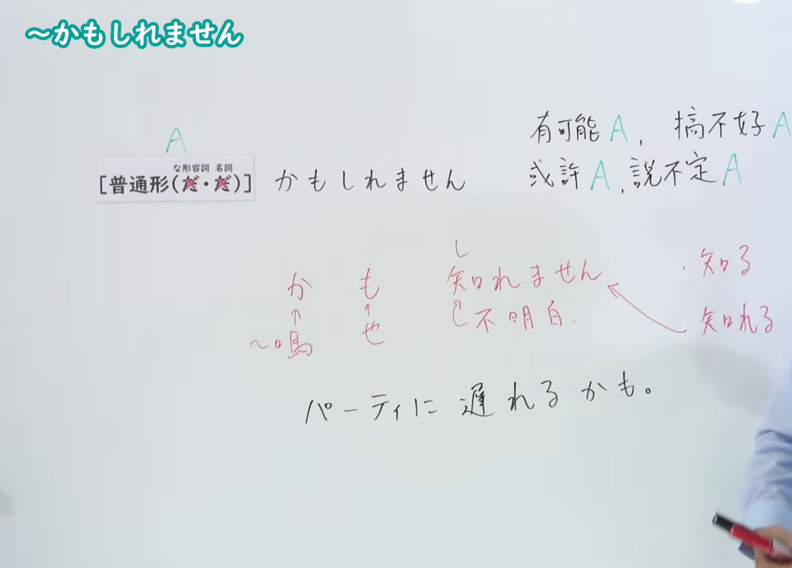
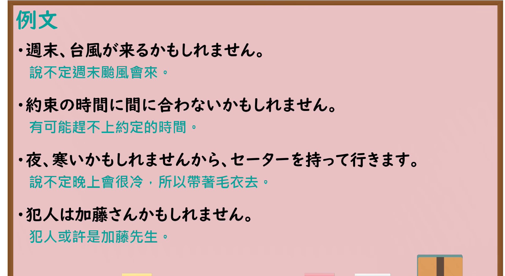

---
{
  "id": "N4-G-0003",
  "kind": "grammar",
  "level": "N4",
  "title": "～かもしれない／～かもしれません（也许……、说不定……）",
  "card_revision": 1,
  "schema_version": 1,
  "source": {
    "lesson": "N4 第3个语法",
    "material": "出口日語原视频板书、YouTube 原 WebVTT（中文为主、日语为辅）与Hagoromo文型检索正文",
    "video": "https://www.youtube.com/watch?v=tQWU3QnDFd8",
    "screenshot": "assets/grammar/n4/N4-G-0003-connection.png",
    "screenshot_seconds": 180.0,
    "screenshot_crop": {
      "x": 0,
      "y": 0,
      "width": 1450,
      "height": 1040
    }
  },
  "tags": [
    "かもしれない",
    "推量",
    "N4"
  ],
  "confusions": [
    "〜だろう",
    "〜に違いない"
  ]
}
---

# N4 第3个语法：～かもしれない／～かもしれません

# 视频学习资料整理

- 课程：[出口日語「～かもしれない／～かもしれません」](https://www.youtube.com/watch?v=tQWU3QnDFd8)
- 视频 ID：`tQWU3QnDFd8`
- 视频时长：4分35秒

## 接续图

- 实际时间：3分0.00秒（180.00秒）
- 原图尺寸：1920×1080
- 裁切区域：左上角 `(0, 0)` 至右下角 `(1450, 1040)`；选用 03:00 画面，板书已完整书写「普通形（だ・だ）＋かもしれません」、中文含义说明「可能A，搞不好A；也許A，說不定A」、拆分释疑「か・も・知れません」以及口语缩约例句「パーティに遅れるかも。」，老师让出板书区域。固定左上角 (0, 0)，裁切区域宽 1450、高 1040，去除右侧人物与边缘多余画面，充分保留底部例句与板书注释。

## 例句图

- 实际时间：3分25.55秒（205.55秒）
- 原图尺寸：1920×1080
- 裁切区域：左上角 `(0, 0)` 至右下角 `(1900, 1040)`；提取自视频 03:25 处的例句黑板页面。固定左上角 (0, 0)，裁切区域宽 1900、高 1040，保留全部四条例句及中文翻译，避免底部第四句及排版被裁切。

# 核心

## 功能一：可能 A，搞不好 A

**最上位意味カテゴリー：**

- **かもしれない：** 考え・感情（想法与感情）

**中位意味カテゴリー：**

- **かもしれない：** 推量（推测）

**意味：**

- **かもしれない：** 推量・概言（推测与概说）

**くわしい意味記述：**

- **かもしれない：** 「あることが起こる可能性がある」という話し手の推量を表す。（表示说话人“某事有可能发生”的推测。）

**派生語：** 未列出

### 例句

1. 彼は来年日本へ来るかもしれません。

   （他明年也许会来日本。）

2. それでいいのかもしれません。

   （那样说不定也可以。）

3. 小説として読めば、作品中に出てくる元和一年大凶から昭和十五年半凶までの蜒蜒つづく津軽凶作年表などは作品の傷として見えるかもしれません。

   （如果作为小说来读，作品中出现的从元和一年大歉收到昭和十五年半歉收的连绵不断的津轻凶作年表等，或许会被看作作品的瑕疵。）

4. あるいは破格と見えるかもしれません。

   （或者也可能会被看作破格之举。）

# 来源

- [出口日語原视频](https://www.youtube.com/watch?v=tQWU3QnDFd8)
- [Hagoromo 文型検索「かもしれない」](https://hagoromo-text.work/lookup?vid=414)（查询日期：2026-09-25）
