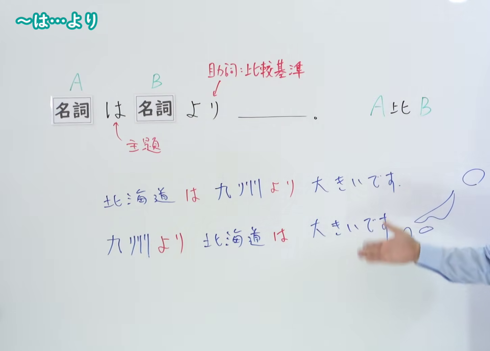
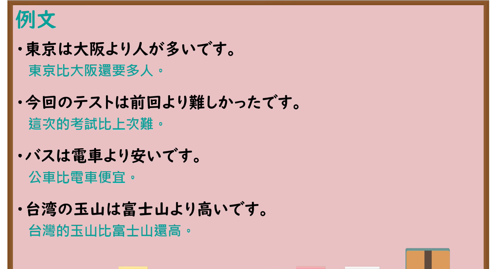

---
{
  "id": "N4-G-0004",
  "kind": "grammar",
  "level": "N4",
  "title": "～は～より（A比B……）",
  "card_revision": 1,
  "schema_version": 1,
  "source": {
    "lesson": "N4 第4个语法",
    "material": "出口日語原视频板书、YouTube 原 WebVTT（中文为主、日语为辅）与Hagoromo文型检索正文",
    "video": "https://www.youtube.com/watch?v=TNHl4-bOss8",
    "screenshot": "assets/grammar/n4/N4-G-0004-connection.png",
    "screenshot_seconds": 180.0,
    "screenshot_crop": {
      "x": 0,
      "y": 0,
      "width": 1450,
      "height": 1040
    }
  },
  "tags": [
    "は〜より",
    "比較",
    "N4"
  ],
  "confusions": [
    "〜のほうが〜より",
    "〜ほど〜ない"
  ]
}
---

# N4 第4个语法：～は～より

# 视频学习资料整理

- 课程：[出口日語「～は～より」](https://www.youtube.com/watch?v=TNHl4-bOss8)
- 视频 ID：`TNHl4-bOss8`
- 视频时长：4分46秒

## 接续图

- 实际时间：3分0.00秒（180.00秒）
- 原图尺寸：1920×1080
- 裁切区域：左上角 `(0, 0)` 至右下角 `(1450, 1040)`；00:01 画面仅有基本句型骨架；选用 03:00 画面，板书已补充「主題」「助詞: 比較基準」、词序调换例句「北海道は 九州より 大きいです／九州より 北海道は 大きいです」与对比说明，老师让出板书。固定左上角 (0, 0)，裁切区域宽 1450、高 1040，去除右侧人物与边缘多余画面，充分保留底部例句与对比图示。

## 例句图

- 实际时间：3分34.00秒（214.00秒）
- 原图尺寸：1920×1080
- 裁切区域：左上角 `(0, 0)` 至右下角 `(1900, 1040)`；提取自视频 03:34 处的例句黑板页面。固定左上角 (0, 0)，裁切区域宽 1900、高 1040，去除右侧与底部粉笔槽多余画面，完整保留全部四条例句及中文翻译。

# 核心

## 功能一：A比B

**最上位意味カテゴリー：**

- **は〜より：** ものごとの関係（事物的关系）

**中位意味カテゴリー：**

- **は〜より：** 比較（比较）

**意味：**

- **は〜より：** 比較（比较）

**くわしい意味記述：**

- **は〜より：** 「XはYより」でXとYを比べて，Xが程度が高いことを述べる時に使う。（用“XはYより”的形式对X和Y进行比较，用于叙述X的程度更高。）

**派生語：** 未列出

### 例句

1. この本はあの本より難しいです。

   （这本书比那本书难。）

2. また人々の信頼をかちうるのは、おしゃべりの人よりよい聞き手である。

   （另外，比起夸夸其谈的人，善于倾听的人更能赢得人们的信赖。）

3. 京都のお店は、大阪のお店より、こじんまりとしていると思います。

   （我觉得京都的店铺比起大阪的店铺来，要更加小巧玲珑一些。）

4. 私は人より携帯電話をもつのが遅かったので、最初は興奮しました。

   （我比别人拥有手机的时间要晚，所以一开始非常兴奋。）

# 来源

- [出口日語原视频](https://www.youtube.com/watch?v=TNHl4-bOss8)
- [Hagoromo 文型検索「は〜より」](https://hagoromo-text.work/lookup?vid=1427)（查询日期：2026-09-25）
