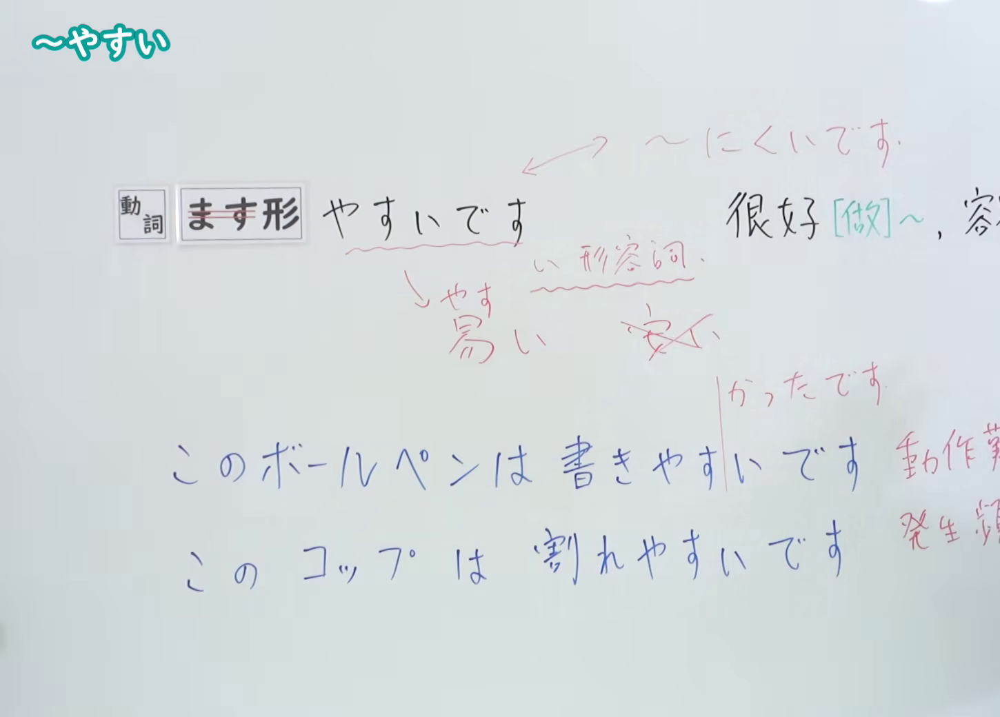
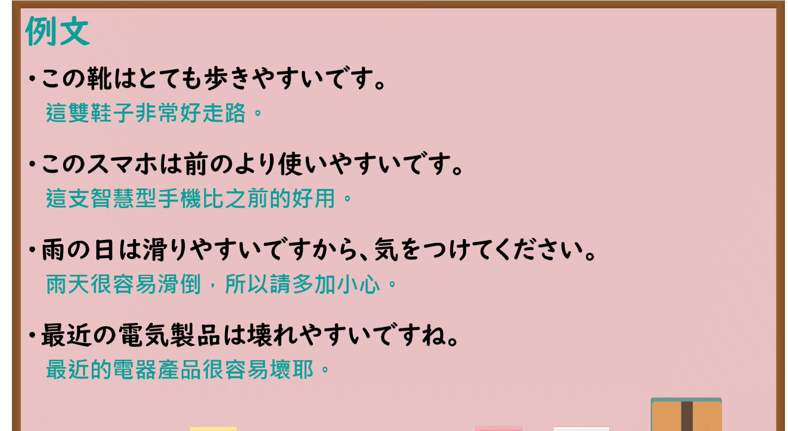

---
{
  "id": "N4-G-0005",
  "kind": "grammar",
  "level": "N4",
  "title": "～やすい（容易……、好……）",
  "card_revision": 1,
  "schema_version": 1,
  "source": {
    "lesson": "N4 第5个语法",
    "material": "出口日語原视频板书、YouTube 原 WebVTT（中文为主、日语为辅）与毎日のんびり日本語教師正文",
    "video": "https://www.youtube.com/watch?v=XXrvlMDDWdM",
    "screenshot": "assets/grammar/n4/N4-G-0005-connection.png",
    "screenshot_seconds": 180.0,
    "screenshot_crop": {
      "x": 0,
      "y": 0,
      "width": 1450,
      "height": 1040
    }
  },
  "tags": [
    "やすい",
    "難易",
    "頻度",
    "N4"
  ],
  "confusions": [
    "～にくい",
    "～がちだ"
  ]
}
---

# N4 第5个语法：～やすい

# 视频学习资料整理

- 课程：[出口日語「～やすい」](https://www.youtube.com/watch?v=XXrvlMDDWdM)
- 视频 ID：`XXrvlMDDWdM`
- 视频时长：5分00秒

## 接续图

- 实际时间：3分0.00秒（180.00秒）
- 原图尺寸：1920×1080
- 裁切区域：左上角 `(0, 0)` 至右下角 `(1450, 1040)`；00:01 画面尚未补充语义类别注解；选用 03:00 画面，板书已完整列出「動詞ます形＋やすいです」「很好[做]~、容易[做]~」、区分「動作難度」例句「このボールペンは書きやすいです」与「発生頻度」例句「このコップは割れやすいです」以及形容词词尾变化说明，老师侧身让出板书。固定左上角 (0, 0)，裁切区域宽 1450、高 1040，去除右侧人物与边缘多余画面，确保底部板书完整不缺失。

## 例句图

- 实际时间：3分45.00秒（225.00秒）
- 原图尺寸：1920×1080
- 裁切区域：左上角 `(0, 0)` 至右下角 `(1900, 1040)`；提取自视频 03:45 处的例句黑板页面。固定左上角 (0, 0)，裁切区域宽 1900、高 1040，去除右侧与底部多余画面，完整保留全部四条例句及中文翻译。

# 核心

## 功能一：很好做 A、容易做 A

**くわしい意味記述：**

- **～やすい：** 動ます形に接続して、その動作が簡単、あるいはその状態が簡単に発生することを表します。「やすい」は、い形容詞として扱われます。（接在动词连用形（ます形）之后，表示该动作容易进行，或者某种状态容易发生。「やすい」作为一类形容词（い形容词）活用。）

### 例句

1. 先生の説明はいつも分かりやすい。

   （老师的讲解总是很容易理解。）

2. このペンは使いやすくていつも愛用している。

   （这支笔很好用，我一直很喜欢用它。）

3. 彼は気さくで話しやすい人だ。

   （他为人直爽，很容易与人交谈。）

4. この部分は間違えやすいので注意してください。

   （这个部分很容易弄错，请大家多加注意。）

# 来源

- [出口日語原视频](https://www.youtube.com/watch?v=XXrvlMDDWdM)
- [毎日のんびり日本語教師「～やすい（易い）」](https://mainichi-nonbiri.com/grammar/n4-yasui/)（查询日期：2026-09-25）
