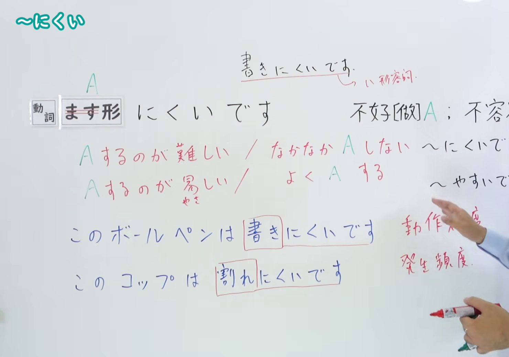
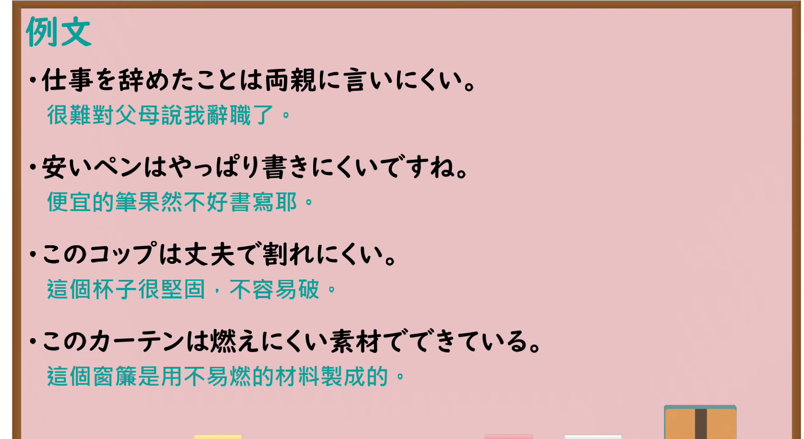

---
{
  "id": "N4-G-0006",
  "kind": "grammar",
  "level": "N4",
  "title": "～にくい（难……、不容易……）",
  "card_revision": 1,
  "schema_version": 1,
  "source": {
    "lesson": "N4 第6个语法",
    "material": "出口日語原视频板书、YouTube 原 WebVTT（中文为主、日语为辅）与毎日のんびり日本語教師正文",
    "video": "https://www.youtube.com/watch?v=O9bfoJMjsxE",
    "screenshot": "assets/grammar/n4/N4-G-0006-connection.png",
    "screenshot_seconds": 240.0,
    "screenshot_crop": {
      "x": 0,
      "y": 0,
      "width": 1480,
      "height": 1040
    }
  },
  "tags": [
    "にくい",
    "難易",
    "頻度",
    "N4"
  ],
  "confusions": [
    "～やすい",
    "～づらい",
    "～がたい"
  ]
}
---

# N4 第6个语法：～にくい

# 视频学习资料整理

- 课程：[出口日語「～にくい」](https://www.youtube.com/watch?v=O9bfoJMjsxE)
- 视频 ID：`O9bfoJMjsxE`
- 视频时长：5分37秒

## 接续图

- 实际时间：4分0.00秒（240.00秒）
- 原图尺寸：1920×1080
- 裁切区域：左上角 `(0, 0)` 至右下角 `(1480, 1040)`；00:01 画面中下半部分板书尚未展开；选用 04:00 画面，板书已完整书写「動詞ます形＋にくいです」「不好[做]A；不容易[做]A」「Aするのが難しい／なかなかAしない」、区分「動作難度」例句「このボールペンは書きにくいです」与「発生頻度」例句「このコップは割れにくいです」以及词尾变化，老师让出板书区域。固定左上角 (0, 0)，裁切区域宽 1480、高 1040，去除右侧人物与边缘多余画面，完整保留全部板书说明。

## 例句图

- 实际时间：4分12.00秒（252.00秒）
- 原图尺寸：1920×1080
- 裁切区域：左上角 `(0, 0)` 至右下角 `(1900, 1040)`；提取自视频 04:12 处的例句黑板页面。固定左上角 (0, 0)，裁切区域宽 1900、高 1040，去除右侧与底部粉笔槽多余画面，完整保留全部四条例句及中文翻译。

# 核心

## 功能一：不好做 A、不容易做 A

**くわしい意味記述：**

- **～にくい：** 動ます形に接続して、その動作が困難、あるいはその状態が発生する可能性が低いことを表します。「にくい」は、い形容詞として扱われます。（接在动词连用形（ます形）之后，表示该动作难以进行，或者某种状态发生的可能性较低。「にくい」作为一类形容词（い形容词）活用。）

### 例句

1. 先生の説明はいつも分かりにくい。

   （老师的说明总是很难理解。）

2. このペンは使いにくい。

   （这支笔很难用。）

3. この単語は長くて覚えにくい。

   （这个单词太长，不好记。）

4. 燃えにくい建材で家を作る。

   （使用不易燃烧的建材建造房屋。）

# 来源

- [出口日語原视频](https://www.youtube.com/watch?v=O9bfoJMjsxE)
- [毎日のんびり日本語教師「～にくい（難い）」](https://mainichi-nonbiri.com/grammar/n4-nikui/)（查询日期：2026-09-25）
