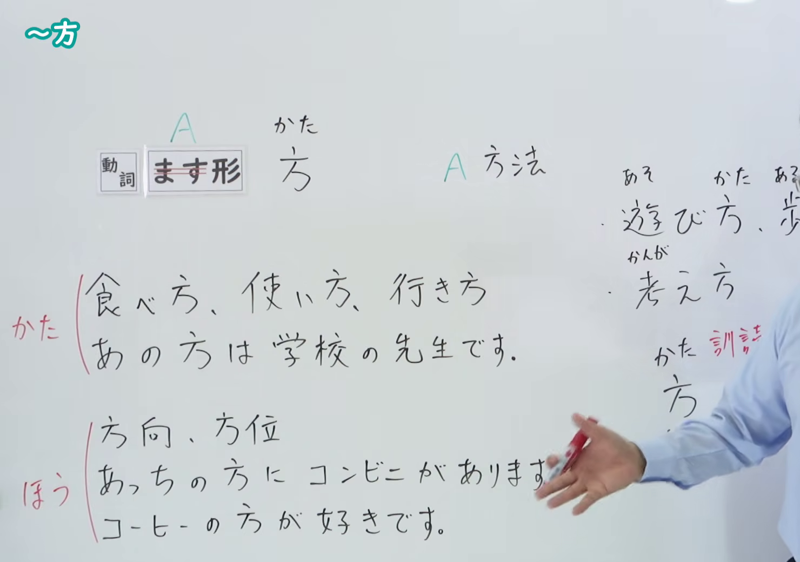
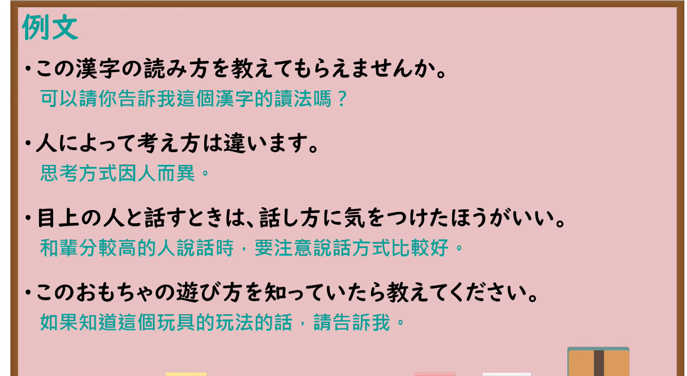

---
{
  "id": "N4-G-0007",
  "kind": "grammar",
  "level": "N4",
  "title": "～方／～かた（……的方法、……的方式）",
  "card_revision": 1,
  "schema_version": 1,
  "source": {
    "lesson": "N4 第7个语法",
    "material": "出口日語原视频板书、YouTube 原 WebVTT（中文为主、日语为辅）与毎日のんびり日本語教師正文",
    "video": "https://www.youtube.com/watch?v=zaRioJxUsFg",
    "screenshot": "assets/grammar/n4/N4-G-0007-connection.png",
    "screenshot_seconds": 120.0,
    "screenshot_crop": {
      "x": 0,
      "y": 0,
      "width": 1480,
      "height": 1040
    }
  },
  "tags": [
    "方",
    "かた",
    "方法",
    "N4"
  ],
  "confusions": [
    "〜方（ほう）",
    "〜やり方"
  ]
}
---

# N4 第7个语法：～方／～かた

# 视频学习资料整理

- 课程：[出口日語「～方／～かた」](https://www.youtube.com/watch?v=zaRioJxUsFg)
- 视频 ID：`zaRioJxUsFg`
- 视频时长：6分14秒

## 接续图

- 实际时间：2分0.00秒（120.00秒）
- 原图尺寸：1920×1080
- 裁切区域：左上角 `(0, 0)` 至右下角 `(1480, 1040)`；00:01 画面例词较少；选用 02:00 画面，板书已完整书写「動詞ます形＋方（かた）」「A 方法」、丰富例词「食べ方、使い方、行き方、遊び方、考え方」以及对比辨析「あの方は 学校の先生です（かた／敬称）」「方向・方位：あっちの方に（ほう）」「コーヒーの方が好きです（ほう／比較）」等完整板书，老师让出板书区域。固定左上角 (0, 0)，裁切区域宽 1480、高 1040，去除右侧人物与边缘多余画面，确保底部板书完全保留。

## 例句图

- 实际时间：4分40.00秒（280.00秒）
- 原图尺寸：1920×1080
- 裁切区域：左上角 `(0, 0)` 至右下角 `(1900, 1040)`；提取自视频 04:40 处的例句黑板页面。固定左上角 (0, 0)，裁切区域宽 1900、高 1040，去除右侧与底部粉笔槽多余画面，完整保留全部四条例句及中文翻译。

# 核心

## 功能一：A 的方法

**くわしい意味記述：**

- **～方（かた）：** 動詞のます形に接続して、～の方法／～の様子という意味を表します。（接在动词连用形（ます形）之后，表示做某事的方法或某种状态样子。）

### 例句

1. 人は死に方は選べないが、生き方は選べる。

   （人虽然无法选择死亡的方式，但可以选择活着的方式。）

2. 乗り換えの仕方が分からないので教えてください。

   （我不知道换乘的方法，请教教我。）

3. 銀行への行き方を教えてください。

   （请告诉我前往银行的走法。）

4. 謝り方を間違ったせいで、もっと叱られた。

   （因为道歉的方式弄错了，结果被训斥得更厉害了。）

# 来源

- [出口日語原视频](https://www.youtube.com/watch?v=zaRioJxUsFg)
- [毎日のんびり日本語教師「～方」](https://mainichi-nonbiri.com/grammar/n4-kata/)（查询日期：2026-09-25）
