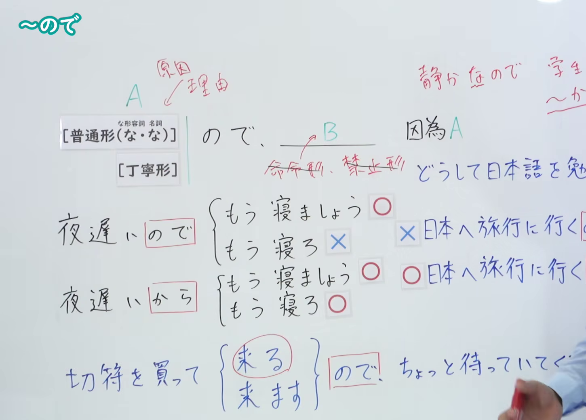
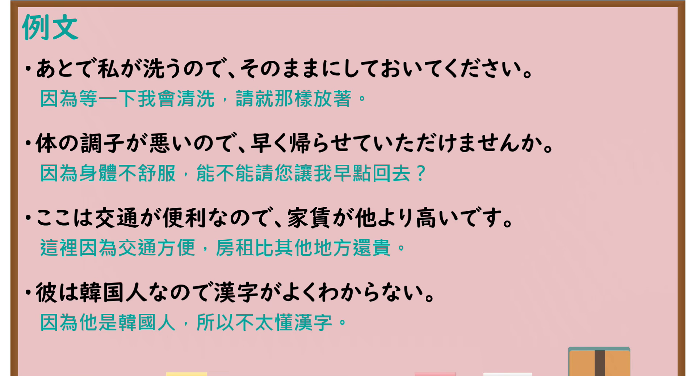

---
{
  "id": "N4-G-0008",
  "kind": "grammar",
  "level": "N4",
  "title": "～ので（因为……、由于……）",
  "card_revision": 1,
  "schema_version": 1,
  "source": {
    "lesson": "N4 第8个语法",
    "material": "出口日語原视频板书、YouTube 原 WebVTT（中文为主、日语为辅）与Hagoromo文型检索正文",
    "video": "https://www.youtube.com/watch?v=PPJBKQBdvr0",
    "screenshot": "assets/grammar/n4/N4-G-0008-connection.png",
    "screenshot_seconds": 385.6,
    "screenshot_crop": {
      "x": 0,
      "y": 0,
      "width": 1450,
      "height": 1040
    }
  },
  "tags": [
    "ので",
    "原因",
    "理由",
    "N4"
  ],
  "confusions": [
    "～から",
    "～ため（に）"
  ]
}
---

# N4 第8个语法：～ので

# 视频学习资料整理

- 课程：[出口日語「～ので」](https://www.youtube.com/watch?v=PPJBKQBdvr0)
- 视频 ID：`PPJBKQBdvr0`
- 视频时长：8分35秒

## 接续图

- 实际时间：6分25.60秒（385.60秒）
- 原图尺寸：1920×1080
- 裁切区域：左上角 `(0, 0)` 至右下角 `(1450, 1040)`；00:01 画面中后项限制及「から」对比尚未写完；选用 06:25 画面，板书已完整书写「普通形（な・な）＋ので、B」「因為A」、A为理由、后项B「✕命令形、禁止形」限制、对比例句「夜遅いので（もう寝ましょう✕／もう寝ろ✕）」「夜遅いから（もう寝ましょう○／もう寝ろ○）」与丁寧体接续「切符を買って来る／来ますので」，老师侧身让出板书。固定左上角 (0, 0)，裁切区域宽 1450、高 1040，去除右侧人物与边缘多余画面，充分保留底部全部例句板书。

## 例句图

- 实际时间：7分17.00秒（437.00秒）
- 原图尺寸：1920×1080
- 裁切区域：左上角 `(0, 0)` 至右下角 `(1900, 1040)`；提取自视频 07:17 处的例句黑板页面。固定左上角 (0, 0)，裁切区域宽 1900、高 1040，去除右侧与底部多余画面，完整保留全部四条例句及中文翻译。

# 核心

## 功能一：因为 A

**最上位意味カテゴリー：**

- **ので：** ものごとの関係（事物的关系）

**中位意味カテゴリー：**

- **ので：** 原因・理由（原因与理由）

**意味：**

- **ので：** 理由（理由）

**くわしい意味記述：**

- **ので：** 因果関係を表す丁寧な表現。〜（だ）から。会話などの文末で用いる時は「〜ので。」という形になり，「〜のでです。」とはならない。（表示因果关系的礼貌表达方式。相当于“〜（だ）から”。在会话等句尾使用时采用“〜ので。”的形式，不能说成“〜のでです。”。）

**派生語：** 未列出

### 例句

1. 昨日は頭が痛かったので、薬を飲んで、寝ていました。

   （昨天因为头痛，吃了药就一直在睡觉。）

2. 気が転倒しているので、わざわざ暴露された雪渓へ飛び出し、走るつもりで走れずに転げまわるということになる。

   （因为心慌意乱，反而特地跳到露出的雪谷上，想跑却跑不动，结果滚成了一团。）

3. この論証は長くなるので省くけれど、馬は引っぱらないとついてこない。

   （关于这一点的论证太长所以在此省略，不过马如果不牵着是不会跟着走的。）

4. 探照灯は測定を終えた瞬間に手早く消してしまうので、敵にしてみれば目がくらみ応射不能になる。

   （探照灯在完成测定的瞬间就会迅速熄灭，对于敌方而言就会感到眼花缭乱而无法还击。）

# 来源

- [出口日語原视频](https://www.youtube.com/watch?v=PPJBKQBdvr0)
- [Hagoromo 文型検索「ので」](https://hagoromo-text.work/lookup?vid=1404)（查询日期：2026-09-25）
