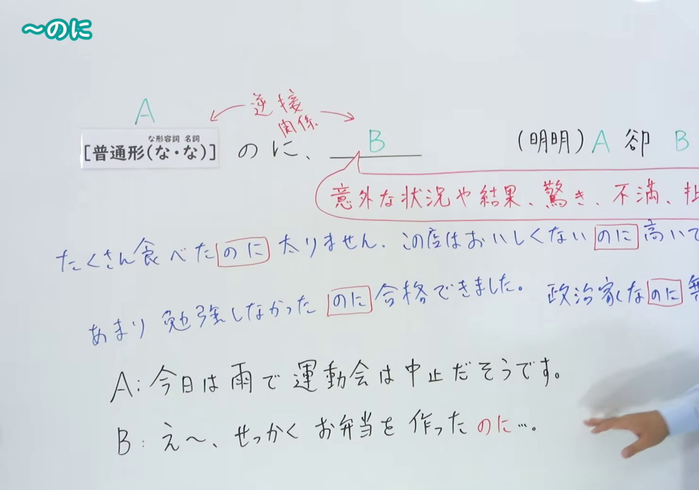
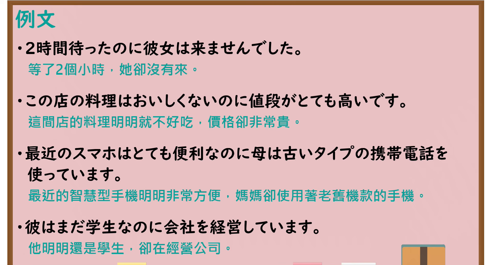

---
{
  "id": "N4-G-0009",
  "kind": "grammar",
  "level": "N4",
  "title": "～のに（明明……却……）",
  "card_revision": 1,
  "schema_version": 1,
  "source": {
    "lesson": "N4 第9个语法",
    "material": "出口日語原视频板书、YouTube 原 WebVTT（中文为主、日语为辅）与Hagoromo文型检索正文",
    "video": "https://www.youtube.com/watch?v=XSeDgcZEl60",
    "screenshot": "assets/grammar/n4/N4-G-0009-connection.png",
    "screenshot_seconds": 350.7,
    "screenshot_crop": {
      "x": 0,
      "y": 0,
      "width": 1480,
      "height": 1040
    }
  },
  "tags": [
    "のに",
    "逆接",
    "譲歩",
    "N4"
  ],
  "confusions": [
    "～けれども",
    "～くせに"
  ]
}
---

# N4 第9个语法：～のに

# 视频学习资料整理

- 课程：[出口日語「～のに」](https://www.youtube.com/watch?v=XSeDgcZEl60)
- 视频 ID：`XSeDgcZEl60`
- 视频时长：7分48秒

## 接续图

- 实际时间：5分50.70秒（350.70秒）
- 原图尺寸：1920×1080
- 裁切区域：左上角 `(0, 0)` 至右下角 `(1480, 1040)`；00:01 画面下部例句尚未完整书写；选用 05:50 画面，板书已完整书写「普通形（な・な）＋のに、B」「（明明）A 卻 B」「意外な状況や結果、驚き、不満、批判等」、四条例句「たくさん食べたのに太りません」「この店はおいしくないのに高いです」「あまり勉強しなかったのに合格できました」「政治家なのに無責任だ」及对话例句，老师侧身让出板书。固定左上角 (0, 0)，裁切区域宽 1480、高 1040，去除右侧人物与边缘多余画面，高度充分保留全部四条例句。

## 例句图

- 实际时间：6分37.00秒（397.00秒）
- 原图尺寸：1920×1080
- 裁切区域：左上角 `(0, 0)` 至右下角 `(1900, 1040)`；提取自视频 06:37 处的例句黑板页面。固定左上角 (0, 0)，裁切区域宽 1900、高 1040，去除右侧与底部粉笔槽多余画面，完整保留全部四条例句及中文翻译。

# 核心

## 功能一：（明明）A 却 B

**最上位意味カテゴリー：**

- **のに：** ものごとの関係（事物的关系）

**中位意味カテゴリー：**

- **のに：** 逆接・譲歩（转折与让步）

**意味：**

- **のに：** 逆接（转折）

**くわしい意味記述：**

- **のに：** 「けど」の意味で逆接を表す。特に，前の内容から当然後ろの内容が成立すると考えていたのに，それが成立しなったことについて，意外だとか残念だといった気持ちを表すのに使う。（具有“けど”的意思，表示转折。特别是本以为前项内容理所当然会引出后项内容，结果却没有成立，用于表达对此感到意外或遗憾的心情。）

**派生語：** 未列出

### 例句

1. 田中さんは、来るといったのに、来なかった。

   （田中明明说了要来，却还是没来。）

2. なかには子供のいない夫婦なのに、「おとうさん」「おかあさん」と呼び合っている人たちもいます。

   （其中有些人明明是没有孩子的夫妇，却互相称呼对方为“爸爸”“妈妈”。）

3. みんなが見えにくいのを我慢して立っているのに、自分ひとり「すいません」と中へはいってゆくわけにはいかない。

   （大家都强忍着视线被挡而站着看，自己一个人总不能说句“不好意思”就硬挤到前面去。）

4. 絨毯のヘリにつまずいて歩く小さな仔猫に我家を教えたわけでもないのに、数ヵ月経ち、ひとり歩きができるようになると、ミーはひょっこり現れるようになった。

   （虽然我并没有教过那只走路会在地毯边缘绊倒的小猫我家的位置，但过了几个月它能够独自走动后，咪咪便突然出现在了我家。）

# 来源

- [出口日語原视频](https://www.youtube.com/watch?v=XSeDgcZEl60)
- [Hagoromo 文型検索「のに」](https://hagoromo-text.work/lookup?vid=1410)（查询日期：2026-09-25）
