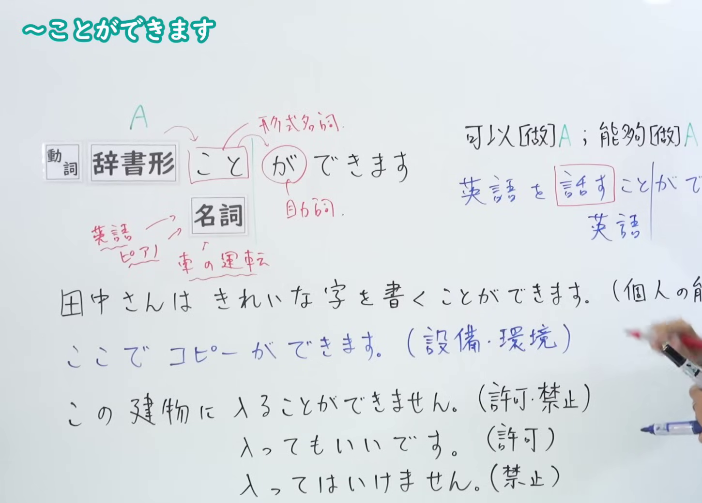
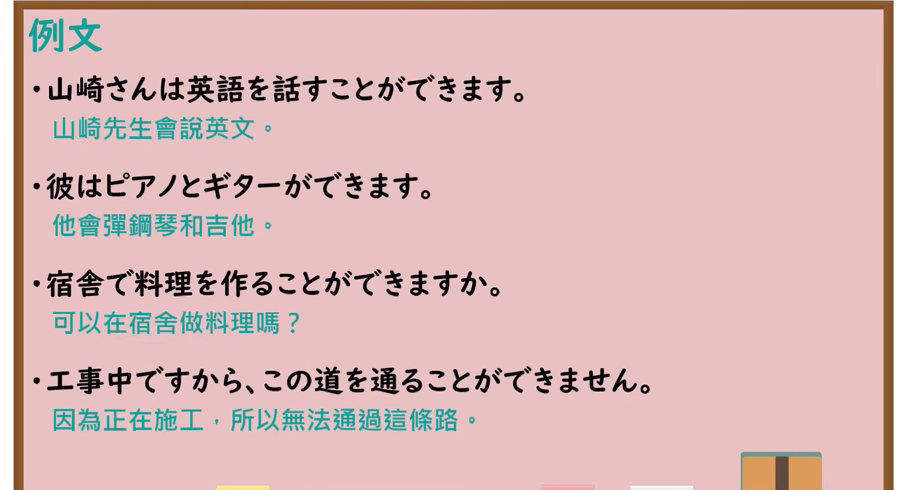

---
{
  "id": "N4-G-0010",
  "kind": "grammar",
  "level": "N4",
  "title": "～ことができる／～ことができます（能够……、会……、可以……）",
  "card_revision": 1,
  "schema_version": 1,
  "source": {
    "lesson": "N4 第10个语法",
    "material": "出口日語原视频板书、YouTube 原 WebVTT（中文为主、日语为辅）与Hagoromo文型检索正文",
    "video": "https://www.youtube.com/watch?v=piR9EADQDw4",
    "screenshot": "assets/grammar/n4/N4-G-0010-connection.png",
    "screenshot_seconds": 180.0,
    "screenshot_crop": {
      "x": 0,
      "y": 0,
      "width": 1450,
      "height": 1040
    }
  },
  "tags": [
    "ことができる",
    "可能",
    "能力",
    "N4"
  ],
  "confusions": [
    "可能動詞（〜れる／〜られる）",
    "〜ていい"
  ]
}
---

# N4 第10个语法：～ことができる／～ことができます

# 视频学习资料整理

- 课程：[出口日語「～ことができる／～ことができます」](https://www.youtube.com/watch?v=piR9EADQDw4)
- 视频 ID：`piR9EADQDw4`
- 视频时长：8分47秒

## 接续图

- 实际时间：3分0.00秒（180.00秒）
- 原图尺寸：1920×1080
- 裁切区域：左上角 `(0, 0)` 至右下角 `(1450, 1040)`；00:01 画面尚未补充词性标记与句意拆解；选用 03:00 画面，板书已完整书写「動詞辞書形＋ことができます」「名詞＋ができます」「可以[做]A；能夠[做]A；會[做]A」、细分能力（個人の能力・機能）、设备环境（設備・環境）、许可禁止（許可・禁止）的三组完整例句，老师让出板书区域。固定左上角 (0, 0)，裁切区域宽 1450、高 1040，去除右侧人物与边缘多余画面，充分保留底部全部例句板书。

## 例句图

- 实际时间：7分27.00秒（447.00秒）
- 原图尺寸：1920×1080
- 裁切区域：左上角 `(0, 0)` 至右下角 `(1900, 1040)`；提取自视频 07:27 处的例句黑板页面。固定左上角 (0, 0)，裁切区域宽 1900、高 1040，去除右侧与底部多余画面，完整保留全部四条例句及中文翻译。

# 核心

## 功能一：可以做 A；能够做 A；会做 A

**最上位意味カテゴリー：**

- **ことができる：** ものごとの様子（事物的状态与样貌）

**中位意味カテゴリー：**

- **ことができる：** 可能・難易（可能与难易）

**意味：**

- **ことができる：** 可能：可能（可能：可能）

**くわしい意味記述：**

- **ことができる：** ある人の能力や可能性を表す時に用いる。改まった場面，かたい文章では可能形よりも用いられる。（用于表示某人的能力或某种可能性。在郑重场合或庄重的书面文章中，比可能形态更常被使用。）

**派生語：** 未列出

### 例句

1. あなたは英語で手紙を書くことができますか。

   （你会用英语写信吗？）

2. 熊は、あごの骨を砕かれたりして馬に食らいつくことができない。

   （熊如果被击碎了下颌骨，就无法去撕咬马匹了。）

3. 二十近い例に日本人と同じ動作がまったく見られなかったことは、「正反対」を十分例証したものと断言できるのではなかろうか。

   （在近二十个案例中完全没有见到与日本人相同的动作，这难道不能断言已经充分例证了“截然相反”吗？）

4. どの社会の人々も、人間という「種」として本質的に同様な特質をもつばかりでなく、これほど文明が進んだにもかかわらず、一定の条件に対しては、個人としても集団としても、他の動物に共通した反応を示すことも十分指摘できるのである。

   （无论哪种社会的人们，不仅作为人类这一“物种”在本质上拥有相同的特质，而且即便文明如此发达，在特定条件下，无论作为个体还是群体，都会表现出与其他动物相同的反应，这一点也是完全可以指出的。）

# 来源

- [出口日語原视频](https://www.youtube.com/watch?v=piR9EADQDw4)
- [Hagoromo 文型検索「ことができる」](https://hagoromo-text.work/lookup?vid=507)（查询日期：2026-09-25）
