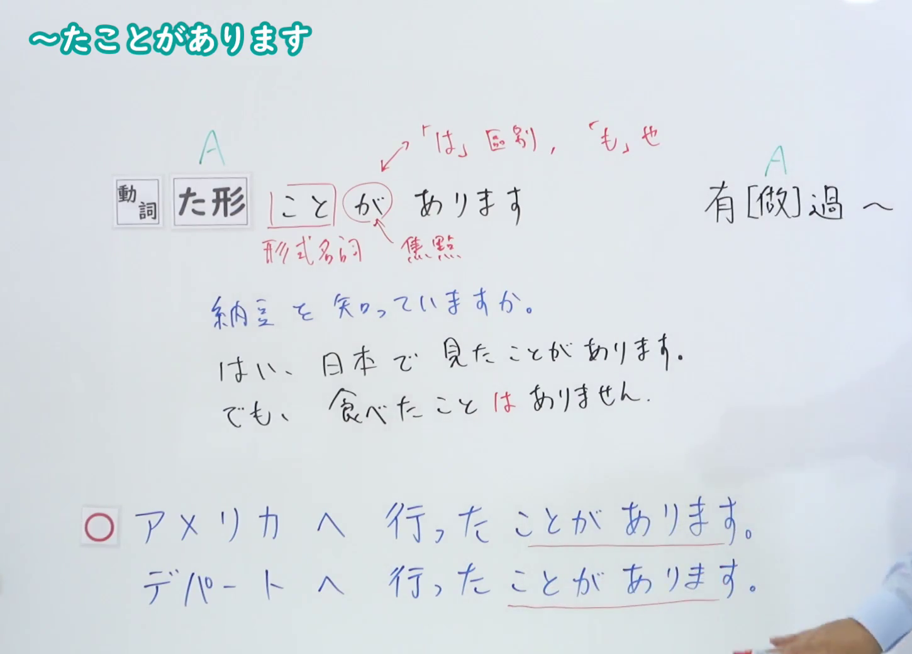
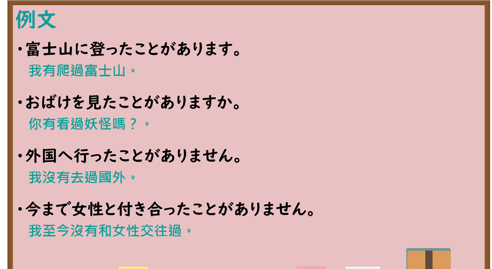

---
{
  "id": "N4-G-0011",
  "kind": "grammar",
  "level": "N4",
  "title": "～たことがあります（曾经做过……）",
  "card_revision": 1,
  "schema_version": 1,
  "source": {
    "lesson": "N4 第11个语法",
    "material": "出口日語原视频板书、Bilibili P11 音频的本地中文／日语混合转写 WebVTT与Hagoromo文型检索正文",
    "video": "https://www.youtube.com/watch?v=ep3WyLddZvs",
    "screenshot": "assets/grammar/n4/N4-G-0011-connection.png",
    "screenshot_seconds": 180.0,
    "screenshot_crop": {
      "x": 0,
      "y": 0,
      "width": 1450,
      "height": 1040
    }
  },
  "tags": [
    "たことがある",
    "経験",
    "N4"
  ],
  "confusions": [
    "～ことがある",
    "～たばかりだ"
  ]
}
---

# N4 第11个语法：～たことがあります

# 视频学习资料整理

- 课程：[出口日語「～たことがあります」](https://www.youtube.com/watch?v=ep3WyLddZvs)
- 视频 ID：`ep3WyLddZvs`
- 视频时长：5分17秒

## 接续图

- 实际时间：3分0.00秒（180.00秒）
- 原图尺寸：1920×1080
- 裁切区域：左上角 `(0, 0)` 至右下角 `(1450, 1040)`；00:01 画面尚未补充助词标记与对比辨析；选用 03:00 画面，板书已完整书写「動詞た形＋ことがあります」「有[做]過〜」、「こと（形式名詞）」「が（焦點）」、否定助词替换「食べたことはありません」、去过某地的「アメリカへ行ったことがあります」以及不适用单纯日常动作的「デパートへ行ったことがあります（✕）」对比辨析，老师让出板书区域。固定左上角 (0, 0)，裁切区域宽 1450、高 1040，去除右侧人物与边缘多余画面，充分保留底部例句板书，高度充足不缺失内容。

## 例句图

- 实际时间：3分57.45秒（237.45秒）
- 原图尺寸：1920×1080
- 裁切区域：左上角 `(0, 0)` 至右下角 `(1900, 1040)`；提取自视频 03:57 处的例句黑板页面。固定左上角 (0, 0)，裁切区域宽 1900、高 1040，去除右侧与底部多余画面，完整保留全部四条例句及中文翻译，确保底部第四条例句完整呈现。

# 核心

## 功能一：有做过 A

**最上位意味カテゴリー：**

- **たことがある：** 限定・非限定（限定与非限定）

**中位意味カテゴリー：**

- **たことがある：** 範囲（范围）

**意味：**

- **たことがある：** 範囲（范围）

**くわしい意味記述：**

- **たことがある：** 経験を表す。（表示经历与经验。）

**派生語：** 未列出

### 例句

1. 私は富士山に登ったことがあります。

   （我曾经登过富士山。）

2. 以前、その人には一度会ったことがある。

   （以前曾和那个人见过一次面。）

3. この薬を飲んで気分が悪くなったことがありますか。

   （你曾因为吃这种药而感到过身体不舒服吗？）

4. 私はフランス語を習ったことがありません。

   （我从来没有学过法语。）

# 来源

- [出口日語原视频](https://www.youtube.com/watch?v=ep3WyLddZvs)
- [Hagoromo 文型検索「たことがある」](https://hagoromo-text.work/lookup?vid=694)（查询日期：2026-09-25）
