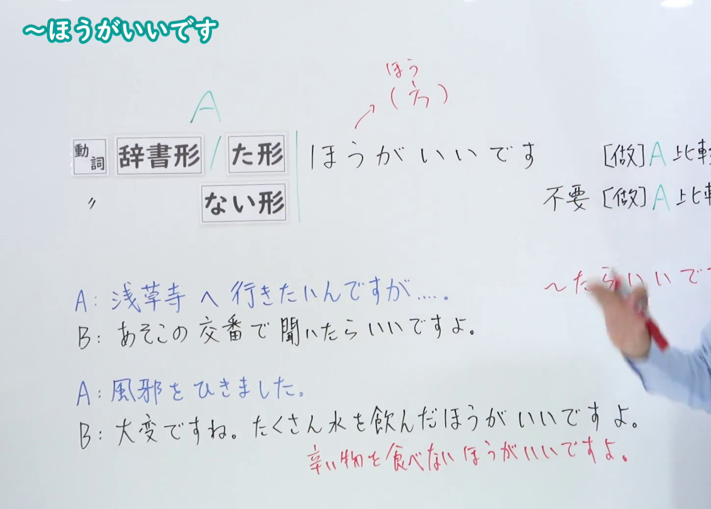
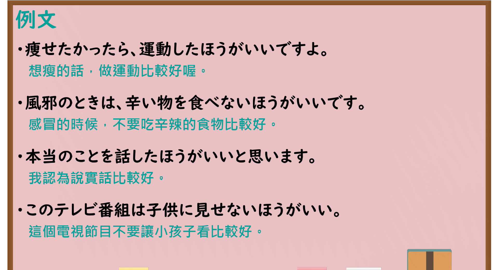

---
{
  "id": "N4-G-0012",
  "kind": "grammar",
  "level": "N4",
  "title": "～ほうがいいです（做……比较好）",
  "card_revision": 1,
  "schema_version": 1,
  "source": {
    "lesson": "N4 第12个语法",
    "material": "出口日語原视频板书、YouTube 原 WebVTT（中文为主、日语为辅）与Hagoromo文型检索正文",
    "video": "https://www.youtube.com/watch?v=Teca_tEu3IM",
    "screenshot": "assets/grammar/n4/N4-G-0012-connection.png",
    "screenshot_seconds": 240.0,
    "screenshot_crop": {
      "x": 0,
      "y": 0,
      "width": 1450,
      "height": 1040
    }
  },
  "tags": [
    "ほうがいい",
    "助言",
    "勧告",
    "N4"
  ],
  "confusions": [
    "〜たらいい",
    "〜べきだ"
  ]
}
---

# N4 第12个语法：～ほうがいいです

# 视频学习资料整理

- 课程：[出口日語「～ほうがいいです」](https://www.youtube.com/watch?v=Teca_tEu3IM)
- 视频 ID：`Teca_tEu3IM`
- 视频时长：5分46秒

## 接续图

- 实际时间：4分0.00秒（240.00秒）
- 原图尺寸：1920×1080
- 裁切区域：左上角 `(0, 0)` 至右下角 `(1450, 1040)`；00:01 画面尚未补充否定句型与「〜たらいいです」对比；选用 04:00 画面，板书已完整书写「動詞 [辞書形/た形] ほうがいいです（[做]A比較好）」「動詞ない形 ほうがいいです（不要[做]A比較好）」、建议句型对比「あそこの交番で聞いたらいいですよ（〜たらいいです）」与「たくさん水を飲んだほうがいいですよ／辛い物を食べないほうがいいです」，老师让出板书区域。固定左上角 (0, 0)，裁切区域宽 1450、高 1040，去除右侧人物与边缘多余画面，充分保留底部例句板书。

## 例句图

- 实际时间：4分18.93秒（258.93秒）
- 原图尺寸：1920×1080
- 裁切区域：左上角 `(0, 0)` 至右下角 `(1900, 1040)`；提取自视频 04:18 处的例句黑板页面。固定左上角 (0, 0)，裁切区域宽 1900、高 1040，去除右侧与底部多余画面，完整保留全部四条例句及中文翻译。

# 核心

## 功能一：做 A 比较好；不要做 A 比较好

**最上位意味カテゴリー：**

- **ほうがいい：** 勧誘・申し出・助言（劝诱、提议与建议）

**中位意味カテゴリー：**

- **ほうがいい：** 助言（建议）

**意味：**

- **ほうがいい：** 勧告（劝告）

**くわしい意味記述：**

- **ほうがいい：** 聞き手に自分の意見を強くすすめるときに使う。（用于向听话人强烈推荐自己的意见时。）

**派生語：** 未列出

### 例句

1. 薬を飲んで、早く寝たほうがいいですよ。

   （吃点药，早点睡觉比较好哦。）

2. あまり無理をしないほうがいいです。

   （最好不要太勉强自己。）

3. 旅行の前にホテルの予約をしておいたほうがいいでしょう。

   （旅行前最好先把酒店预订好比较好吧。）

4. 分からない言葉があったら、辞書を引いたほうがいい。

   （如果有不懂的词汇，查查字典比较好。）

# 来源

- [出口日語原视频](https://www.youtube.com/watch?v=Teca_tEu3IM)
- [Hagoromo 文型検索「ほうがいい」](https://hagoromo-text.work/lookup?vid=1500)（查询日期：2026-09-25）
