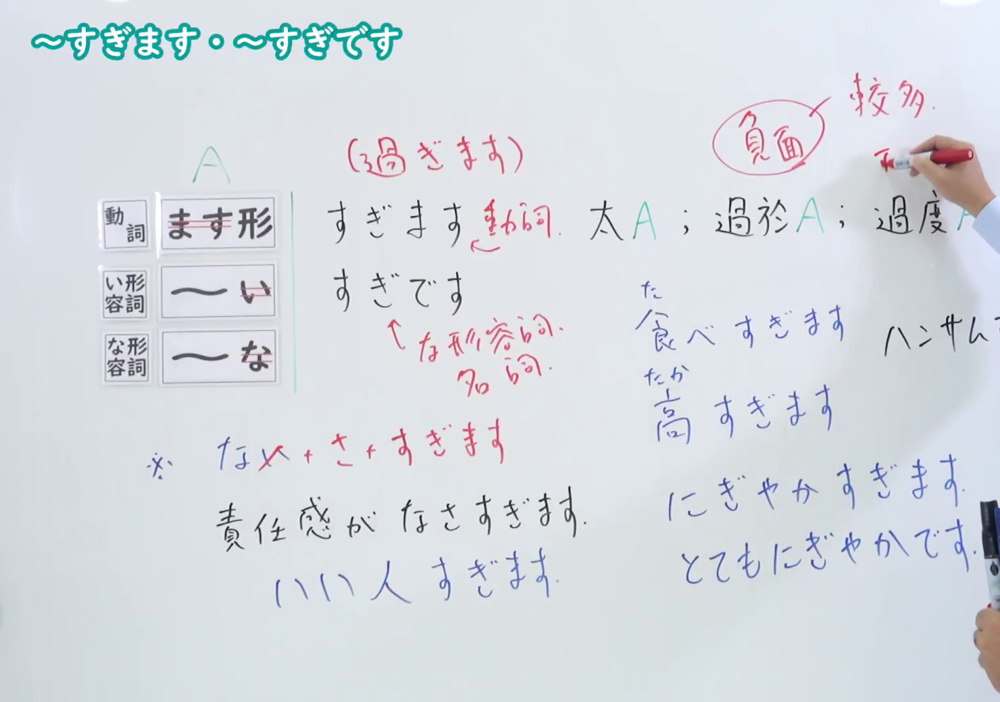
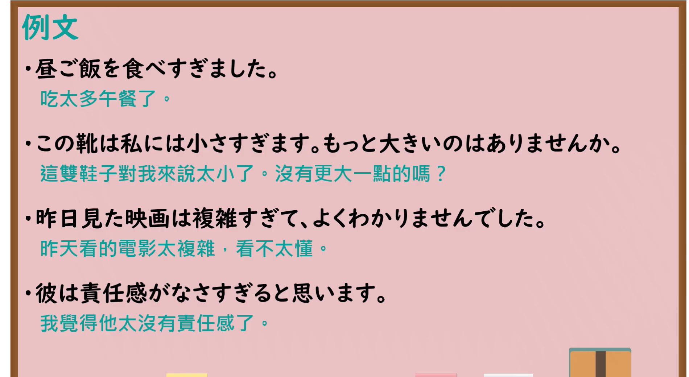

---
{
  "id": "N4-G-0013",
  "kind": "grammar",
  "level": "N4",
  "title": "～すぎます・～すぎです（太……、过于……）",
  "card_revision": 1,
  "schema_version": 1,
  "source": {
    "lesson": "N4 第13个语法",
    "material": "出口日語原视频板书、Bilibili P13 音频的本地中文／日语混合转写 WebVTT与毎日のんびり日本語教師正文",
    "video": "https://www.youtube.com/watch?v=dtgB4k4i0ck",
    "screenshot": "assets/grammar/n4/N4-G-0013-connection.png",
    "screenshot_seconds": 333.3,
    "screenshot_crop": {
      "x": 0,
      "y": 0,
      "width": 1480,
      "height": 1040
    }
  },
  "tags": [
    "すぎる",
    "すぎます",
    "過度",
    "N4"
  ],
  "confusions": [
    "～すぎる",
    "あまりにも"
  ]
}
---

# N4 第13个语法：～すぎます・～すぎです

# 视频学习资料整理

- 课程：[出口日語「～すぎます・～すぎです」](https://www.youtube.com/watch?v=dtgB4k4i0ck)
- 视频 ID：`dtgB4k4i0ck`
- 视频时长：7分25秒

## 接续图

- 实际时间：5分33.30秒（333.30秒）
- 原图尺寸：1920×1080
- 裁切区域：左上角 `(0, 0)` 至右下角 `(1480, 1040)`；00:01 画面尚未补充名词形容词派生与特殊变化；选用 05:33 画面，板书已完整书写「動詞ます形／い形容詞語幹／な形容詞語幹＋すぎます・すぎです」「太 A；過於 A；過度 A」、词性变化示例「食べすぎます／高すぎます／にぎやかすぎます／ハンサムすぎる」以及特殊形式「※ない→なさすぎます（責任感がなさすぎます）／いい人すぎます」，老师让出板书区域。固定左上角 (0, 0)，裁切区域宽 1480、高 1040，去除右侧人物与边缘多余画面，充分保留底部全部补充板书。

## 例句图

- 实际时间：6分17.75秒（377.75秒）
- 原图尺寸：1920×1080
- 裁切区域：左上角 `(0, 0)` 至右下角 `(1900, 1040)`；提取自视频 06:17 处的例句黑板页面。固定左上角 (0, 0)，裁切区域宽 1900、高 1040，去除右侧与底部多余画面，完整保留全部四条例句及中文翻译。

# 核心

## 功能一：太 A、过于 A、过度 A

**くわしい意味記述：**

- **～すぎる／～すぎます／～すぎです：** 動ます形、い形語幹、な形語幹に接続して、その動作や状態が普通の程度・水準を超えていることを表します。（接在动词连用形（ます形）、一类形容词（い形容词）词干、二类形容词（な形容词）词干后，表示该动作或状态超过了正常的程度或水平。）

### 例句

1. 夜景が美しすぎて見とれてしまった。

   （夜景太美了，看得出神了。）

2. もう若くないからか、食べ過ぎるとすぐ胃もたれする。

   （可能是因为不再年轻了吧，吃多了马上就会胃胀。）

3. この服は私には派手すぎます。

   （这件衣服对我来说太花哨了。）

4. この部屋は狭すぎて荷物が全部入りきらない。

   （这个房间太小了，行李根本放不下。）

# 来源

- [出口日語原视频](https://www.youtube.com/watch?v=dtgB4k4i0ck)
- [毎日のんびり日本語教師「～過ぎる／が過ぎる」](https://mainichi-nonbiri.com/grammar/n4-sugiru/)（查询日期：2026-09-25）
