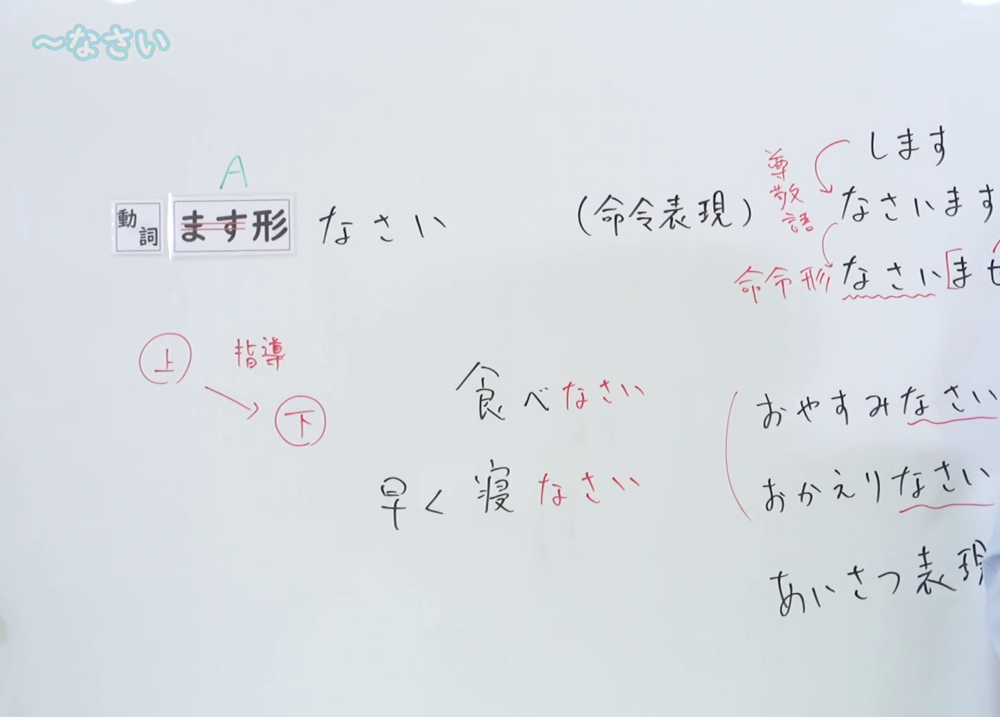
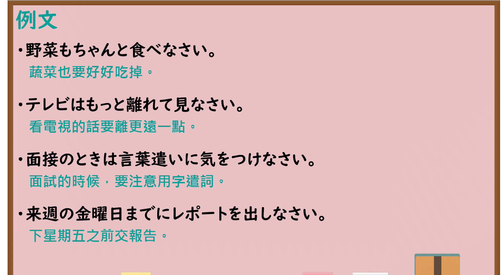

---
{
  "id": "N4-G-0014",
  "kind": "grammar",
  "level": "N4",
  "title": "～なさい（做……吧、请做……）",
  "card_revision": 1,
  "schema_version": 1,
  "source": {
    "lesson": "N4 第14个语法",
    "material": "出口日語原视频板书、YouTube 原 WebVTT（中文为主、日语为辅）与Hagoromo文型检索正文",
    "video": "https://www.youtube.com/watch?v=VTB8eLpqgZo",
    "screenshot": "assets/grammar/n4/N4-G-0014-connection.png",
    "screenshot_seconds": 258.45,
    "screenshot_crop": {
      "x": 0,
      "y": 0,
      "width": 1450,
      "height": 1040
    }
  },
  "tags": [
    "なさい",
    "命令",
    "指示",
    "N4"
  ],
  "confusions": [
    "命令形",
    "～てください"
  ]
}
---

# N4 第14个语法：～なさい

# 视频学习资料整理

- 课程：[出口日語「～なさい」](https://www.youtube.com/watch?v=VTB8eLpqgZo)
- 视频 ID：`VTB8eLpqgZo`
- 视频时长：5分45秒

## 接续图

- 实际时间：4分18.45秒（258.45秒）
- 原图尺寸：1920×1080
- 裁切区域：左上角 `(0, 0)` 至右下角 `(1450, 1040)`；00:01 画面尚未补充例词与寒暄语辨析；选用 04:18 画面，板书已完整书写「動詞ます形＋なさい（命令表現）」、上级对下级（親→子、教師→生徒）指导指示用法、词尾由来（なさいます→なさいませ→なさい）、命令例词「食べなさい／早く寝なさい」以及日常寒暄语衍生「おやすみなさい／おかえりなさい（あいさつ表現）」，老师侧身让出板书。固定左上角 (0, 0)，裁切区域宽 1450、高 1040，去除右侧人物与边缘多余画面，充分保留底部例词与注解。

## 例句图

- 实际时间：4分30.00秒（270.00秒）
- 原图尺寸：1920×1080
- 裁切区域：左上角 `(0, 0)` 至右下角 `(1900, 1040)`；提取自视频 04:30 处的例句黑板页面。固定左上角 (0, 0)，裁切区域宽 1900、高 1040，去除右侧与底部多余画面，完整保留全部四条例句及中文翻译。

# 核心

## 功能一：做 A（命令表现）

**最上位意味カテゴリー：**

- **Vなさい：** 働きかけ（施加影响）

**中位意味カテゴリー：**

- **Vなさい：** 命令・依頼（命令与请求）

**意味：**

- **Vなさい：** 命令（命令）

**くわしい意味記述：**

- **Vなさい：** Vで表す行為を相手に命令する意味。「V命令形」よりもやわらかく言いたいときに使う。（表示命令对方进行动词所示行为之意。用于想比动词命令形语气更委婉地表达命令时。）

**派生語：** 未列出

### 例句

1. 早く起きなさい。

   （快点起床。）

2. ここに名前を書きなさい。

   （在这里写上名字。）

3. ご飯を食べる前に、ちゃんと手を洗いなさい。

   （吃饭前要好好洗手。）

4. 質問があったら、手を挙げなさい。

   （如果有疑问，请举手。）

# 来源

- [出口日語原视频](https://www.youtube.com/watch?v=VTB8eLpqgZo)
- [Hagoromo 文型検索「Vなさい」](https://hagoromo-text.work/lookup?vid=184)（查询日期：2026-09-25）
