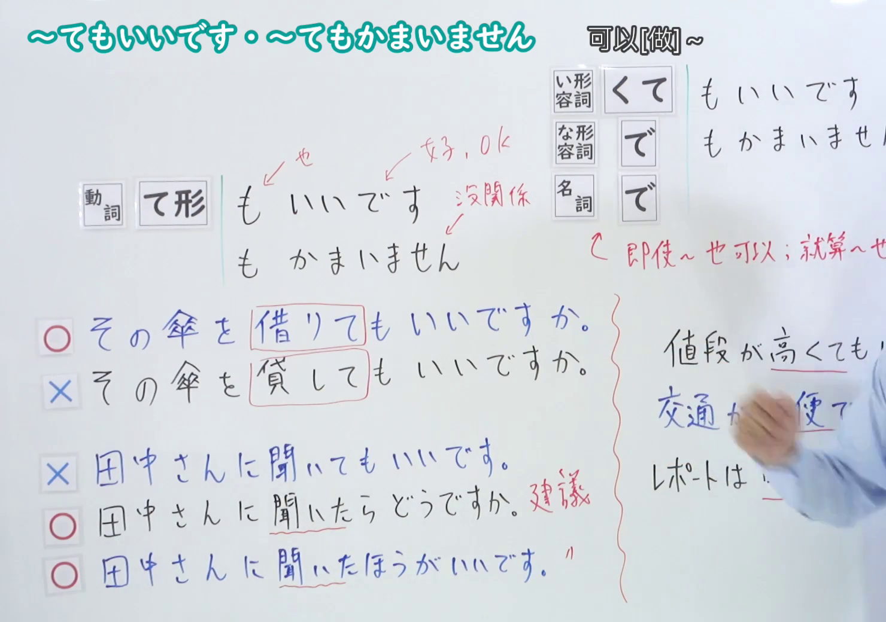
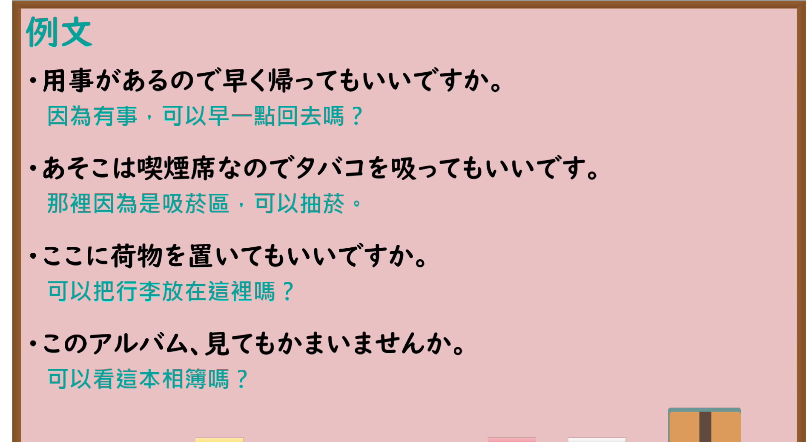

---
{
  "id": "N4-G-0015",
  "kind": "grammar",
  "level": "N4",
  "title": "～てもいいです・～てもかまいません（可以……）",
  "card_revision": 1,
  "schema_version": 1,
  "source": {
    "lesson": "N4 第15个语法",
    "material": "出口日語原视频板书、Bilibili P15 音频的本地中文／日语混合转写 WebVTT与Hagoromo文型检索正文",
    "video": "https://www.youtube.com/watch?v=z1N9GnpRgrU",
    "screenshot": "assets/grammar/n4/N4-G-0015-connection.png",
    "screenshot_seconds": 332.4,
    "screenshot_crop": {
      "x": 0,
      "y": 0,
      "width": 1480,
      "height": 1040
    }
  },
  "tags": [
    "てもいい",
    "てもかまわない",
    "許可",
    "N4"
  ],
  "confusions": [
    "～てはいけない",
    "～てもいいですか"
  ]
}
---

# N4 第15个语法：～てもいいです・～てもかまいません

# 视频学习资料整理

- 课程：[出口日語「～てもいいです・～てもかまいません」](https://www.youtube.com/watch?v=z1N9GnpRgrU)
- 视频 ID：`z1N9GnpRgrU`
- 视频时长：7分24秒

## 接续图

- 实际时间：5分32.40秒（332.40秒）
- 原图尺寸：1920×1080
- 裁切区域：左上角 `(0, 0)` 至右下角 `(1480, 1040)`；00:01 画面尚未补充名词形容词接续与句意对比；选用 05:32 画面，板书已完整书写「動詞て形／い形容詞くて／な形容詞で／名詞で＋もいいです・もかまいません」「可以[做]~」、借入借出对比「その傘を借りてもいいですか／✕その傘を貸してもいいですか」、许可与建议对比「田中さんに聞いてもいいです／田中さんに聞いたほうがいいです」、非动词例句「値段が高くてもいいです／交通が不便でもいいです／レポートは明日でもいいです」，老师让出板书区域。固定左上角 (0, 0)，裁切区域宽 1480、高 1040，去除右侧人物与边缘多余画面，充分保留底部全部例句板书。

## 例句图

- 实际时间：6分16.72秒（376.72秒）
- 原图尺寸：1920×1080
- 裁切区域：左上角 `(0, 0)` 至右下角 `(1900, 1040)`；提取自视频 06:16 处的例句黑板页面。固定左上角 (0, 0)，裁切区域宽 1900、高 1040，去除右侧与底部多余画面，完整保留全部四条例句及中文翻译。

# 核心

## 功能一：可以做 A

**最上位意味カテゴリー：**

- **てもいい：** 働きかけ（施加影响）
- **てもかまわない：** 働きかけ（施加影响）

**中位意味カテゴリー：**

- **てもいい：** 許可・禁止（许可与禁止）
- **てもかまわない：** 許可・禁止（许可与禁止）

**意味：**

- **てもいい：** 許可（许可）
- **てもかまわない：** 許可（许可）

**くわしい意味記述：**

- **てもいい：** 話し手が聞き手に許可を求めたり，話し手が聞き手（友達や目下の人）に許可を与えたりするときに使う。（用于说话人向听话人请求许可，或说话人向听话人（朋友或晚辈）给予许可时。）
- **てもかまわない：** 話し手が聞き手に許可を求めたり，話し手が聞き手（友達や目下の人）に許可を与えたりするときに使う。（用于说话人向听话人请求许可，或说话人向听话人（朋友或晚辈）给予许可时。）

**派生語：** 未列出

### 例句

1. ここでタバコを吸ってもいいですか。

   （可以在这里抽烟吗？）

2. この部屋のものは、自由に使ってもいいですよ。

   （这个房间里的东西，可以自由使用哦。）

3. 用事があるなら、もう帰ってもかまいませんよ。

   （如果有事的话，现在回去也没关系哦。）

4. 提出は明日になってもかまいませんか。

   （明天再提交也可以吗？）

# 来源

- [出口日語原视频](https://www.youtube.com/watch?v=z1N9GnpRgrU)
- [Hagoromo 文型検索「てもいい」](https://hagoromo-text.work/lookup?vid=876)（查询日期：2026-09-25）
- [Hagoromo 文型検索「てもかまわない」](https://hagoromo-text.work/lookup?vid=879)（查询日期：2026-09-25）
