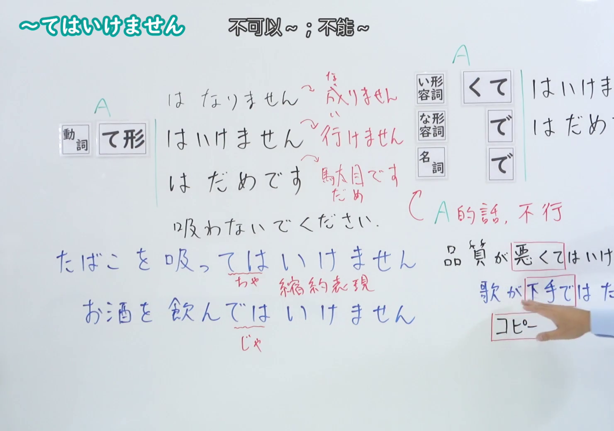
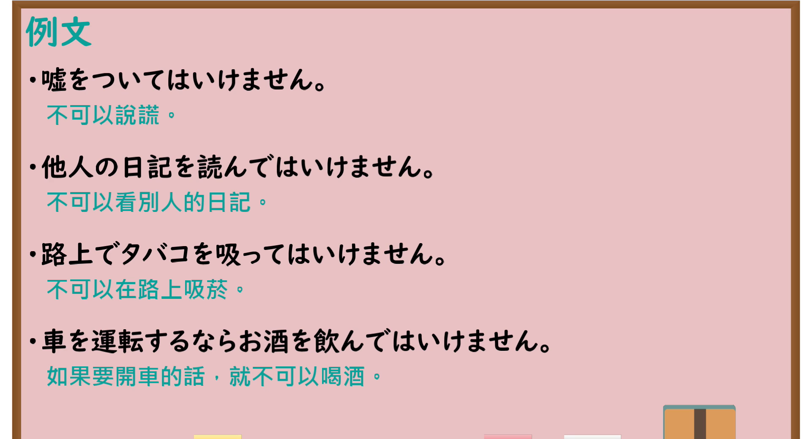

---
{
  "id": "N4-G-0016",
  "kind": "grammar",
  "level": "N4",
  "title": "～てはいけません・～てはだめです（不可以……、不能……）",
  "card_revision": 1,
  "schema_version": 1,
  "source": {
    "lesson": "N4 第16个语法",
    "material": "出口日語原视频板书、YouTube 原 WebVTT（中文为主、日语为辅）与Hagoromo文型检索正文",
    "video": "https://www.youtube.com/watch?v=ylZKLkbuUhY",
    "screenshot": "assets/grammar/n4/N4-G-0016-connection.png",
    "screenshot_seconds": 320.35,
    "screenshot_crop": {
      "x": 0,
      "y": 0,
      "width": 1480,
      "height": 1040
    }
  },
  "tags": [
    "てはいけない",
    "てはだめだ",
    "禁止",
    "N4"
  ],
  "confusions": [
    "～ないでください",
    "～べからず"
  ]
}
---

# N4 第16个语法：～てはいけません・～てはだめです

# 视频学习资料整理

- 课程：[出口日語「～てはいけません・～てはだめです」](https://www.youtube.com/watch?v=ylZKLkbuUhY)
- 视频 ID：`ylZKLkbuUhY`
- 视频时长：7分08秒

## 接续图

- 实际时间：5分20.35秒（320.35秒）
- 原图尺寸：1920×1080
- 裁切区域：左上角 `(0, 0)` 至右下角 `(1480, 1040)`；00:01 画面尚未补充名词形容词接续与口语缩约；选用 05:20 画面，板书已完整书写「動詞て形／い形容詞くて／な形容詞で／名詞で＋はいけません・はだめです」「不可以~；不能~」、词尾由来（行けません／駄目です）、禁止表达例句「たばこを吸っては（ちゃ）いけません／お酒を飲んでは（じゃ）いけません」以及非动词例句「品質が悪くてはいけません／歌が下手ではだめです／コピーではだめです」，老师让出板书区域。固定左上角 (0, 0)，裁切区域宽 1480、高 1040，去除右侧人物与边缘多余画面，充分保留底部全部板书。

## 例句图

- 实际时间：6分03.05秒（363.05秒）
- 原图尺寸：1920×1080
- 裁切区域：左上角 `(0, 0)` 至右下角 `(1900, 1040)`；提取自视频 06:03 处的例句黑板页面。固定左上角 (0, 0)，裁切区域宽 1900、高 1040，去除右侧与底部多余画面，完整保留全部四条例句及中文翻译。

# 核心

## 功能一：不可以做 A、不能做 A

**最上位意味カテゴリー：**

- **てはいけない：** 働きかけ（施加影响）

**中位意味カテゴリー：**

- **てはいけない：** 許可・禁止（许可与禁止）

**意味：**

- **てはいけない：** 禁止・当為の否定（禁止与理应如此的否定）

**くわしい意味記述：**

- **てはいけない：** ある行為をすることを禁止する意味を表す。「てはいけません」は，親が子供に，教師が生徒に注意するときや，規則を伝えるときに使う。（表示禁止进行某种行为之意。“てはいけません”用于父母对孩子、教师对学生进行提醒告诫，或传达规章制度时。）

**派生語：** 未列出

### 例句

1. 教室の中で走ってはいけません。

   （不可以在教室里奔跑。）

2. テストのときは、隣の人の答えを見てはいけません。

   （考试的时候，不能看旁边人的答案。）

3. ここに車を止めてはいけません。

   （不能把车停在这里。）

4. 人の悪口を言ってはいけません。

   （不可以讲别人的坏话。）

# 来源

- [出口日語原视频](https://www.youtube.com/watch?v=ylZKLkbuUhY)
- [Hagoromo 文型検索「てはいけない」](https://hagoromo-text.work/lookup?vid=845)（查询日期：2026-09-25）
