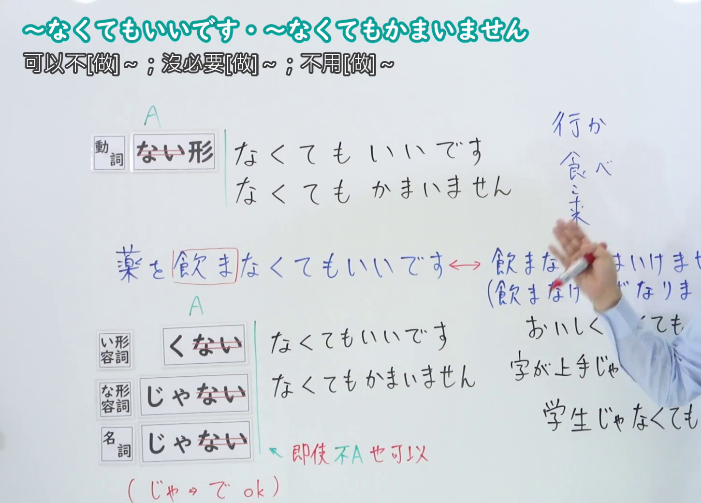
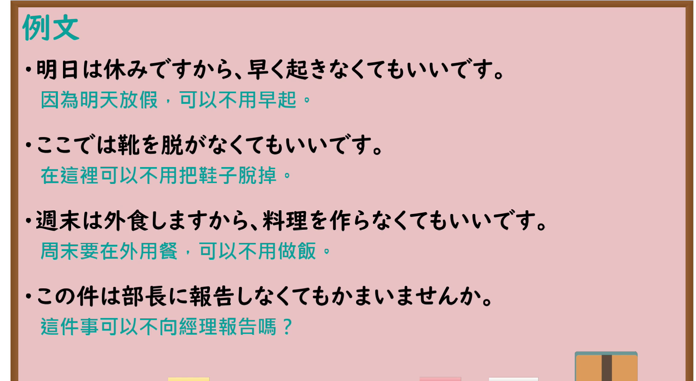

---
{
  "id": "N4-G-0017",
  "kind": "grammar",
  "level": "N4",
  "title": "～なくてもいいです・～なくてもかまいません（不用……、可以不……）",
  "card_revision": 1,
  "schema_version": 1,
  "source": {
    "lesson": "N4 第17个语法",
    "material": "出口日語原视频板书、YouTube 原 WebVTT（中文为主、日语为辅）与Hagoromo文型检索正文",
    "video": "https://www.youtube.com/watch?v=ssh44b0NTeA",
    "screenshot": "assets/grammar/n4/N4-G-0017-connection.png",
    "screenshot_seconds": 278.13,
    "screenshot_crop": {
      "x": 0,
      "y": 0,
      "width": 1450,
      "height": 1040
    }
  },
  "tags": [
    "なくてもいい",
    "なくてもかまわない",
    "不必要",
    "N4"
  ],
  "confusions": [
    "～なくてもすむ",
    "～ないでいい"
  ]
}
---

# N4 第17个语法：～なくてもいいです・～なくてもかまいません

# 视频学习资料整理

- 课程：[出口日語「～なくてもいいです・～なくてもかまいません」](https://www.youtube.com/watch?v=ssh44b0NTeA)
- 视频 ID：`ssh44b0NTeA`
- 视频时长：6分11秒

## 接续图

- 实际时间：4分38.13秒（278.13秒）
- 原图尺寸：1920×1080
- 裁切区域：左上角 `(0, 0)` 至右下角 `(1450, 1040)`；00:01 画面尚未补充形容词与名词接续；选用 04:38 画面，板书已完整书写「動詞ない形／い形容詞くない／な形容詞じゃない／名詞じゃない＋くてもいいです・くてもかまいません」「可以不[做]~；沒必要[做]~；不用[做]~」、与义务表达的对比「薬を飲まなくてもいいです ←→ 飲まなくてはいけません」以及「おいしくなくてもいいです／字が上手じゃなくてもいいです／学生じゃなくてもかまいません」，老师侧身让出板书。固定左上角 (0, 0)，裁切区域宽 1450、高 1040，去除右侧人物与边缘多余画面，充分保留底部例句板书。

## 例句图

- 实际时间：4分50.00秒（290.00秒）
- 原图尺寸：1920×1080
- 裁切区域：左上角 `(0, 0)` 至右下角 `(1900, 1040)`；提取自视频 04:50 处的例句黑板页面。固定左上角 (0, 0)，裁切区域宽 1900、高 1040，去除右侧与底部多余画面，完整保留全部四条例句及中文翻译。

# 核心

## 功能一：可以不做 A、没必要做 A、不用做 A

**最上位意味カテゴリー：**

- **なくてもいい：** 必要性（必要性）
- **なくてもかまわない：** 必要性（必要性）

**中位意味カテゴリー：**

- **なくてもいい：** 必要・不必要（必要与不必要）
- **なくてもかまわない：** 必要・不必要（必要与不必要）

**意味：**

- **なくてもいい：** 不必要（不必要）
- **なくてもかまわない：** 不必要（不必要）

**くわしい意味記述：**

- **なくてもいい：** 「する必要はない」という意味。（表示“没有必要做”之意。）
- **なくてもかまわない：** 「する必要はない」という意味。「なくてもいい」と同じ意味だが，「なくてもいい」より改まった場面で用いることが多い。（表示“没有必要做”之意。与“なくてもいい”意思相同，但比“なくてもいい”更常用于郑重场合。）

**派生語：** 未列出

### 例句

1. 明日は日曜日ですから、早く起きなくてもいいです。

   （明天是星期天，所以不用早起。）

2. この仕事は急ぎませんから、今日中に終わらせなくてもいいですよ。

   （这项工作不着急，所以不用在今天之内完成哦。）

3. 参加したくないなら、無理に来なくてもかまいません。

   （如果不想参加的话，勉强不来也没关系。）

4. 名前は漢字で書かなくてもかまいませんか。

   （名字不用汉字写也可以吗？）

# 来源

- [出口日語原视频](https://www.youtube.com/watch?v=ssh44b0NTeA)
- [Hagoromo 文型検索「なくてもいい」](https://hagoromo-text.work/lookup?vid=1129)（查询日期：2026-09-25）
- [Hagoromo 文型検索「なくてもかまわない」](https://hagoromo-text.work/lookup?vid=1130)（查询日期：2026-09-25）
