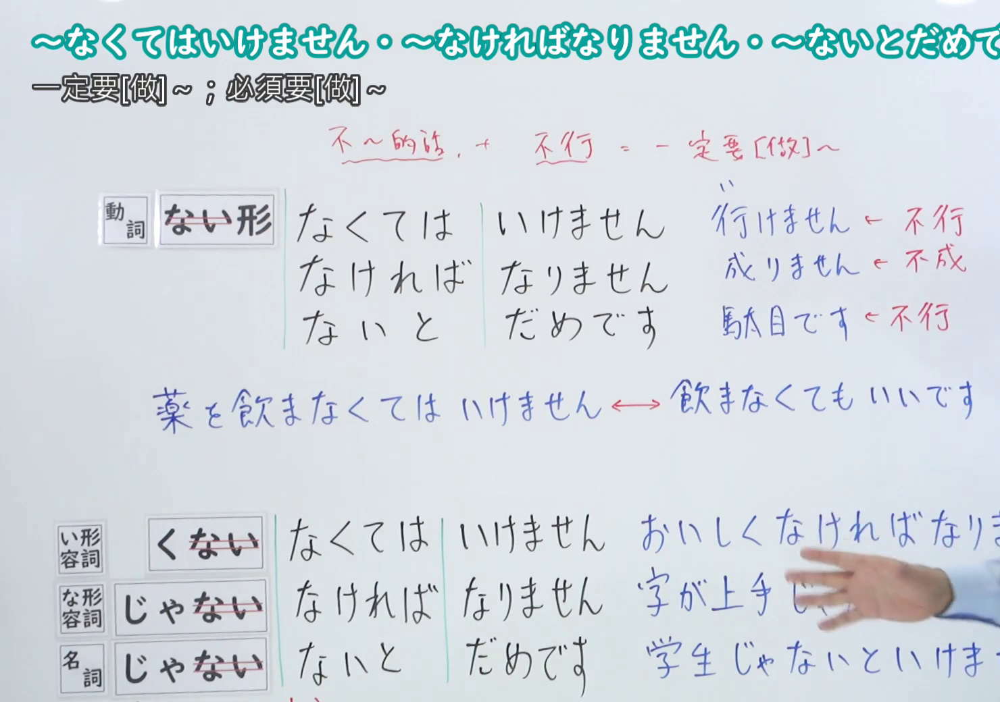
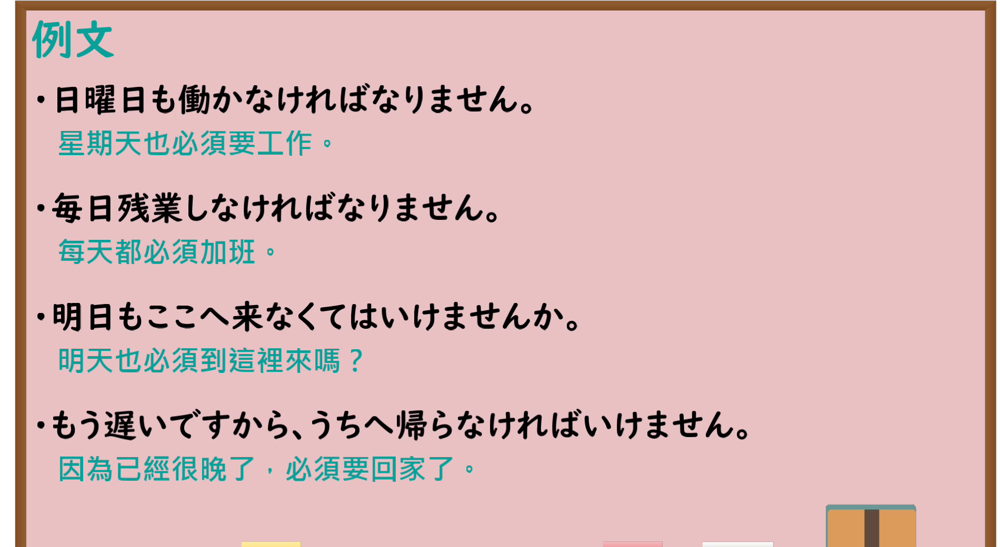

---
{
  "id": "N4-G-0018",
  "kind": "grammar",
  "level": "N4",
  "title": "～なくてはいけません・～なければなりません・～ないとだめです（必须……、一定要……）",
  "card_revision": 1,
  "schema_version": 1,
  "source": {
    "lesson": "N4 第18个语法",
    "material": "出口日語原视频板书、YouTube 原 WebVTT（中文为主、日语为辅）与Hagoromo文型检索正文",
    "video": "https://www.youtube.com/watch?v=wRFhv5Ky_KA",
    "screenshot": "assets/grammar/n4/N4-G-0018-connection.png",
    "screenshot_seconds": 323.0,
    "screenshot_crop": {
      "x": 0,
      "y": 0,
      "width": 1480,
      "height": 1040
    }
  },
  "tags": [
    "なければならない",
    "なくてはいけない",
    "ないとだめだ",
    "義務",
    "N4"
  ],
  "confusions": [
    "～ざるを得ない",
    "～べきだ"
  ]
}
---

# N4 第18个语法：～なくてはいけません・～なければなりません・～ないとだめです

# 视频学习资料整理

- 课程：[出口日語「～なくてはいけません・～なければなりません・～ないとだめです」](https://www.youtube.com/watch?v=wRFhv5Ky_KA)
- 视频 ID：`wRFhv5Ky_KA`
- 视频时长：7分11秒

## 接续图

- 实际时间：5分23.00秒（323.00秒）
- 原图尺寸：1920×1080
- 裁切区域：左上角 `(0, 0)` 至右下角 `(1480, 1040)`；00:01 画面尚未补充三种否定接续成因与形容词名词板书；选用 05:23 画面，板书已完整书写「動詞ない形／い形容詞くない／な形容詞じゃない／名詞じゃない＋なくてはいけません／なければなりません／ないとだめです」「一定要[做]~；必須要[做]~」、词尾辨析（行けません・成りません・駄目です）、与许可句型的双向对比「薬を飲まなくてはいけません ←→ 飲まなくてもいいです」以及「おいしくなければなりません／字が上手じゃないとだめです／学生じゃないといけません」，老师让出板书区域。固定左上角 (0, 0)，裁切区域宽 1480、高 1040，去除右侧人物与边缘多余画面，充分保留底部全部板书。

## 例句图

- 实际时间：6分06.00秒（366.00秒）
- 原图尺寸：1920×1080
- 裁切区域：左上角 `(0, 0)` 至右下角 `(1900, 1040)`；提取自视频 06:06 处的例句黑板页面。固定左上角 (0, 0)，裁切区域宽 1900、高 1040，去除右侧与底部多余画面，完整保留全部四条例句及中文翻译。

# 核心

## 功能一：一定要做 A、必须要做 A

**最上位意味カテゴリー：**

- **なければならない：** 当為（应当与必然）
- **なくてはいけない：** 当為（应当与必然）
- **ないとだめだ：** 当為（应当与必然）

**中位意味カテゴリー：**

- **なければならない：** 義務・必然（义务与必然）
- **なくてはいけない：** 義務・必然（义务与必然）
- **ないとだめだ：** 義務・必然（义务与必然）

**意味：**

- **なければならない：** 義務（义务）
- **なくてはいけない：** 義務（义务）
- **ないとだめだ：** 義務（义务）

**くわしい意味記述：**

- **なければならない：** 規則・法律などから考えて，ある行為をする・ある状態になる義務や必要性があると言うときに使う。（从规章制度、法律等角度考虑，用于表示有义务或必要进行某种行为、处于某种状态时。）
- **なくてはいけない：** 社会常識や何らかの理由から，ある行為をする・ある状態になる必要があると言うときに使う。「〜なければならない」よりも話しことばで使われることが多い。（从社会常识或某种理由出发，用于表示有必要进行某种行为、处于某种状态时。比“〜なければならない”更常用于口语中。）
- **ないとだめだ：** ある理由から，ある行為をする・ある状態になる必要があるという意味。「ないといけない」「なければならない」よりも砕けた話しことばで使う。（表示出于某种理由，有必要进行某种行为、处于某种状态之意。比“ないといけない”“なければならない”更常用于随意的口语中。）

**派生語：** 未列出

### 例句

1. 学生はもっと勉強しなければならない。

   （学生必须更加努力学习。）

2. 国民は税金を納めなければなりません。

   （国民必须依法纳税。）

3. 時間がありませんから、早く行かなくてはいけません。

   （因为没时间了，所以必须快点去。）

4. 約束の時間はちゃんと守らないとだめですよ。

   （约好的时间必须好好遵守才行哦。）

# 来源

- [出口日語原视频](https://www.youtube.com/watch?v=wRFhv5Ky_KA)
- [Hagoromo 文型検索「なければならない」](https://hagoromo-text.work/lookup?vid=1136)（查询日期：2026-09-25）
- [Hagoromo 文型検索「なくてはいけない」](https://hagoromo-text.work/lookup?vid=1126)（查询日期：2026-09-25）
- [Hagoromo 文型検索「ないとだめだ」](https://hagoromo-text.work/lookup?vid=1110)（查询日期：2026-09-25）
