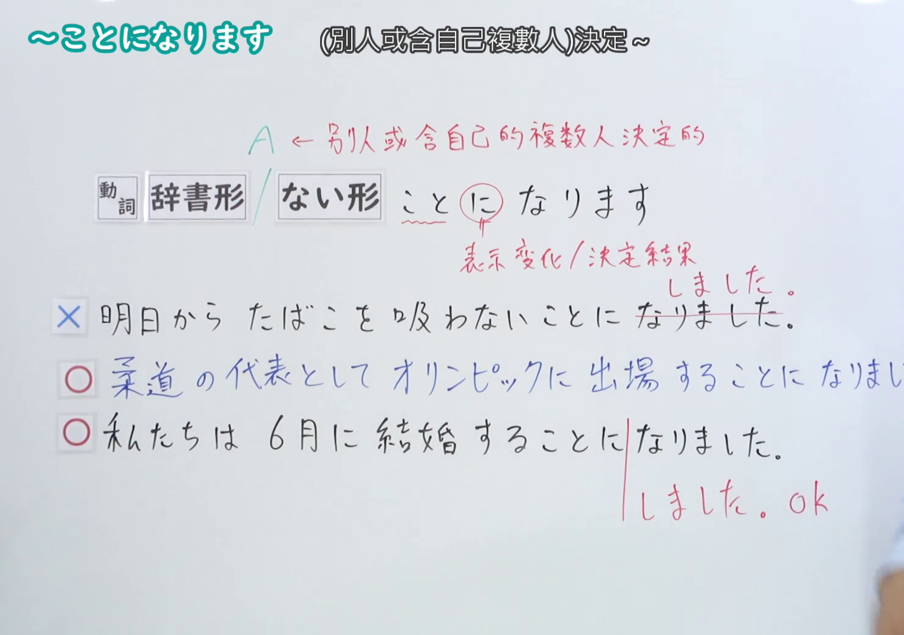
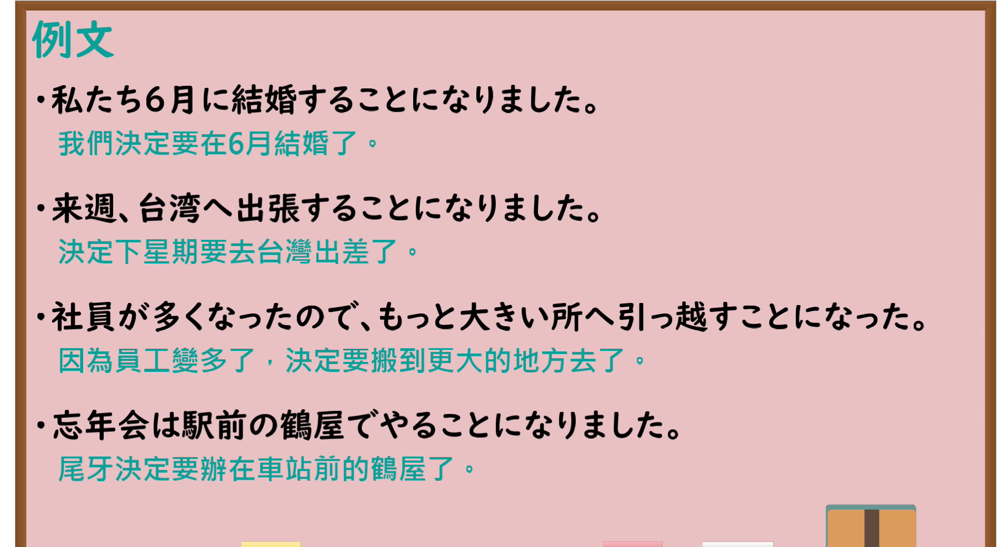

---
{
  "id": "N4-G-0019",
  "kind": "grammar",
  "level": "N4",
  "title": "～ことになります（决定……、定下……）",
  "card_revision": 1,
  "schema_version": 1,
  "source": {
    "lesson": "N4 第19个语法",
    "material": "出口日語原视频板书、Bilibili P19 音频的本地中文／日语混合转写 WebVTT与Hagoromo文型检索正文",
    "video": "https://www.youtube.com/watch?v=Wik5iTUZVP0",
    "screenshot": "assets/grammar/n4/N4-G-0019-connection.png",
    "screenshot_seconds": 306.0,
    "screenshot_crop": {
      "x": 0,
      "y": 0,
      "width": 1480,
      "height": 1040
    }
  },
  "tags": [
    "ことになる",
    "決定",
    "結果",
    "N4"
  ],
  "confusions": [
    "～ことにする",
    "～ようになっている"
  ]
}
---

# N4 第19个语法：～ことになります

# 视频学习资料整理

- 课程：[出口日語「～ことになります」](https://www.youtube.com/watch?v=Wik5iTUZVP0)
- 视频 ID：`Wik5iTUZVP0`
- 视频时长：6分48秒

## 接续图

- 实际时间：5分06.00秒（306.00秒）
- 原图尺寸：1920×1080
- 裁切区域：左上角 `(0, 0)` 至右下角 `(1480, 1040)`；00:01 画面尚未补充主语判定与对比例句；选用 05:06 画面，板书已完整书写「動詞 [辞書形/ない形] ことになります」「（個人或者自己複數人）決定~」「A←別人或含自己的複數人決定的」「表示変化／決定結果」、辨析不适用个人单独临时决定的「✕明日からたばこを吸わないことになりました」以及正确例句「○柔道の代表としてオリンピックに出場することになりました」「○私たちは6月に結婚することになりました」，老师让出板书区域。固定左上角 (0, 0)，裁切区域宽 1480、高 1040，去除右侧人物与边缘多余画面，充分保留底部全部例句板书。

## 例句图

- 实际时间：5分46.18秒（346.18秒）
- 原图尺寸：1920×1080
- 裁切区域：左上角 `(0, 0)` 至右下角 `(1900, 1040)`；提取自视频 05:46 处的例句黑板页面。固定左上角 (0, 0)，裁切区域宽 1900、高 1040，去除右侧与底部多余画面，完整保留全部四条例句及中文翻译。

# 核心

## 功能一：决定做 A（他人或团体决定结果）

**最上位意味カテゴリー：**

- **ことになる：** ものごとの様子（事物的状态与样貌）

**中位意味カテゴリー：**

- **ことになる：** 変化・不変化（变化与不变化）

**意味：**

- **ことになる：** 結末（结局与结果）

**くわしい意味記述：**

- **ことになる：** 何らかの事情で，そうなる」あるいは「論理的に考えると，そうなる」ということを表す。決定されたこと，規則や習慣，予定などを客観的に述べる時に使う。（表示“出于某种情况而变成那样”或“从逻辑上考虑就会变成那样”。用于客观陈述被决定的事情、规章制度、习惯、预定安排等。）

**派生語：** 未列出

### 例句

1. 来月から大阪の支店へ転勤することになりました。

   （已经决定从下个月起调动到大阪分店工作。）

2. この学校では、日本語以外の言葉を使ってはいけないことになっています。

   （在这所学校里，规定不可以讲日语以外的语言。）

3. 会議は来週の月曜日に開かれることになった。

   （会议决定在下周一举行。）

4. 今度の出張には、私も同行することになりました。

   （这次出差，也定由我一同前往。）

# 来源

- [出口日語原视频](https://www.youtube.com/watch?v=Wik5iTUZVP0)
- [Hagoromo 文型検索「ことになる」](https://hagoromo-text.work/lookup?vid=528)（查询日期：2026-09-25）
