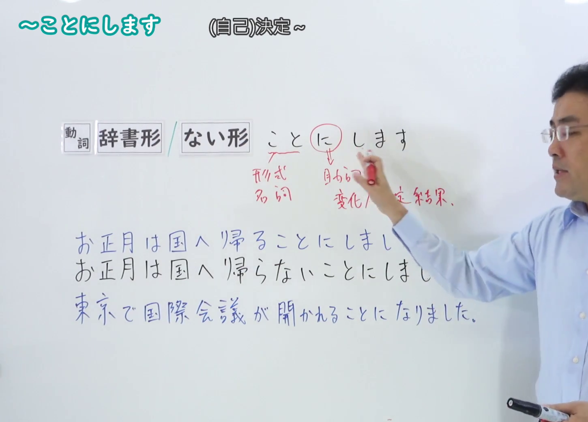
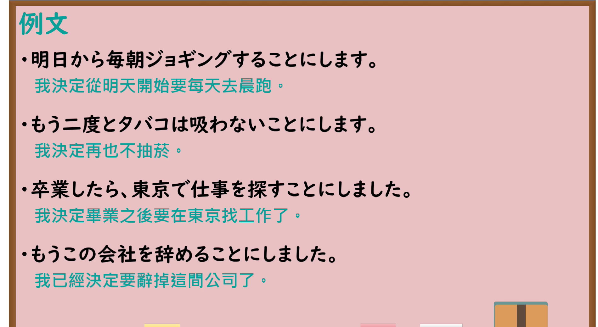

---
{
  "id": "N4-G-0020",
  "kind": "grammar",
  "level": "N4",
  "title": "～ことにします（决定……）",
  "card_revision": 1,
  "schema_version": 1,
  "source": {
    "lesson": "N4 第20个语法",
    "material": "出口日語原视频板书、YouTube 原 WebVTT（中文为主、日语为辅）与Hagoromo文型检索正文",
    "video": "https://www.youtube.com/watch?v=p_yGzIue5Eg",
    "screenshot": "assets/grammar/n4/N4-G-0020-connection.png",
    "screenshot_seconds": 60.0,
    "screenshot_crop": {
      "x": 0,
      "y": 0,
      "width": 1450,
      "height": 1040
    }
  },
  "tags": [
    "ことにする",
    "決定",
    "意志",
    "N4"
  ],
  "confusions": [
    "～ことになる",
    "～ようとする"
  ]
}
---

# N4 第20个语法：～ことにします

# 视频学习资料整理

- 课程：[出口日語「～ことにします」](https://www.youtube.com/watch?v=p_yGzIue5Eg)
- 视频 ID：`p_yGzIue5Eg`
- 视频时长：4分28秒

## 接续图

- 实际时间：1分00.00秒（60.00秒）
- 原图尺寸：1920×1080
- 裁切区域：左上角 `(0, 0)` 至右下角 `(1450, 1040)`；00:01 画面尚未补充语法词性标注与「〜ことになります」对比；选用 01:00 画面，板书已完整书写「動詞 [辞書形/ない形] ことにします」「（自己）決定~」、「こと（形式名詞）」「に（助詞：変化／決定結果）」、自身主动决定的肯定与否定对比例句「お正月は国へ帰ることにしました／お正月は国へ帰らないことにしました」以及与客观决定的对比「東京で国際会議が開かれることになりました（〜ことになります）」，老师让出板书区域。固定左上角 (0, 0)，裁切区域宽 1450、高 1040，去除右侧人物与边缘多余画面，充分保留底部全部例句板书。

## 例句图

- 实际时间：3分20.33秒（200.33秒）
- 原图尺寸：1920×1080
- 裁切区域：左上角 `(0, 0)` 至右下角 `(1900, 1040)`；提取自视频 03:20 处的例句黑板页面。固定左上角 (0, 0)，裁切区域宽 1900、高 1040，去除右侧与底部多余画面，完整保留全部四条例句及中文翻译。

# 核心

## 功能一：决定做 A（自己主动决定）

**最上位意味カテゴリー：**

- **ことにする：** 考え・感情（想法与感情）

**中位意味カテゴリー：**

- **ことにする：** 意志（意志）

**意味：**

- **ことにする：** 決定（决定）

**くわしい意味記述：**

- **ことにする：** 「〜することを決める」の意味。これからある行為を行うことを表す。「〜することにしている」の形で，自分が決めた習慣を表す。（表示“决定做某事”之意。表示今后将要进行某种行为。以“〜することにしている”的形式表示自己定下的习惯。）

**派生語：** 未列出

### 例句

1. いろいろ考えましたが、会社を辞めることにしました。

   （经过深思熟虑，我决定辞职。）

2. 健康のために、毎朝ジョギングすることにしています。

   （为了健康，我每天早晨都坚持慢跑。）

3. 今年はタバコをやめることにしました。

   （我决定今年把烟戒掉。）

4. 車の運転は危ないので、電車で行くことにします。

   （开车很危险，所以我决定坐电车去。）

# 来源

- [出口日語原视频](https://www.youtube.com/watch?v=p_yGzIue5Eg)
- [Hagoromo 文型検索「ことにする」](https://hagoromo-text.work/lookup?vid=525)（查询日期：2026-09-25）
