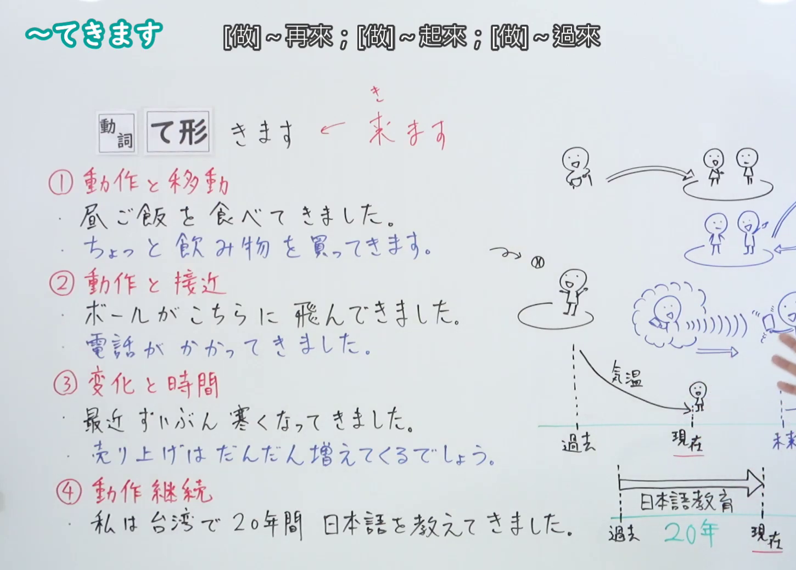
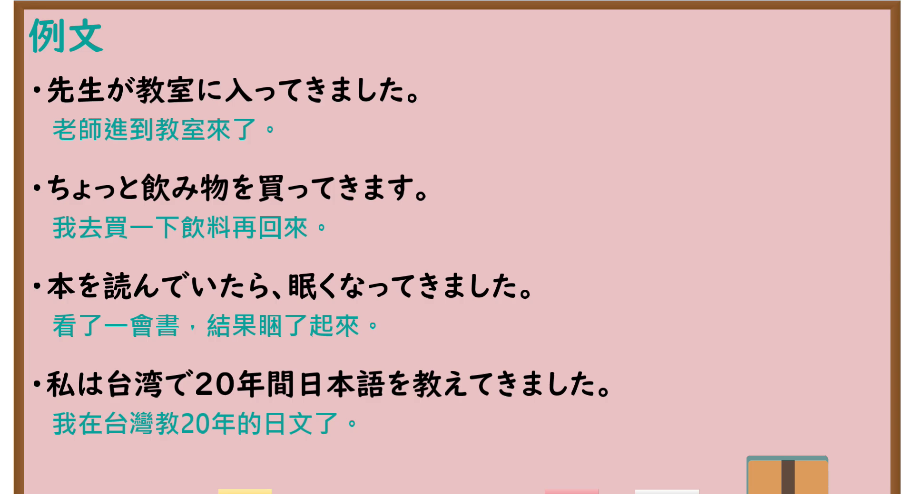

---
{
  "id": "N4-G-0021",
  "kind": "grammar",
  "level": "N4",
  "title": "～てきます（做……后来、……起来）",
  "card_revision": 1,
  "schema_version": 1,
  "source": {
    "lesson": "N4 第21个语法",
    "material": "出口日語原视频板书、YouTube 原 WebVTT（中文为主、日语为辅）与Hagoromo文型检索正文",
    "video": "https://www.youtube.com/watch?v=Xe33cRtFyr0",
    "screenshot": "assets/grammar/n4/N4-G-0021-connection.png",
    "screenshot_seconds": 273.75,
    "screenshot_crop": {
      "x": 0,
      "y": 0,
      "width": 1450,
      "height": 1040
    }
  },
  "tags": [
    "てくる",
    "てきます",
    "移動",
    "変化",
    "継続",
    "N4"
  ],
  "confusions": [
    "～ていきます",
    "～て帰る"
  ]
}
---

# N4 第21个语法：～てきます

# 视频学习资料整理

- 课程：[出口日語「～てきます」](https://www.youtube.com/watch?v=Xe33cRtFyr0)
- 视频 ID：`Xe33cRtFyr0`
- 视频时长：6分05秒

## 接续图

- 实际时间：4分33.75秒（273.75秒）
- 原图尺寸：1920×1080
- 裁切区域：左上角 `(0, 0)` 至右下角 `(1450, 1040)`；00:01 画面尚未展开四大分类板书；选用 04:33 画面，板书已完整书写「動詞て形＋きます」的四大核心用法：①「動作＋移動（去買~來；去拿~來；去做了某事後回來）」、②「動作向自己靠近（由遠及近）」、③「時間狀態變化（從過去到現在逐漸改變、顯現）」、④「動作持續（從過去某時點一直持續進行到現在）」，老师让出板书区域。固定左上角 (0, 0)，裁切区域宽 1450、高 1040，去除右侧人物与边缘多余画面，充分保留底部全部板书，高度充足不缺失内容。

## 例句图

- 实际时间：5分02.95秒（302.95秒）
- 原图尺寸：1920×1080
- 裁切区域：左上角 `(0, 0)` 至右下角 `(1900, 1040)`；提取自视频 05:02 处的例句黑板页面。固定左上角 (0, 0)，裁切区域宽 1900、高 1040，去除右侧与底部多余画面，完整保留对应四大用法的全部四条例句及中文翻译，确保底部第四条例句完整呈现。

# 核心

## 功能一：動作＋移動（去做了某事後回來）

**最上位意味カテゴリー：**

- **Vてくる：** 場所・時間（场所与时间）

**中位意味カテゴリー：**

- **Vてくる：** 時間的前後（时间的前后）

**意味：**

- **Vてくる：** 継起（後）（相继发生（后））

**くわしい意味記述：**

- **Vてくる：** ある行為をした後で、元の場所に戻る・来ることを表す。（表示在某个地方进行了某种行为之后，回到原来的场所或来到眼前。）

**派生語：** 未列出

### 例句

1. ちょっと飲み物を買ってきます。

   （我去买点饮料就回来。）

2. 昼ごはんを外で食べてきました。

   （我去外面吃过午饭回来了。）

3. 郵便局へ行って切手を買ってきます。

   （我去趟邮局买邮票就回来。）

## 功能二：空間移動由遠及近（朝說話人方向靠近過來）

**最上位意味カテゴリー：**

- **Vてくる：** 場所・時間（场所与时间）

**中位意味カテゴリー：**

- **Vてくる：** 移動（移动）

**意味：**

- **Vてくる：** 接近・到来（靠近与到来）

**くわしい意味記述：**

- **Vてくる：** 動作や移動が、話し手のいる場所・視点に向かって近づいてくることを表す。（表示动作或物体朝向说话人所在的场所或视点靠近过来。）

**派生語：** 未列出

### 例句

1. 先生が教室に入ってきました。

   （老师走进了教室来。）

2. ボールがこちらに飛んできました。

   （球朝我们这边飞了过来。）

3. 向こうから黒い車が走ってきました。

   （一辆黑色的汽车从对面驶了过来。）

## 功能三：時間狀態變化（從過去到現在逐漸發展、顯現出來）

**最上位意味カテゴリー：**

- **Vてくる：** ものごとの様子（事物的状态与样貌）

**中位意味カテゴリー：**

- **Vてくる：** 変化・不変化（变化与不变化）

**意味：**

- **Vてくる：** 変化（变化）

**くわしい意味記述：**

- **Vてくる：** 過去のある時点から現在に向かって、状態が次第に変わってきたり、表面に現れてきたりすることを表す。（表示从过去的某一时间点向着现在，状态逐渐发生变化或显现出来。）

**派生語：** 未列出

### 例句

1. 本を読んでいたら眠くなってきました。

   （读着书，不知不觉就困起来了。）

2. 最近ずいぶん寒くなってきました。

   （最近变得相当冷起来了。）

3. だいぶ日本語が上手になってきましたね。

   （日语渐渐变得熟练起来了呢。）

## 功能四：動作持續（從過去某時點一直持續進行到現在）

**最上位意味カテゴリー：**

- **Vてくる：** 時間・アスペクト（时间与体貌）

**中位意味カテゴリー：**

- **Vてくる：** 継続（持续）

**意味：**

- **Vてくる：** 継続（持续）

**くわしい意味記述：**

- **Vてくる：** 過去のある時点から現在に至るまで、ある動作や行為をずっと途切れることなく続けてきたことを表す。（表示从过去的某一时间点直到现在，某种动作或行为一直持续进行着。）

**派生語：** 未列出

### 例句

1. 私は台湾で20年間日本語を教えてきました。

   （我在台湾持续教了20年的日语。）

2. 日本に来てから、ずっとこの会社で働いてきました。

   （来到日本之后，我一直在这家公司工作到现在。）

3. 子どもの頃からずっとピアノを練習してきました。

   （从孩提时代起，我就一直练习钢琴到现在。）

# 来源

- [出口日語原视频](https://www.youtube.com/watch?v=Xe33cRtFyr0)
- [Hagoromo 文型検索「Vてくる（継起）」](https://hagoromo-text.work/lookup?vid=171)（查询日期：2026-09-25）
- [Hagoromo 文型検索「Vてくる（変化）」](https://hagoromo-text.work/lookup?vid=172)（查询日期：2026-09-25）
- [Hagoromo 文型検索「Vてくる（継続）」](https://hagoromo-text.work/lookup?vid=815)（查询日期：2026-09-25）
