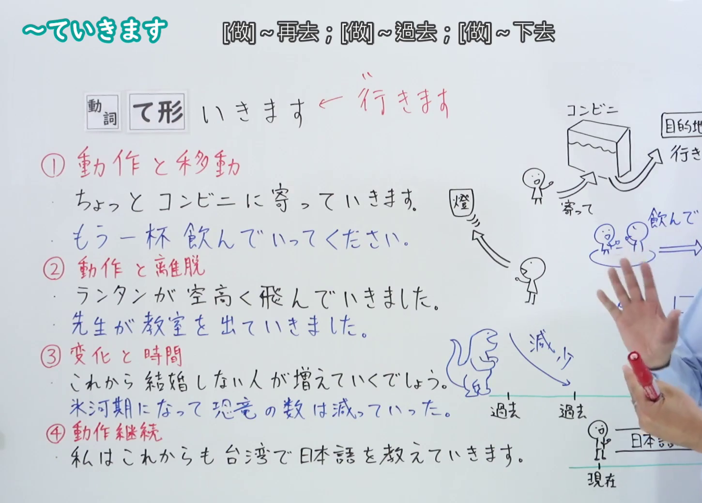
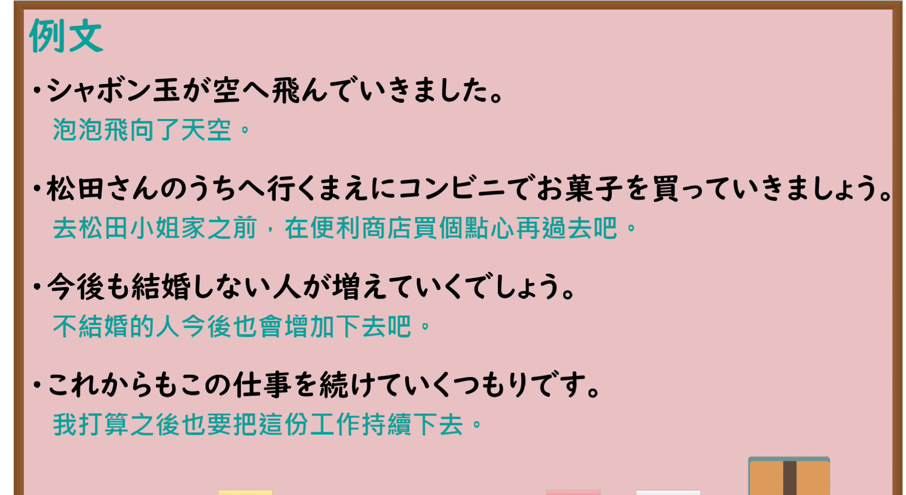

---
{
  "id": "N4-G-0022",
  "kind": "grammar",
  "level": "N4",
  "title": "～ていきます（做……后去、……下去）",
  "card_revision": 1,
  "schema_version": 1,
  "source": {
    "lesson": "N4 第22个语法",
    "material": "出口日語原视频板书、YouTube 原 WebVTT（中文为主、日语为辅）与Hagoromo文型检索正文",
    "video": "https://www.youtube.com/watch?v=e1JQgWC0SsM",
    "screenshot": "assets/grammar/n4/N4-G-0022-connection.png",
    "screenshot_seconds": 400.8,
    "screenshot_crop": {
      "x": 0,
      "y": 0,
      "width": 1450,
      "height": 1040
    }
  },
  "tags": [
    "ていく",
    "ていきます",
    "移動",
    "変化",
    "継続",
    "N4"
  ],
  "confusions": [
    "～てきます",
    "～ていく（消滅）"
  ]
}
---

# N4 第22个语法：～ていきます

# 视频学习资料整理

- 课程：[出口日語「～ていきます」](https://www.youtube.com/watch?v=e1JQgWC0SsM)
- 视频 ID：`e1JQgWC0SsM`
- 视频时长：8分21秒

## 接续图

- 实际时间：6分40.80秒（400.80秒）
- 原图尺寸：1920×1080
- 裁切区域：左上角 `(0, 0)` 至右下角 `(1450, 1040)`；00:01 画面尚未补充四大分类板书；选用 06:40 画面，板书已完整书写「動詞て形＋いきます」的四大核心用法：①「動作＋移動（去做了某事後再去別處／離開）」、②「動作遠離自己（由近及遠）」、③「時間狀態變化（從現在面向未來逐漸發展變化）」、④「動作持續（從現在面向未來一直持續做下去）」，老师让出板书区域。固定左上角 (0, 0)，裁切区域宽 1450、高 1040，去除右侧人物与边缘多余画面，充分保留底部全部板书。

## 例句图

- 实际时间：7分05.14秒（425.14秒）
- 原图尺寸：1920×1080
- 裁切区域：左上角 `(0, 0)` 至右下角 `(1900, 1040)`；提取自视频 07:05 处的例句黑板页面。固定左上角 (0, 0)，裁切区域宽 1900、高 1040，去除右侧与底部多余画面，完整保留对应四大用法的全部四条例句及中文翻译。

# 核心

## 功能一：動作＋移動（做完動作後去往別處／離開）

**最上位意味カテゴリー：**

- **Vていく：** 場所・時間（场所与时间）

**中位意味カテゴリー：**

- **Vていく：** 移動（移动）

**意味：**

- **Vていく：** 継起・移動（相继发生与移动）

**くわしい意味記述：**

- **Vていく：** 話し手のいる場所である行為をした後で、どこか別の場所へ行くことを表す。（表示在说话人所在的场所进行了某种行为之后，去往其他别的地方。）

**派生語：** 未列出

### 例句

1. 松田さんの家へ行く前にコンビニでお菓子を買っていきましょう。

   （去松田家之前，先去便利店买点点心带过去吧。）

2. ちょっとコンビニに寄って行きます。

   （顺便去一下便利店再去。）

3. 喉が渇いたので、お茶を飲んで行きます。

   （嗓子渴了，我喝杯茶再去。）

## 功能二：空間移動由近及遠（遠離說話人而去）

**最上位意味カテゴリー：**

- **Vていく：** 場所・時間（场所与时间）

**中位意味カテゴリー：**

- **Vていく：** 移動（移动）

**意味：**

- **Vていく：** 離脱・遠去（离开与远去）

**くわしい意味記述：**

- **Vていく：** 動作や移動が、話し手のいる場所・視点から離れて遠くへ向かっていくことを表す。（表示动作或物体从说话人所在的场所或视点离开，朝着远处去。）

**派生語：** 未列出

### 例句

1. シャボン玉が空へ飛んでいきました。

   （肥皂泡泡向着天空飞远了。）

2. 先生が教室を出て行きました。

   （老师走出了教室去。）

3. 鳥の群れが南の空へ飛んでいきました。

   （鸟群向着南方的天空飞去了。）

## 功能三：時間狀態變化（從現在面向未來逐漸發展變化）

**最上位意味カテゴリー：**

- **Vていく：** ものごとの様子（事物的状态与样貌）

**中位意味カテゴリー：**

- **Vていく：** 変化・不変化（变化与不变化）

**意味：**

- **Vていく：** 変化（变化）

**くわしい意味記述：**

- **Vていく：** 現在（または基準となる時点）から未来に向かって、状態がだんだんと変化し続けることを表す。（表示从现在或基准时间点向着未来，状态逐渐持续发生变化。）

**派生語：** 未列出

### 例句

1. 今後も結婚しない人が増えていくでしょう。

   （今后不结婚的人大概也会继续增加下去吧。）

2. これからもっと寒くなっていくでしょう。

   （今后天气大概会越来越冷下去吧。）

3. 氷河期になって、恐竜の数は減っていきました。

   （进入冰河期后，恐龙的数量逐渐减少下去了。）

## 功能四：動作持續（從現在面向未來一直持續做下去）

**最上位意味カテゴリー：**

- **Vていく：** 時間・アスペクト（时间与体貌）

**中位意味カテゴリー：**

- **Vていく：** 継続（持续）

**意味：**

- **Vていく：** 継続（持续）

**くわしい意味記述：**

- **Vていく：** 現在から未来に向かって、ある動作や行為をこれからも続けて行うことを表す。（表示从现在面向未来，今后也将继续进行某种动作或行为。）

**派生語：** 未列出

### 例句

1. これからもこの仕事を続けていくつもりです。

   （今后我也打算把这份工作继续做下去。）

2. 私はこれからも台湾で日本語を教えていきます。

   （我今后也打算在台湾继续教日语下去。）

3. 大学を卒業した後も、研究を続けていくつもりです。

   （大学毕业之后，我也打算把研究继续做下去。）

# 来源

- [出口日語原视频](https://www.youtube.com/watch?v=e1JQgWC0SsM)
- [Hagoromo 文型検索「Vていく（継続・移動）」](https://hagoromo-text.work/lookup?vid=156)（查询日期：2026-09-25）
- [Hagoromo 文型検索「Vていく（変化）」](https://hagoromo-text.work/lookup?vid=157)（查询日期：2026-09-25）
- [Hagoromo 文型検索「Vていく（継続）」](https://hagoromo-text.work/lookup?vid=795)（查询日期：2026-09-25）
