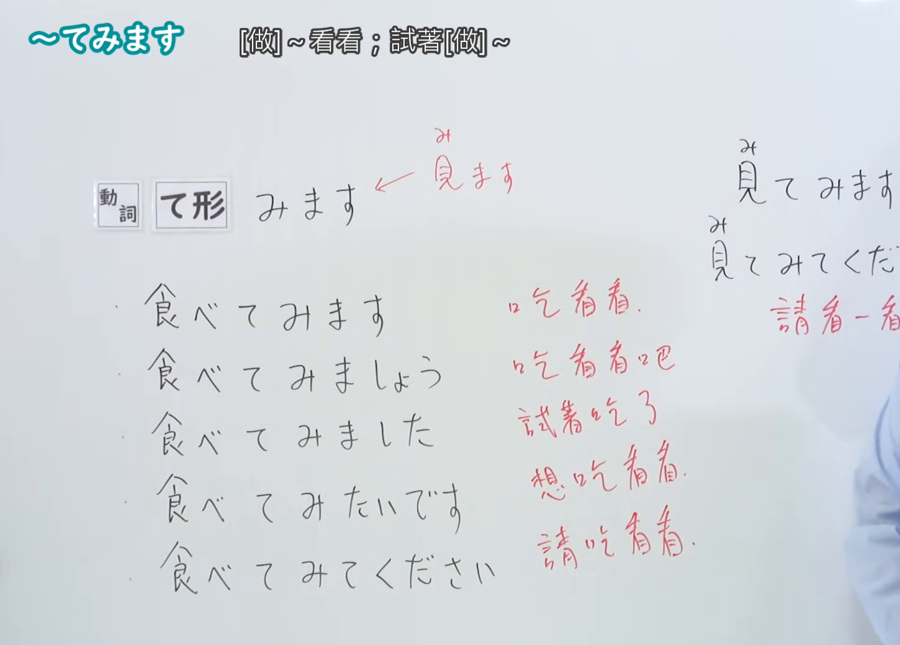
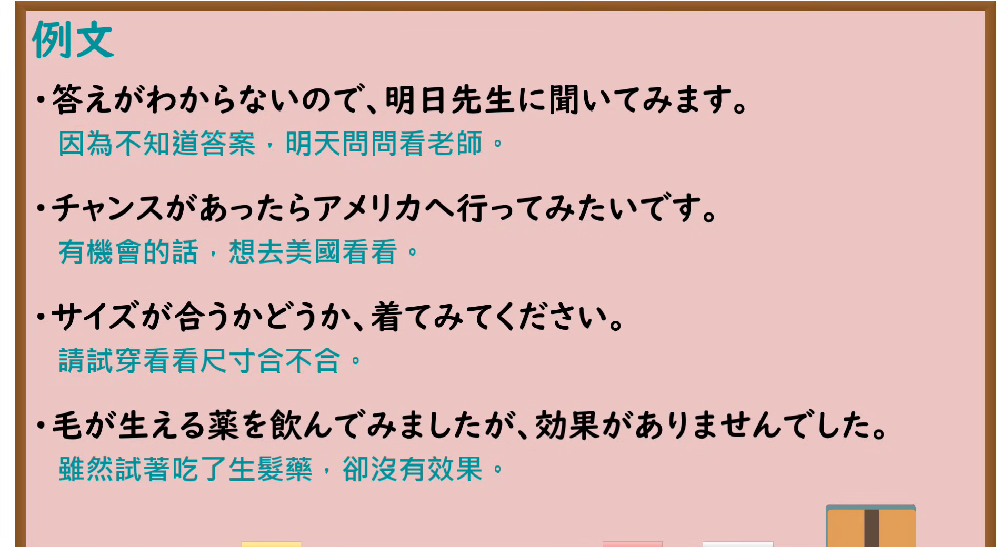

---
{
  "id": "N4-G-0023",
  "kind": "grammar",
  "level": "N4",
  "title": "～てみます（试着做……）",
  "card_revision": 1,
  "schema_version": 1,
  "source": {
    "lesson": "N4 第23个语法",
    "material": "出口日語原视频板书、YouTube 原 WebVTT（中文为主、日语为辅）与Hagoromo文型检索正文",
    "video": "https://www.youtube.com/watch?v=GLy5nScVsvk",
    "screenshot": "assets/grammar/n4/N4-G-0023-connection.png",
    "screenshot_seconds": 211.0,
    "screenshot_crop": {
      "x": 0,
      "y": 0,
      "width": 1450,
      "height": 1040
    }
  },
  "tags": [
    "てみる",
    "てみます",
    "試み",
    "N4"
  ],
  "confusions": [
    "～てみる（視覚）",
    "～てみせる"
  ]
}
---

# N4 第23个语法：～てみます

# 视频学习资料整理

- 课程：[出口日語「～てみます」](https://www.youtube.com/watch?v=GLy5nScVsvk)
- 视频 ID：`GLy5nScVsvk`
- 视频时长：5分05秒

## 接续图

- 实际时间：3分31.00秒（211.00秒）
- 原图尺寸：1920×1080
- 裁切区域：左上角 `(0, 0)` 至右下角 `(1450, 1040)`；选用 03:31 画面（镜头拉近之前），黑板最上方完整保留「【Ｎ４文法】～てみます」醒目标题；板书已完整书写「動詞て形＋みます」「試著做做看~」「日本の納豆を食べてみます／この服を着てみます」「意志動詞に接続」、强调不确定结果而亲自尝试，老师让出板书区域。固定左上角 (0, 0)，裁切区域宽 1450、高 1040，去除右侧人物与边缘多余画面，充分保留顶部标题与底部例词注解，绝无内容缺失。

## 例句图

- 实际时间：4分03.00秒（243.00秒）
- 原图尺寸：1920×1080
- 裁切区域：左上角 `(0, 0)` 至右下角 `(1900, 1040)`；提取自视频 04:03 处的例句黑板页面。底色为粉灰色课程幻灯片，固定左上角 (0, 0)，裁切区域宽 1900、高 1040，去除右侧与底部多余画面，完整保留四条核心例句及中文翻译，确保底部第四条例句完整呈现。

# 核心

## 功能一：试着做 A（尝试与探索）

**最上位意味カテゴリー：**

- **Vてみる：** 行為・出来事（行为与事件）

**中位意味カテゴリー：**

- **Vてみる：** 経験・試み（经验与尝试）

**意味：**

- **Vてみる：** 試み（尝试）

**くわしい意味記述：**

- **Vてみる：** 何かを知るために，試しにすることを表す。意志動詞につく。（表示为了了解某种情况而尝试去做某事。接在意志动词后。）

**派生語：** 未列出

### 例句

1. 答えがわからないので明日先生に聞いてみます。

   （因为不知道答案，明天我试着问问老师。）

2. チャンスがあったらアメリカへ行ってみたいです。

   （如果有机会的话，我想去美国看看。）

3. サイズが合うかどうか着てみてください。

   （不知道尺码合不合适，请试穿一下看看。）

4. 毛が生える薬を飲んでみましたが効果がありませんでした。

   （虽然试着吃了生发药，但并没有效果。）

# 来源

- [出口日語原视频](https://www.youtube.com/watch?v=GLy5nScVsvk)
- [Hagoromo 文型検索「Vてみる」](https://hagoromo-text.work/lookup?vid=175)（查询日期：2026-09-25）
