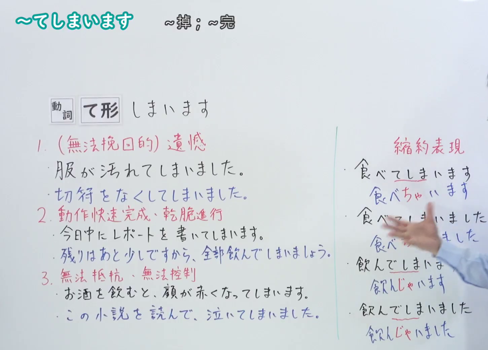
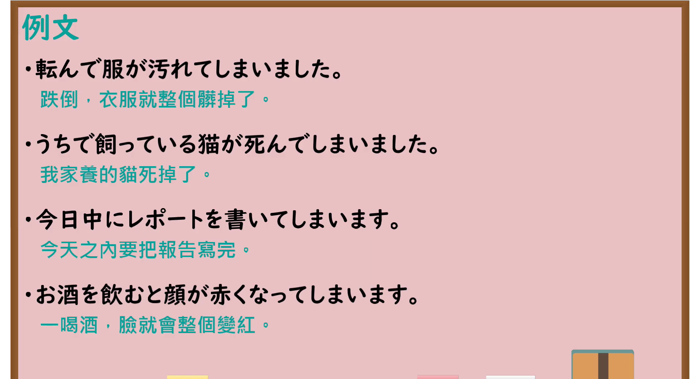

---
{
  "id": "N4-G-0024",
  "kind": "grammar",
  "level": "N4",
  "title": "～てしまいます（……完了、不小心……了）",
  "card_revision": 1,
  "schema_version": 1,
  "source": {
    "lesson": "N4 第24个语法",
    "material": "出口日語原视频板书、YouTube 原 WebVTT（中文为主、日语为辅）与Hagoromo文型检索正文",
    "video": "https://www.youtube.com/watch?v=3qtvW1TxZ7I",
    "screenshot": "assets/grammar/n4/N4-G-0024-connection.png",
    "screenshot_seconds": 366.4,
    "screenshot_crop": {
      "x": 0,
      "y": 0,
      "width": 1450,
      "height": 1040
    }
  },
  "tags": [
    "てしまう",
    "てしまいます",
    "遺憾",
    "完了",
    "自発",
    "N4"
  ],
  "confusions": [
    "～ちゃう",
    "～ておく"
  ]
}
---

# N4 第24个语法：～てしまいます

# 视频学习资料整理

- 课程：[出口日語「～te shimaimasu」](https://www.youtube.com/watch?v=3qtvW1TxZ7I)
- 视频 ID：`3qtvW1TxZ7I`
- 视频时长：7分38秒

## 接续图

- 实际时间：6分06.40秒（366.40秒）
- 原图尺寸：1920×1080
- 裁切区域：左上角 `(0, 0)` 至右下角 `(1450, 1040)`；00:01 画面尚未补充三大用法细分与口语缩约；选用 06:06 画面，板书已完整书写「動詞て形＋しまいます」的三大核心用法：①「遺憾・後悔（事情一旦發生無法挽回）」、②「動作完了・全部完成（徹底做完）」、③「無法控制的自發動作・生理反應（難以用意志控制）」，以及口语缩约「～ちゃう／～じゃう」，老师侧身让出板书区域。固定左上角 (0, 0)，裁切区域宽 1450、高 1040，去除右侧人物与边缘多余画面，充分保留底部全部板书。

## 例句图

- 实际时间：6分33.88秒（393.88秒）
- 原图尺寸：1920×1080
- 裁切区域：左上角 `(0, 0)` 至右下角 `(1900, 1040)`；提取自视频 06:33 处的例句黑板页面。固定左上角 (0, 0)，裁切区域宽 1900、高 1040，去除右侧与底部多余画面，完整保留对应三大用法的全部四条例句及中文翻译。

# 核心

## 功能一：遺憾・後悔（事情一旦發生無法挽回的遺憾懊惱）

**最上位意味カテゴリー：**

- **Vてしまう：** 行為・出来事（行为与事件）

**中位意味カテゴリー：**

- **Vてしまう：** 終了（结束）

**意味：**

- **Vてしまう：** 遺憾・後悔（遗憾与后悔）

**くわしい意味記述：**

- **Vてしまう：** 予期しない望ましくない事態が起こってしまい、元の状態に戻せず残念・後悔する気持ちを表す。（表示发生了出乎意料的不良事态，无法恢复原状而感到遗憾、懊恼的心情。）

**派生語：** 未列出

### 例句

1. 服が汚れてしまいました。

   （衣服弄脏了。）

2. 切符をなくしてしまいました。

   （我不小心把车票弄丢了。）

3. 家で飼っている猫が死んでしまいました。

   （家里养的猫死掉了。）

## 功能二：動作完了・全部完成（徹底做完、全部完成）

**最上位意味カテゴリー：**

- **Vてしまう：** 行為・出来事（行为与事件）

**中位意味カテゴリー：**

- **Vてしまう：** 終了（结束）

**意味：**

- **Vてしまう：** 完了（完成）

**くわしい意味記述：**

- **Vてしまう：** ある動作や行為を全て、完全にやり終えたことを強調して表す。特定の期限までに完了させる意志を表すこともある。（用于强调某种动作或行为全部、彻底完成。亦用于表示在特定期限前完成某事的意志。）

**派生語：** 未列出

### 例句

1. 今日中にレポートを書いてしまいます。

   （我今天之内要把报告全部写完。）

2. 残りは少しですから、全部飲んでしまいましょう。

   （只剩一点点了，我们把它全部喝光吧。）

3. その本は面白かったので、一日で全部読んでしまいました。

   （那本书很有趣，我一天之内就全部读完了。）

## 功能三：無法控制的自發動作・生理反應（難以用意志控制的生理反應或情感迸發）

**最上位意味カテゴリー：**

- **Vてしまう：** 行為・出来事（行为与事件）

**中位意味カテゴリー：**

- **Vてしまう：** 心理・生理（心理与生理）

**意味：**

- **Vてしまう：** 無意志・自発（无意志与自发反应）

**くわしい意味記述：**

- **Vてしまう：** 人の意志では制御できない自然な生理現象や、抑えきれない感情が自然と現れてしまうことを表す。（表示人的意志无法控制的自然生理现象，或难以克制的情感自然而然地显露出来。）

**派生語：** 未列出

### 例句

1. お酒を飲むと顔が赤くなってしまいます。

   （一喝酒脸就会变红。）

2. この小説を読んで泣いてしまいました。

   （读了这部小说，我不由得哭了出来。）

3. 悲しい映画を見て、涙が出てしまいました。

   （看了悲伤的电影，眼泪不由自主地流了出来。）

# 来源

- [出口日語原视频](https://www.youtube.com/watch?v=3qtvW1TxZ7I)
- [Hagoromo 文型検索「Vてしまう」](https://hagoromo-text.work/lookup?vid=824)（查询日期：2026-09-25）
- [Hagoromo 文型検索「Vちゃう」](https://hagoromo-text.work/lookup?vid=760)（查询日期：2026-09-25）
