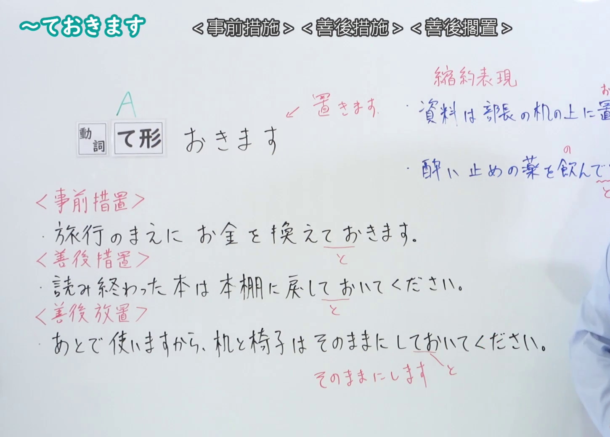
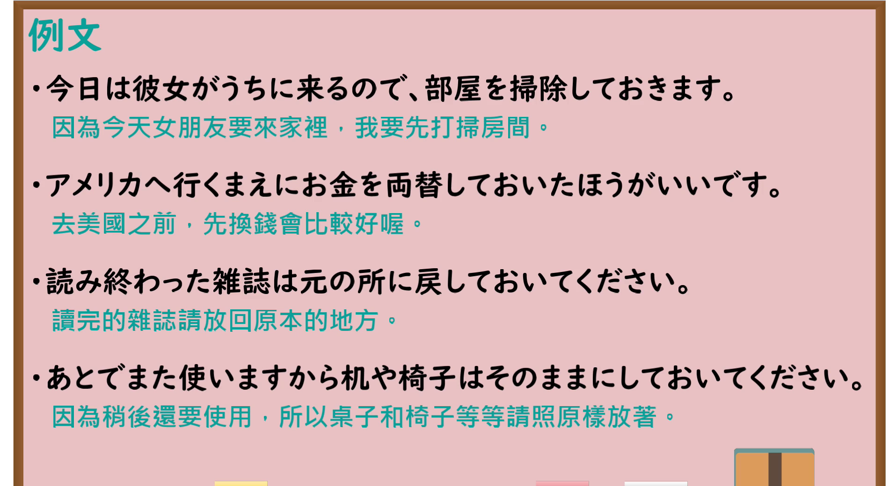

---
{
  "id": "N4-G-0025",
  "kind": "grammar",
  "level": "N4",
  "title": "～ておきます（预先做……、保持原状）",
  "card_revision": 1,
  "schema_version": 1,
  "source": {
    "lesson": "N4 第25个语法",
    "material": "出口日語原视频板书、YouTube 原 WebVTT（中文为主、日语为辅）与Hagoromo文型检索正文",
    "video": "https://www.youtube.com/watch?v=AqRldCAg15U",
    "screenshot": "assets/grammar/n4/N4-G-0025-connection.png",
    "screenshot_seconds": 363.2,
    "screenshot_crop": {
      "x": 0,
      "y": 0,
      "width": 1450,
      "height": 1040
    }
  },
  "tags": [
    "ておく",
    "ておきます",
    "準備",
    "放置",
    "N4"
  ],
  "confusions": [
    "～とく",
    "～てある"
  ]
}
---

# N4 第25个语法：～ておきます

# 视频学习资料整理

- 课程：[出口日語「～ておきます」](https://www.youtube.com/watch?v=AqRldCAg15U)
- 视频 ID：`AqRldCAg15U`
- 视频时长：7分34秒

## 接续图

- 实际时间：6分03.20秒（363.20秒）
- 原图尺寸：1920×1080
- 裁切区域：左上角 `(0, 0)` 至右下角 `(1450, 1040)`；00:01 画面尚未补充准备与放置原状双重用法及口语缩约；选用 06:03 画面，板书已完整书写「動詞て形＋おきます」「事前に準備する（準備）／次のためにそのままにしておく（放置）」「旅行の前にホテルの予約をしておきます／窓を開けておきます」以及口语缩约形「～とく／～どく」，老师让出板书区域。固定左上角 (0, 0)，裁切区域宽 1450、高 1040，去除右侧人物与边缘多余画面，充分保留底部全部板书。

## 例句图

- 实际时间：6分30.44秒（390.44秒）
- 原图尺寸：1920×1080
- 裁切区域：左上角 `(0, 0)` 至右下角 `(1900, 1040)`；提取自视频 06:30 处的例句黑板页面。固定左上角 (0, 0)，裁切区域宽 1900、高 1040，去除右侧与底部多余画面，完整保留全部四条例句及中文翻译。

# 核心

## 功能一：预先做 A；保持原状

**最上位意味カテゴリー：**

- **Vておく：** 行為・出来事（行为与事件）

**中位意味カテゴリー：**

- **Vておく：** 準備（准备）

**意味：**

- **Vておく：** 準備（准备）

**くわしい意味記述：**

- **Vておく：** 何かの目的のために，その準備としてある行為をすることを表す。また，次の時のためにそのままの状態を維持することを表す。（表示为了某种目的，作为其准备而进行某种行为。亦表示为了下一次使用而维持现有的状态。）

**派生語：** 未列出

### 例句

1. 旅行の前に、電车的切符を買っておきます。

   （旅行前，预先买好电车车票。）

2. この言葉は試験によく出ますから、覚えておいてください。

   （这个词考试经常出现，请预先记住。）

3. 来週の会議のために、資料をコピーしておきました。

   （为了下周的会议，我已经预先复印好了资料。）

4. 部屋が暑いので、窓を開けておきましょう。

   （房间太热了，把窗户保持开着吧。）

# 来源

- [出口日語原视频](https://www.youtube.com/watch?v=AqRldCAg15U)
- [Hagoromo 文型検索「Vておく」](https://hagoromo-text.work/lookup?vid=167)（查询日期：2026-09-25）
