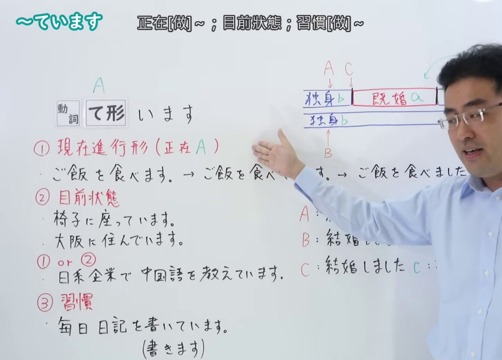
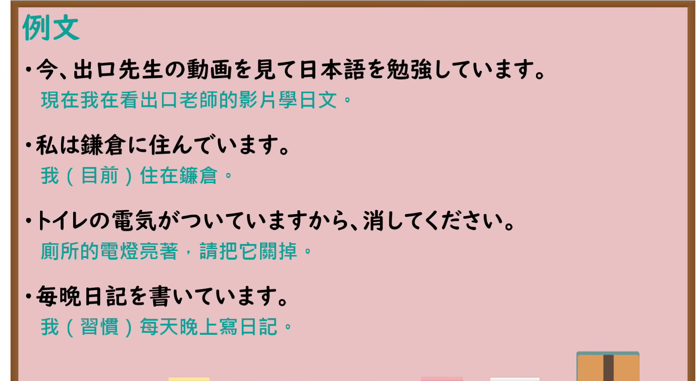

---
{
  "id": "N4-G-0026",
  "kind": "grammar",
  "level": "N4",
  "title": "～ています（正在……、处于……状态）",
  "card_revision": 1,
  "schema_version": 1,
  "source": {
    "lesson": "N4 第26个语法",
    "material": "出口日語原视频板书、YouTube 原 WebVTT（中文为主、日语为辅）与Hagoromo文型检索正文",
    "video": "https://www.youtube.com/watch?v=5jIWEFO7mvo",
    "screenshot": "assets/grammar/n4/N4-G-0026-connection.png",
    "screenshot_seconds": 458.4,
    "screenshot_crop": {
      "x": 0,
      "y": 0,
      "width": 1450,
      "height": 1040
    }
  },
  "tags": [
    "ている",
    "ています",
    "進行",
    "結果状態",
    "N4"
  ],
  "confusions": [
    "～てある",
    "～つつある"
  ]
}
---

# N4 第26个语法：～ています

# 视频学习资料整理

- 课程：[出口日語「～ています」](https://www.youtube.com/watch?v=5jIWEFO7mvo)
- 视频 ID：`5jIWEFO7mvo`
- 视频时长：9分33秒

## 接续图

- 实际时间：7分38.40秒（458.40秒）
- 原图尺寸：1920×1080
- 裁切区域：左上角 `(0, 0)` 至右下角 `(1450, 1040)`；00:01 画面尚未补充动作进行与结果状态存续的动词分类板书；选用 07:38 画面，板书已完整书写「動詞て形＋います」「動作の進行／結果の状態の継続／習慣」「今テレビを見ています／田中さんは結婚しています／毎日ジョギングしています」以及持续动词与瞬间动词的对比辨析，老师让出板书区域。固定左上角 (0, 0)，裁切区域宽 1450、高 1040，去除右侧人物与边缘多余画面，充分保留底部全部例句板书。

## 例句图

- 实际时间：8分29.97秒（509.97秒）
- 原图尺寸：1920×1080
- 裁切区域：左上角 `(0, 0)` 至右下角 `(1900, 1040)`；提取自视频 08:29 处的例句黑板页面。固定左上角 (0, 0)，裁切区域宽 1900、高 1040，去除右侧与底部多余画面，完整保留全部四条例句及中文翻译。

# 核心

## 功能一：正在做 A；处于 A 的状态

**最上位意味カテゴリー：**

- **Vている：** 時間・アスペクト（时间与体貌）
- **Vている：** 時間・アスペクト（时间与体貌）

**中位意味カテゴリー：**

- **Vている：** 継続（持续）
- **Vている：** 状態（状态）

**意味：**

- **Vている：** 進行（进行）
- **Vている：** 結果状態（结果状态）

**くわしい意味記述：**

- **Vている：** 動作や作用が進行中，継続中であることを表す。（表示动作或作用正在进行、持续之中。）
- **Vている：** ある動作・出来事の結果が継続していることを表す。（表示某种动作或事件产生的结果状态在持续之中。）

**派生語：** 未列出

### 例句

1. 私は今、部屋で本を読んでいます。

   （我正在房间里看书。）

2. 外で子供たちが楽しそうに遊んでいます。

   （小孩子们正在外面开心地玩耍。）

3. 窓が開いていますから、涼しい風が入ってきます。

   （因为窗户开着，所以吹进来了凉爽的风。）

4. 姉は東京の会社に勤めています。

   （姐姐在东京的一家公司上班。）

# 来源

- [出口日語原视频](https://www.youtube.com/watch?v=5jIWEFO7mvo)
- [Hagoromo 文型検索「Vている（進行）」](https://hagoromo-text.work/lookup?vid=162)（查询日期：2026-09-25）
- [Hagoromo 文型検索「Vている（結果状態）」](https://hagoromo-text.work/lookup?vid=163)（查询日期：2026-09-25）
