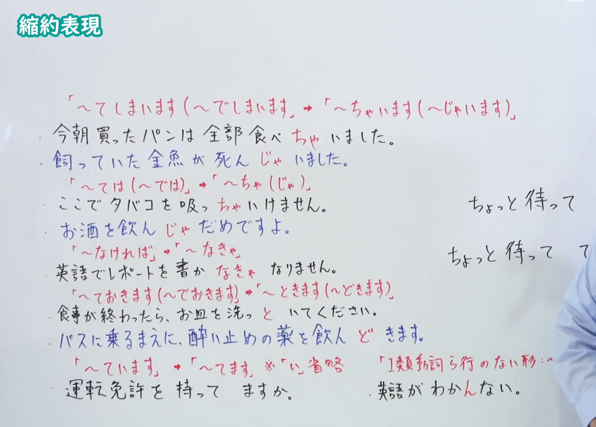
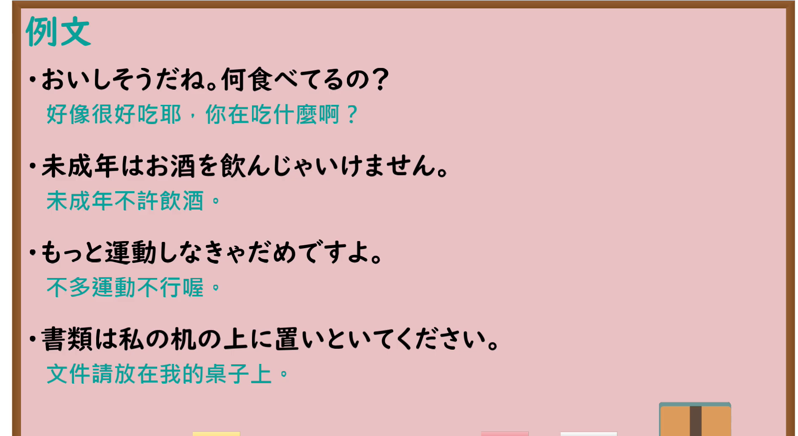

---
{
  "id": "N4-G-0027",
  "kind": "grammar",
  "level": "N4",
  "title": "縮約形（口语缩约表现：～ちゃう、～とく、～なきゃ等）",
  "card_revision": 1,
  "schema_version": 1,
  "source": {
    "lesson": "N4 第27个语法",
    "material": "出口日語原视频板书、YouTube 原 WebVTT（中文为主、日语为辅）与Hagoromo文型检索正文",
    "video": "https://www.youtube.com/watch?v=-FiXqVNXWAk",
    "screenshot": "assets/grammar/n4/N4-G-0027-connection.png",
    "screenshot_seconds": 509.9,
    "screenshot_crop": {
      "x": 0,
      "y": 0,
      "width": 1450,
      "height": 1040
    }
  },
  "tags": [
    "縮約形",
    "口語",
    "会話表現",
    "N4"
  ],
  "confusions": [
    "普通体",
    "方言表現"
  ]
}
---

# N4 第27个语法：縮約形

# 视频学习资料整理

- 课程：[出口日語「縮約形」](https://www.youtube.com/watch?v=-FiXqVNXWAk)
- 视频 ID：`-FiXqVNXWAk`
- 视频时长：10分00秒

## 接续图

- 实际时间：8分29.90秒（509.90秒）
- 原图尺寸：1920×1080
- 裁切区域：左上角 `(0, 0)` 至右下角 `(1450, 1040)`；00:01 画面尚未补充四大缩约句型归纳；选用 08:29 画面，板书已完整书写日语日常口语四大常见缩约：①「〜てしまう→〜ちゃう／〜でしまう→〜じゃう」、②「〜ておく→〜とく／〜でおく→〜どく」、③「〜てはいけない→〜ちゃいけない／〜ではいけない→〜じゃいけない」、④「〜なければならない→〜なきゃいけない／〜なくてはならない→〜なくちゃいけない」，老师让出板书区域。固定左上角 (0, 0)，裁切区域宽 1450、高 1040，去除右侧人物与边缘多余画面，充分保留底部总结板书。

## 例句图

- 实际时间：8分54.00秒（534.00秒）
- 原图尺寸：1920×1080
- 裁切区域：左上角 `(0, 0)` 至右下角 `(1900, 1040)`；提取自视频 08:54 处的例句黑板页面。固定左上角 (0, 0)，裁切区域宽 1900、高 1040，去除右侧与底部多余画面，完整保留全部四条例句及中文翻译。

# 核心

## 功能一：口语缩约表现（ちゃう・とく・ちゃだめ・なきゃ等）

**最上位意味カテゴリー：**

- **Vちゃう：** 行為・出来事（行为与事件）
- **ちゃだめだ：** 働きかけ（施加影响）
- **ちゃ：** 条件・接続（条件与连接）

**中位意味カテゴリー：**

- **Vちゃう：** 終了（结束）
- **ちゃだめだ：** 禁止・判断（禁止与判断）
- **ちゃ：** 順接（顺接）

**意味：**

- **Vちゃう：** 完了（縮約形）（完成（缩约形））
- **ちゃだめだ：** 禁止（縮約形）（禁止（缩约形））
- **ちゃ：** 望ましくない結果（縮約形）（不良结果（缩约形））

**くわしい意味記述：**

- **Vちゃう：** ある動作や行為を全て，完全にやり終えたことを強調したい時に使う。「Vてしまう」の縮約形。（用于强调某种动作或行为全部、彻底完成。“Vてしまう”的口语缩约形。）
- **ちゃだめだ：** ある行為をすることを禁止する意味を表す。くだけた表現で，話しことばで使う。「てはだめだ」の縮約形。（表示禁止进行某种行为之意。为随意的表达方式，用于口语中。“てはだめだ”的口语缩约形。）
- **ちゃ：** 「ては」のくだけた表現。良くない結果が起こる条件を表す。話し言葉。（“ては”的随意口语表达。表示引发不良结果的条件。）

**派生語：** 未列出

### 例句

1. 美味しそうだから、このケーキ全部食べちゃうね。

   （看起来很好吃，这块蛋糕我全吃掉咯。）

2. 明日はテストだから、早く寝なくちゃ。

   （明天有考试，必须早点睡。）

3. 資料は机の上に置いといてください。

   （资料请预先放在桌上。）

4. ここでタバコを吸っちゃいけませんよ。

   （可不能在这里抽烟哦。）

# 来源

- [出口日語原视频](https://www.youtube.com/watch?v=-FiXqVNXWAk)
- [Hagoromo 文型検索「Vちゃう」](https://hagoromo-text.work/lookup?vid=760)（查询日期：2026-09-25）
- [Hagoromo 文型検索「ちゃだめだ」](https://hagoromo-text.work/lookup?vid=761)（查询日期：2026-09-25）
- [Hagoromo 文型検索「ちゃ」](https://hagoromo-text.work/lookup?vid=758)（查询日期：2026-09-25）
