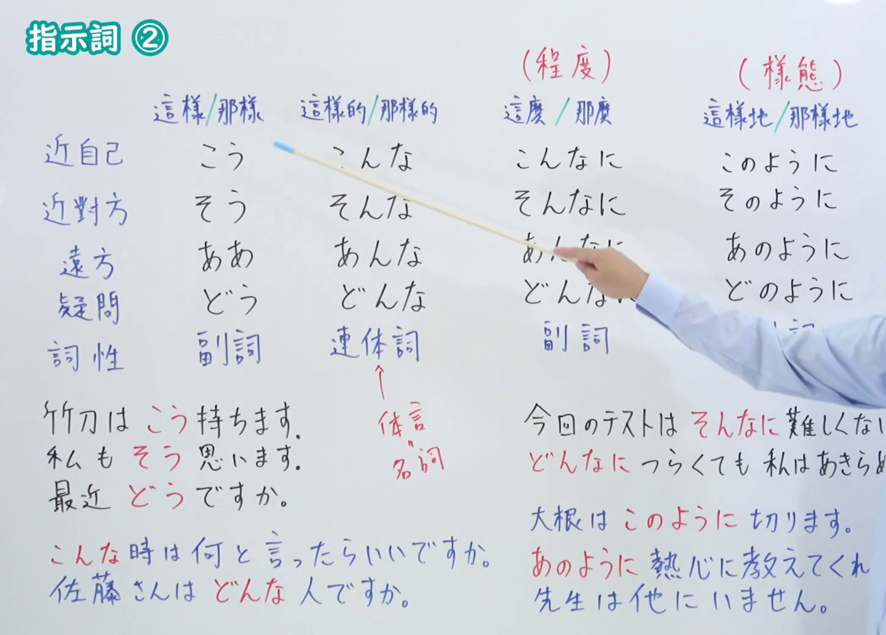
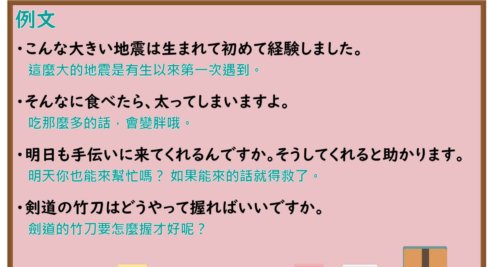

---
{
  "id": "N4-G-0028",
  "kind": "grammar",
  "level": "N4",
  "title": "指示詞 ②（文脉指示：これ・それ・あれ）",
  "card_revision": 1,
  "schema_version": 1,
  "source": {
    "lesson": "N4 第28个语法",
    "material": "出口日語原视频板书、Bilibili P28 音频的本地中文／日语混合转写 WebVTT与Hagoromo文型检索正文",
    "video": "https://www.youtube.com/watch?v=w3mtWbLbGJc",
    "screenshot": "assets/grammar/n4/N4-G-0028-connection.png",
    "screenshot_seconds": 366.75,
    "screenshot_crop": {
      "x": 0,
      "y": 0,
      "width": 1450,
      "height": 1040
    }
  },
  "tags": [
    "指示詞",
    "文脈指示",
    "こそあど",
    "N4"
  ],
  "confusions": [
    "現場指示",
    "指示代名詞"
  ]
}
---

# N4 第28个语法：指示詞 ②

# 视频学习资料整理

- 课程：[出口日語「指示詞 ②」](https://www.youtube.com/watch?v=w3mtWbLbGJc)
- 视频 ID：`w3mtWbLbGJc`
- 视频时长：8分09秒

## 接续图

- 实际时间：6分06.75秒（366.75秒）
- 原图尺寸：1920×1080
- 裁切区域：左上角 `(0, 0)` 至右下角 `(1450, 1040)`；00:01 画面尚未补充文脉指示三系边界与对比例句；选用 06:06 画面，板书已完整书写「文脈指示」「こ／そ／あ」的核心语义与使用边界：「そ」承接对方刚提到或双方对话中首次出现的客观事物；「あ」指代双方彼此均知晓的共有记忆或已知人事物；「こ」指说话人自己单方面特别熟悉、心理拉近或引出话题的事物，老师让出板书区域。固定左上角 (0, 0)，裁切区域宽 1450、高 1040，去除右侧人物与边缘多余画面，充分保留底部全部例句板书。

## 例句图

- 实际时间：6分55.38秒（415.38秒）
- 原图尺寸：1920×1080
- 裁切区域：左上角 `(0, 0)` 至右下角 `(1900, 1040)`；提取自视频 06:55 处的例句黑板页面。固定左上角 (0, 0)，裁切区域宽 1900、高 1040，去除右侧与底部多余画面，完整保留全部四条例句及中文翻译。

# 核心

## 功能一：文脉指示（指代文章与对话中的事物）

**最上位意味カテゴリー：**

- **それ：** 指示・代名（指示与代词）
- **あれ：** 指示・代名（指示与代词）
- **これ：** 指示・代名（指示与代词）

**中位意味カテゴリー：**

- **それ：** 指示（指示）
- **あれ：** 指示（指示）
- **これ：** 指示（指示）

**意味：**

- **それ：** 指示（指示）
- **あれ：** 指示（指示）
- **これ：** 指示（指示）

**くわしい意味記述：**

- **それ：** 会話や文章の中で，相手が述べたことや前に出た話題・事物を指すときに使う。（在对话或文章中，用于指代对方陈述的内容或前面出现的话题、事物。）
- **あれ：** 話し手と聞き手の双方がよく知っている共通の話題・過去の出来事を指す時に使う。（用于指代说话人与听话人双方均非常熟悉的共有话题或过去的事情。）
- **これ：** 話し手がこれから述べようとする内容や，話し手が心理的に身近に感じている事物を指すときに使う。（用于指代说话人接下来想要陈述的内容，或说话人在心理上感到亲近切身的事物。）

**派生語：** 未列出

### 例句

1. 「昨日、新しいレストランへ行ったよ。」「へえ、その店、美味しかった？」

   （“昨天我去了家新餐厅。”“哎，那家店好吃吗？”）

2. 「ほら、去年みんなで行った温泉、覚えている？」「ああ、あの温泉ね、楽しかったね。」

   （“你看，还记得去年大家一起去过的那个温泉吗？”“啊，那个温泉呀，当时真开心呢。”）

3. これから話すことは、誰にも言わないでくださいね。

   （接下来要说的这件事，可别告诉任何人哦。）

4. 「田中さんが結婚するそうですよ。」「えっ、それは本当ですか。」

   （“听说田中先生要结婚了哦。”“咦，那是真的吗？”）

# 来源

- [出口日語原视频](https://www.youtube.com/watch?v=w3mtWbLbGJc)
- [Hagoromo 文型検索「それ」](https://hagoromo-text.work/lookup?vid=639)（查询日期：2026-09-25）
- [Hagoromo 文型検索「あれ」](https://hagoromo-text.work/lookup?vid=243)（查询日期：2026-09-25）
- [Hagoromo 文型検索「これ」](https://hagoromo-text.work/lookup?vid=537)（查询日期：2026-09-25）
