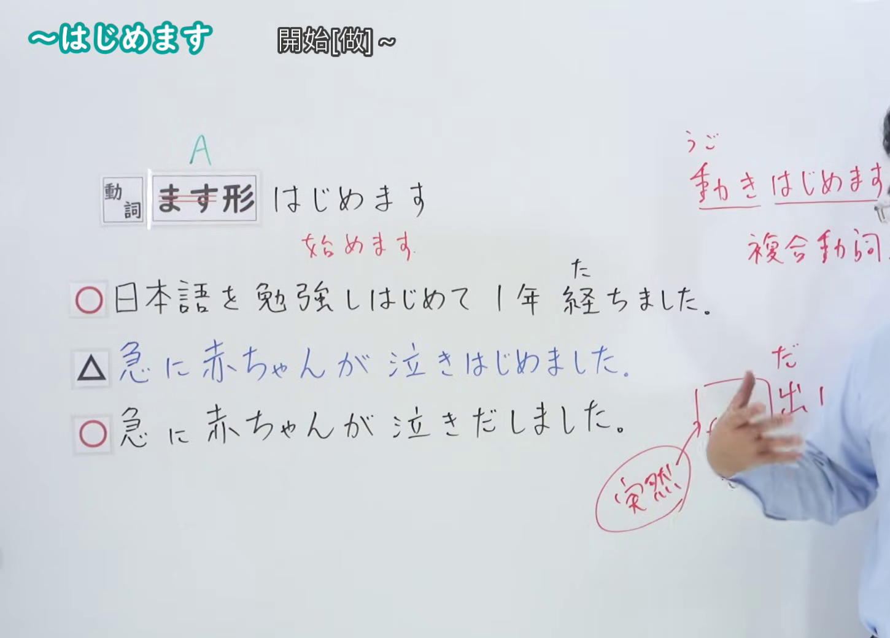
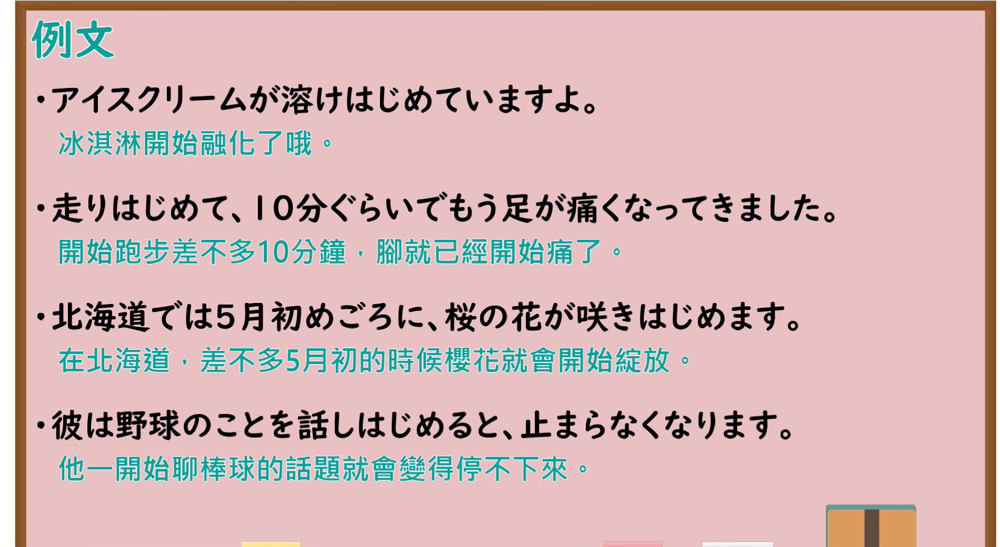

---
{
  "id": "N4-G-0029",
  "kind": "grammar",
  "level": "N4",
  "title": "～はじめます(始めます)（开始……）",
  "card_revision": 1,
  "schema_version": 1,
  "source": {
    "lesson": "N4 第29个语法",
    "material": "出口日語原视频板书、YouTube 原 WebVTT（中文为主、日语为辅）与Hagoromo文型检索正文",
    "video": "https://www.youtube.com/watch?v=FIbjp_l0MIo",
    "screenshot": "assets/grammar/n4/N4-G-0029-connection.png",
    "screenshot_seconds": 224.0,
    "screenshot_crop": {
      "x": 0,
      "y": 0,
      "width": 1450,
      "height": 1040
    }
  },
  "tags": [
    "はじめる",
    "始めます",
    "開始",
    "複合動詞",
    "N4"
  ],
  "confusions": [
    "～だす",
    "～かける"
  ]
}
---

# N4 第29个语法：～はじめます(始めます)

# 视频学习资料整理

- 课程：[出口日語「～はじめます(始めます)」](https://www.youtube.com/watch?v=FIbjp_l0MIo)
- 视频 ID：`FIbjp_l0MIo`
- 视频时长：5分20秒

## 接续图

- 实际时间：3分44.00秒（224.00秒）
- 原图尺寸：1920×1080
- 裁切区域：左上角 `(0, 0)` 至右下角 `(1450, 1040)`；00:01 画面尚未补充复合动词接续与自然现象用法；选用 03:44 画面，板书已完整书写「動詞ます形＋はじめます」「開始[做]~；開始~起來」「雨が降り始めました／桜が咲き始めました／日本語を勉強し始めました」、表示持续性动作或自然现象的开始，老师让出板书区域。固定左上角 (0, 0)，裁切区域宽 1450、高 1040，去除右侧人物与边缘多余画面，充分保留底部全部例句板书。

## 例句图

- 实际时间：4分16.00秒（256.00秒）
- 原图尺寸：1920×1080
- 裁切区域：左上角 `(0, 0)` 至右下角 `(1900, 1040)`；提取自视频 04:16 处的例句黑板页面。固定左上角 (0, 0)，裁切区域宽 1900、高 1040，去除右侧与底部多余画面，完整保留全部四条例句及中文翻译。

# 核心

## 功能一：开始做 A（持续性动作或自然现象的开始）

**最上位意味カテゴリー：**

- **Vはじめる：** 行為・出来事（行为与事件）

**中位意味カテゴリー：**

- **Vはじめる：** 開始（开始）

**意味：**

- **Vはじめる：** 開始（开始）

**くわしい意味記述：**

- **Vはじめる：** 継続する動作・作用・出来事などが始まることを表す。（表示具有持续性的动作、作用、事件等开始发生。）

**派生語：** 未列出

### 例句

1. ゆうべ八時ごろから雨が降り始めました。

   （昨晚八点左右开始下起雨来了。）

2. 桜の花が少しずつ咲き始めましたね。

   （樱花开始一点点绽放了呢。）

3. 先月から毎朝ジョギングを始めました。

   （从上个月开始，我每天早晨开始慢跑。）

4. 赤ちゃんがスプーンを使って自分でご飯を食べ始めました。

   （小宝宝开始用勺子自己吃饭了。）

# 来源

- [出口日語原视频](https://www.youtube.com/watch?v=FIbjp_l0MIo)
- [Hagoromo 文型検索「Vはじめる」](https://hagoromo-text.work/lookup?vid=202)（查询日期：2026-09-25）
