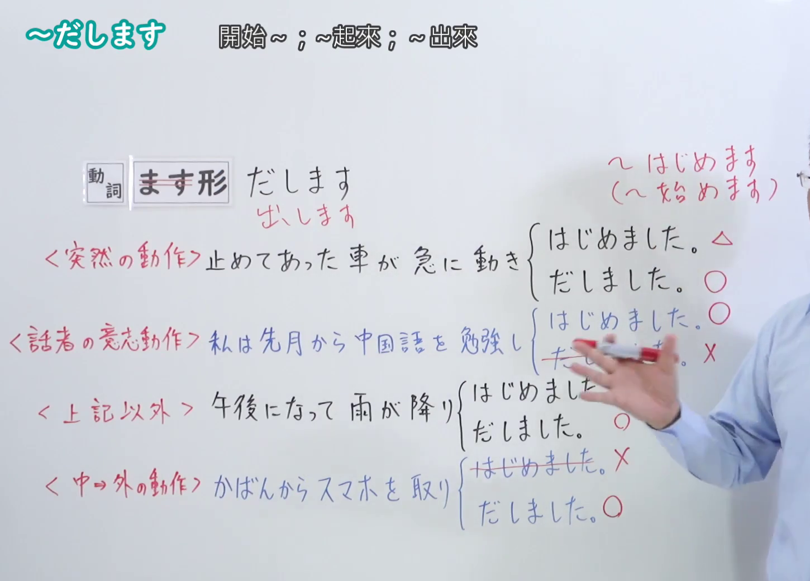
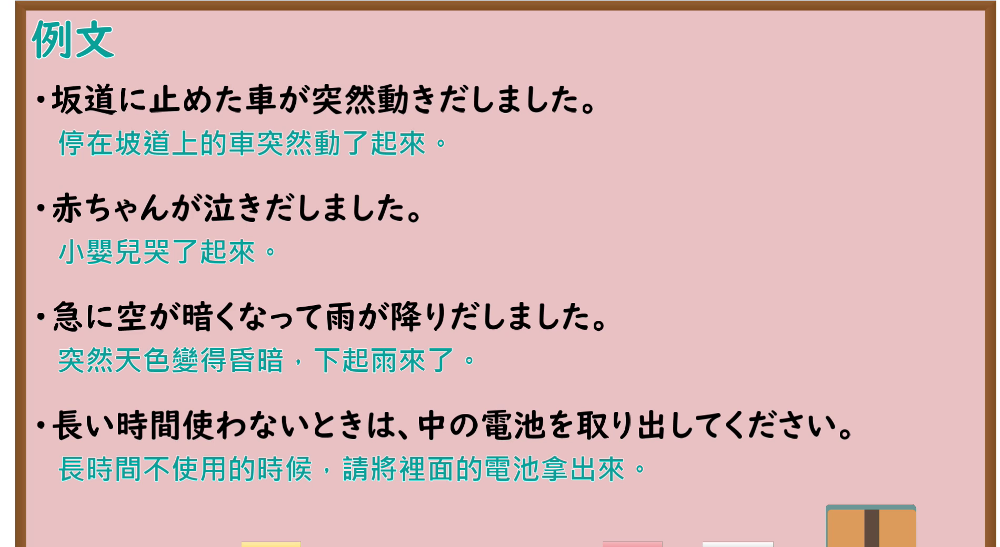

---
{
  "id": "N4-G-0030",
  "kind": "grammar",
  "level": "N4",
  "title": "～だします(出します)（突然开始……、……起来）",
  "card_revision": 1,
  "schema_version": 1,
  "source": {
    "lesson": "N4 第30个语法",
    "material": "出口日語原视频板书、YouTube 原 WebVTT（中文为主、日语为辅）与Hagoromo文型检索正文",
    "video": "https://www.youtube.com/watch?v=k3VFbYM3mTY",
    "screenshot": "assets/grammar/n4/N4-G-0030-connection.png",
    "screenshot_seconds": 305.25,
    "screenshot_crop": {
      "x": 0,
      "y": 0,
      "width": 1450,
      "height": 1040
    }
  },
  "tags": [
    "だす",
    "出します",
    "突発",
    "開始",
    "複合動詞",
    "N4"
  ],
  "confusions": [
    "～はじめます",
    "～かける"
  ]
}
---

# N4 第30个语法：～だします(出します)

# 视频学习资料整理

- 课程：[出口日語「～だします(出します)」](https://www.youtube.com/watch?v=k3VFbYM3mTY)
- 视频 ID：`k3VFbYM3mTY`
- 视频时长：6分47秒

## 接续图

- 实际时间：5分05.25秒（305.25秒）
- 原图尺寸：1920×1080
- 裁切区域：左上角 `(0, 0)` 至右下角 `(1450, 1040)`；00:01 画面尚未补充突发语义与「〜はじめます」对比；选用 05:05 画面，板书已完整书写「動詞ます形＋だします」「突然~起來；急劇~起來」「急に雨が降り出しました／子どもが急に泣き出しました」「與〜はじめます之對比（急劇・突發 vs 自然持續）」，老师让出板书区域。固定左上角 (0, 0)，裁切区域宽 1450、高 1040，去除右侧人物与边缘多余画面，充分保留底部全部例句板书。

## 例句图

- 实际时间：5分37.81秒（337.81秒）
- 原图尺寸：1920×1080
- 裁切区域：左上角 `(0, 0)` 至右下角 `(1900, 1040)`；提取自视频 05:37 处的例句黑板页面。固定左上角 (0, 0)，裁切区域宽 1900、高 1040，去除右侧与底部多余画面，完整保留全部四条例句及中文翻译。

# 核心

## 功能一：突然做 A、……起来（突发或难以自控的开始）

**最上位意味カテゴリー：**

- **Vだす：** 行為・出来事（行为与事件）

**中位意味カテゴリー：**

- **Vだす：** 開始（开始）

**意味：**

- **Vだす：** 開始（开始）

**くわしい意味記述：**

- **Vだす：** 人の意志で制御しにくい動作・作用が始まるという意味を表す。急激な変化や突発的な事態の発生に用いることが多い。（表示人意志难以控制的动作或作用开始发生之意。多用于表示急剧的变化或突发性事态的产生。）

**派生語：** 未列出

### 例句

1. その子は急に大声で泣き出しました。

   （那个孩子突然放声大哭了起来。）

2. さっきまで晴れていたのに、突然雨が降り出しました。

   （刚才还是晴天，却突然下起雨来了。）

3. 先生の冗談を聞いて、みんなが一斉に笑い出しました。

   （听了老师的玩笑，大家都一下子笑了起来。）

4. 止まっていたバスが急に動き出しました。

   （停着的公交车突然开动了起来。）

# 来源

- [出口日語原视频](https://www.youtube.com/watch?v=k3VFbYM3mTY)
- [Hagoromo 文型検索「Vだす」](https://hagoromo-text.work/lookup?vid=147)（查询日期：2026-09-25）
