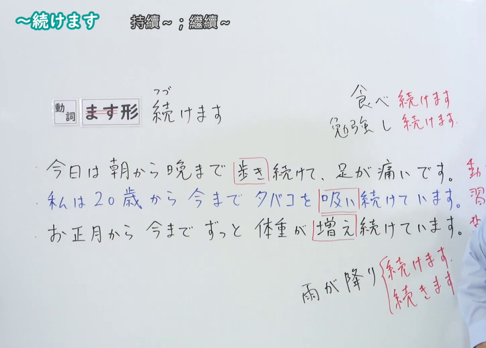
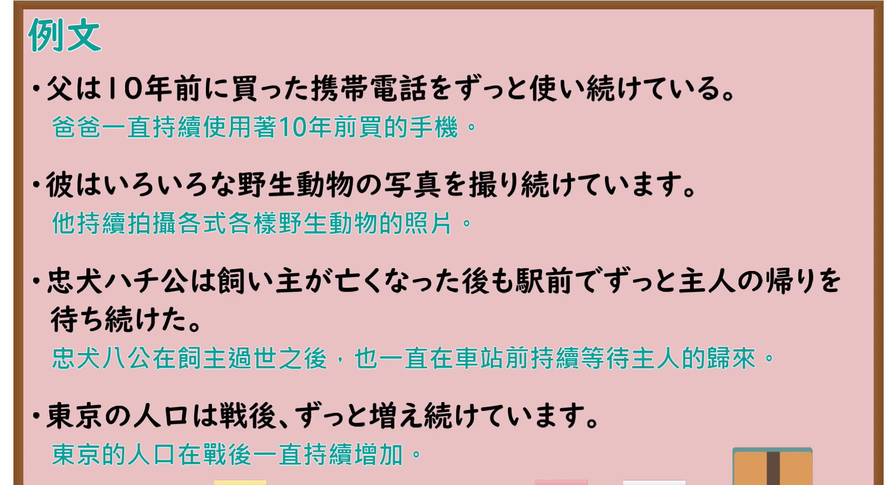

---
{
  "id": "N4-G-0031",
  "kind": "grammar",
  "level": "N4",
  "title": "～つづけます(続けます)（持续……、继续……）",
  "card_revision": 1,
  "schema_version": 1,
  "source": {
    "lesson": "N4 第31个语法",
    "material": "出口日語原视频板书、YouTube 原 WebVTT（中文为主、日语为辅）与Hagoromo文型检索正文",
    "video": "https://www.youtube.com/watch?v=P7PhCsoKzZc",
    "screenshot": "assets/grammar/n4/N4-G-0031-connection.png",
    "screenshot_seconds": 240.0,
    "screenshot_crop": {
      "x": 0,
      "y": 0,
      "width": 1450,
      "height": 1040
    }
  },
  "tags": [
    "つづける",
    "続けます",
    "継続",
    "複合動詞",
    "N4"
  ],
  "confusions": [
    "～はじめる",
    "～おわる"
  ]
}
---

# N4 第31个语法：～つづけます(続けます)

# 视频学习资料整理

- 课程：[出口日語「～つづけます(続けます)」](https://www.youtube.com/watch?v=P7PhCsoKzZc)
- 视频 ID：`P7PhCsoKzZc`
- 视频时长：5分38秒

## 接续图

- 实际时间：4分00.00秒（240.00秒）
- 原图尺寸：1920×1080
- 裁切区域：左上角 `(0, 0)` 至右下角 `(1450, 1040)`；00:01 画面尚未补充复合动词变化与习惯用法；选用 04:00 画面，黑板最上方完整保留「～つづけます」醒目标题；板书已完整书写「動詞ます形＋つづけます」「持續[做]~；繼續[做]~」「雨が降り続いています／日本語を勉強し続けます」、表示动作、习惯或作用不间断的持续，老师让出板书区域。固定左上角 (0, 0)，裁切区域宽 1450、高 1040，去除右侧人物与边缘多余画面，充分保留顶部标题与底部全部板书，高度充足不缺失内容。

## 例句图

- 实际时间：4分30.40秒（270.40秒）
- 原图尺寸：1920×1080
- 裁切区域：左上角 `(0, 0)` 至右下角 `(1900, 1040)`；提取自视频 04:30 处的例句黑板页面。底色为粉灰色课程幻灯片，固定左上角 (0, 0)，裁切区域宽 1900、高 1040，去除右侧与底部多余画面，完整保留全部四条例句及中文翻译，确保底部第四条例句完整呈现。

# 核心

## 功能一：持续做 A、继续做 A（动作或状态的持续）

**最上位意味カテゴリー：**

- **Vつづける：** 場所・時間（场所与时间）

**中位意味カテゴリー：**

- **Vつづける：** 起点・終点（起点与终点）

**意味：**

- **Vつづける：** 継続（持续）

**くわしい意味記述：**

- **Vつづける：** 動作や習慣を続けたり，作用が続いたりすることを表す。（表示继续某种动作或习惯，或某种作用在持续之中。）

**派生語：** 未列出

### 例句

1. ゆうべから雨が降り続いています。

   （从昨晚开始，雨就一直下个不停。）

2. これからも日本語の勉強を続けていくつもりです。

   （今后我也打算把日语学习继续坚持下去。）

3. 彼は三時間もピアノを弾き続けました。

   （他连续弹了三个小时的钢琴。）

4. 諦めないで、毎日練習を続けましょう。

   （不要放弃，每天继续坚持练习吧。）

# 来源

- [出口日語原视频](https://www.youtube.com/watch?v=P7PhCsoKzZc)
- [Hagoromo 文型検索「Vつづける」](https://hagoromo-text.work/lookup?vid=148)（查询日期：2026-09-25）
