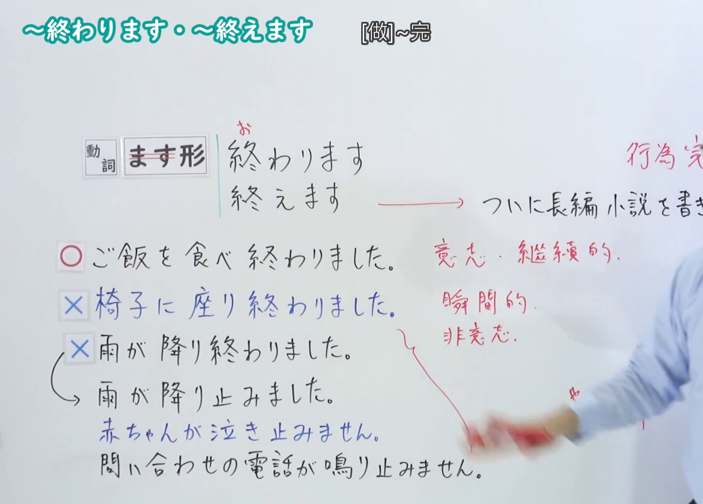
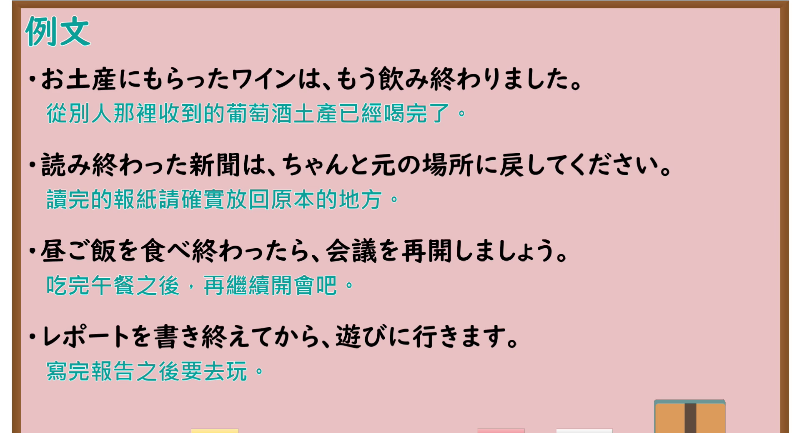

---
{
  "id": "N4-G-0032",
  "kind": "grammar",
  "level": "N4",
  "title": "～おわります(終わります)・～おえます(終えます)（做完……、……结束）",
  "card_revision": 1,
  "schema_version": 1,
  "source": {
    "lesson": "N4 第32个语法",
    "material": "出口日語原视频板书、YouTube 原 WebVTT（中文为主、日语为辅）与Hagoromo文型检索正文",
    "video": "https://www.youtube.com/watch?v=kBp6Y_2zfes",
    "screenshot": "assets/grammar/n4/N4-G-0032-connection.png",
    "screenshot_seconds": 280.5,
    "screenshot_crop": {
      "x": 0,
      "y": 0,
      "width": 1450,
      "height": 1040
    }
  },
  "tags": [
    "おわる",
    "終わります",
    "終えます",
    "終了",
    "複合動詞",
    "N4"
  ],
  "confusions": [
    "～てしまう",
    "～やむ"
  ]
}
---

# N4 第32个语法：～おわります(終わります)・～おえます(終えます)

# 视频学习资料整理

- 课程：[出口日語「～おわります(終わります)・～おえます(終えます)」](https://www.youtube.com/watch?v=kBp6Y_2zfes)
- 视频 ID：`kBp6Y_2zfes`
- 视频时长：6分14秒

## 接续图

- 实际时间：4分40.50秒（280.50秒）
- 原图尺寸：1920×1080
- 裁切区域：左上角 `(0, 0)` 至右下角 `(1450, 1040)`；00:01 画面尚未展开自他动词对照与例句板书；选用 04:40 画面，黑板最上方完整保留「～おわります／～おえます」大标题；板书已完整书写「動詞ます形＋おわります／おえます」「做完~；完成~」「本を読み終わりました／書き終えました」「自動詞・他動詞の対応」、动作或作用的彻底终结，老师让出板书区域。固定左上角 (0, 0)，裁切区域宽 1450、高 1040，去除右侧人物与边缘多余画面，充分保留底部全部板书。

## 例句图

- 实际时间：5分10.42秒（310.42秒）
- 原图尺寸：1920×1080
- 裁切区域：左上角 `(0, 0)` 至右下角 `(1900, 1040)`；提取自视频 05:10 处的例句黑板页面。固定左上角 (0, 0)，裁切区域宽 1900、高 1040，去除右侧与底部多余画面，完整保留全部四条例句及中文翻译。

# 核心

## 功能一：做完 A、完成 A（动作与作用的终结）

**最上位意味カテゴリー：**

- **Vおわる：** 場所・時間（场所与时间）

**中位意味カテゴリー：**

- **Vおわる：** 起点・終点（起点与终点）

**意味：**

- **Vおわる：** 終了（结束）

**くわしい意味記述：**

- **Vおわる：** 動作・作用の終了を表す。（表示动作或作用的终结。）

**派生語：** 未列出

### 例句

1. その本はもう全部読み終わりました。

   （那本书我已经全部读完了。）

2. ご飯を食べ終わったら、お皿を洗ってください。

   （吃完饭后，请把盘子洗一下。）

3. やっと長いレポートを書き終えました。

   （终于把长篇报告写完了。）

4. 先生の話を聞き終わってから、質問をしてください。

   （听完老师的话之后，再进行提问。）

# 来源

- [出口日語原视频](https://www.youtube.com/watch?v=kBp6Y_2zfes)
- [Hagoromo 文型検索「Vおわる」](https://hagoromo-text.work/lookup?vid=138)（查询日期：2026-09-25）
