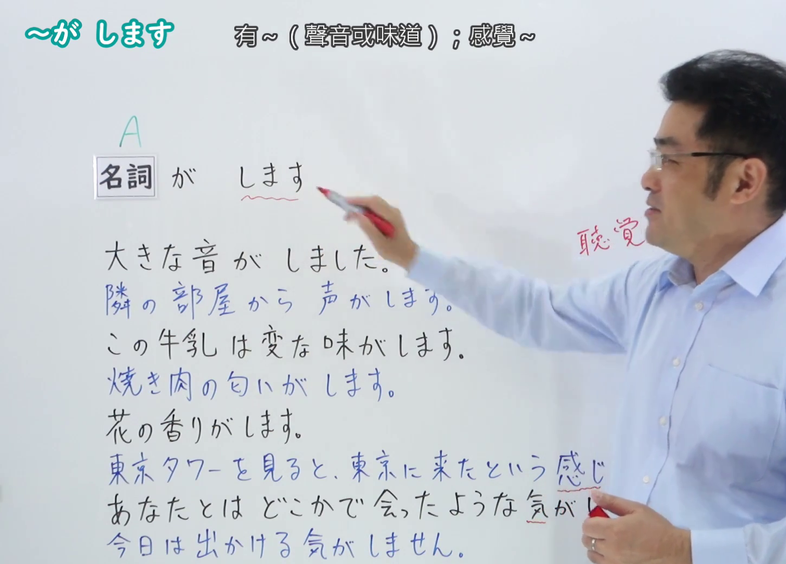
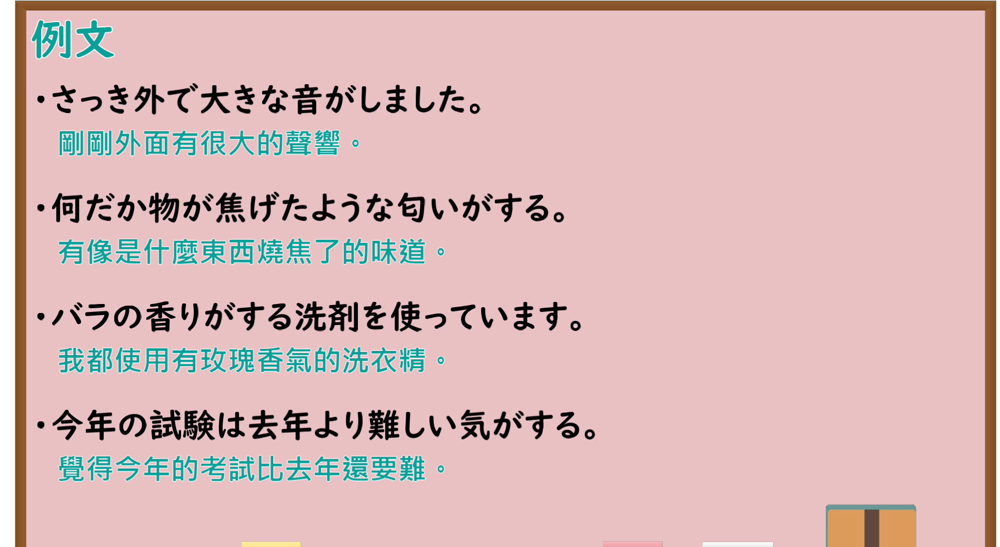

---
{
  "id": "N4-G-0033",
  "kind": "grammar",
  "level": "N4",
  "title": "～がします（有……气味/声音/感觉等）",
  "card_revision": 1,
  "schema_version": 1,
  "source": {
    "lesson": "N4 第33个语法",
    "material": "出口日語原视频板书、YouTube 原 WebVTT（中文为主、日语为辅）与Hagoromo文型检索正文",
    "video": "https://www.youtube.com/watch?v=O0DV-YyYmWw",
    "screenshot": "assets/grammar/n4/N4-G-0033-connection.png",
    "screenshot_seconds": 287.25,
    "screenshot_crop": {
      "x": 0,
      "y": 0,
      "width": 1450,
      "height": 1040
    }
  },
  "tags": [
    "がする",
    "知覚",
    "感覚",
    "味覚",
    "聴覚",
    "N4"
  ],
  "confusions": [
    "～にする",
    "～とする"
  ]
}
---

# N4 第33个语法：～がします

# 视频学习资料整理

- 课程：[出口日語「～がします」](https://www.youtube.com/watch?v=O0DV-YyYmWw)
- 视频 ID：`O0DV-YyYmWw`
- 视频时长：6分23秒

## 接续图

- 实际时间：4分47.25秒（287.25秒）
- 原图尺寸：1920×1080
- 裁切区域：左上角 `(0, 0)` 至右下角 `(1450, 1040)`；00:01 画面尚未补充知觉词汇分类板书；选用 04:47 画面，黑板最上方完整保留「【Ｎ４文法】～が します」大标题；板书已完整书写「名詞＋がします」「有[感覺]~」「音／声／におい／味／感じ／気＋がします」、生理知觉与心理感觉分类表达，老师让出板书区域。固定左上角 (0, 0)，裁切区域宽 1450、高 1040，去除右侧人物与边缘多余画面，充分保留底部例词与板书。

## 例句图

- 实际时间：5分17.89秒（317.89秒）
- 原图尺寸：1920×1080
- 裁切区域：左上角 `(0, 0)` 至右下角 `(1900, 1040)`；提取自视频 05:17 处的例句黑板页面。固定左上角 (0, 0)，裁切区域宽 1900、高 1040，去除右侧与底部多余画面，完整保留全部四条例句及中文翻译。

# 核心

## 功能一：有 A 的气味/声音/感觉（生理与心理知觉）

**最上位意味カテゴリー：**

- **（が）する：** ものごとの様子（事物的状态与样貌）

**中位意味カテゴリー：**

- **（が）する：** 様子・状態（样貌与状态）

**意味：**

- **（が）する：** 状態（状态）

**くわしい意味記述：**

- **（が）する：** 「Nがする」のNには，におい，香り，音，声，味，感じ，気などの語彙を使って，話し手の感覚や知覚を表す。（在“名词＋がする”的名词部分，使用气味、香气、声音、人声、味道、感觉、预感等词汇，表示说话人的感觉或知觉。）

**派生語：** 未列出

### 例句

1. 隣の部屋から変な音がします。

   （从隔壁房间传来了奇怪的声音。）

2. 台所からいいにおいがしてきました。

   （从厨房飘来了一阵诱人的香味。）

3. このスープは少し甘い味がします。

   （这道汤喝起来有一点甜味。）

4. 風邪を引いたような気がします。

   （感觉自己好像感冒了。）

# 来源

- [出口日語原视频](https://www.youtube.com/watch?v=O0DV-YyYmWw)
- [Hagoromo 文型検索「（が）する」](https://hagoromo-text.work/lookup?vid=24)（查询日期：2026-09-25）
