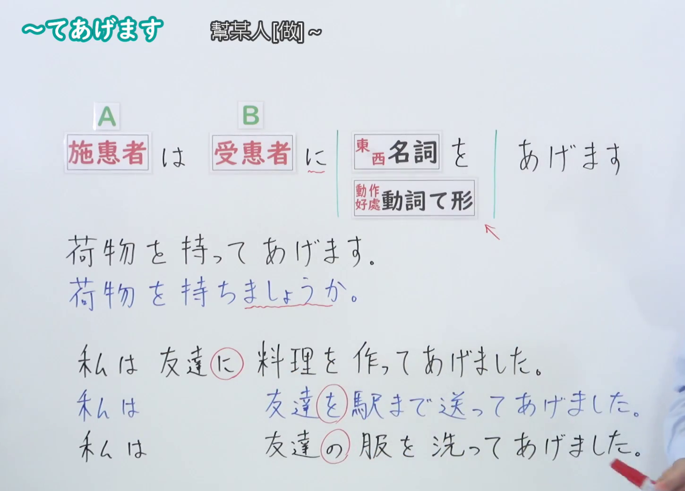

---
{
  "id": "N4-G-0034",
  "kind": "grammar",
  "level": "N4",
  "title": "～てあげます（为……做……、给……做……）",
  "card_revision": 1,
  "schema_version": 1,
  "source": {
    "lesson": "N4 第34个语法",
    "material": "出口日語原视频板书、Bilibili P34 音频的本地中文／日语混合转写 WebVTT与Hagoromo文型检索正文",
    "video": "https://www.youtube.com/watch?v=O-yzGKK7Qhc",
    "screenshot": "assets/grammar/n4/N4-G-0034-connection.png",
    "screenshot_seconds": 330.0,
    "screenshot_crop": {
      "x": 0,
      "y": 0,
      "width": 1450,
      "height": 1040
    }
  },
  "tags": [
    "てあげる",
    "てあげます",
    "授受",
    "やりもらい",
    "恩恵",
    "N4"
  ],
  "confusions": [
    "～てくれる",
    "～てもらう",
    "～てやる"
  ]
}
---

# N4 第34个语法：～てあげます

# 视频学习资料整理

- 课程：[出口日語「～てあげます」](https://www.youtube.com/watch?v=O-yzGKK7Qhc)
- 视频 ID：`O-yzGKK7Qhc`
- 视频时长：7分20秒

## 接续图

- 实际时间：5分30.00秒（330.00秒）
- 原图尺寸：1920×1080
- 裁切区域：左上角 `(0, 0)` 至右下角 `(1450, 1040)`；00:01 画面尚未补充人称视点与长辈使用禁忌板书；选用 05:30 画面，黑板最上方完整保留「【Ｎ４文法】～てあげます」大标题；板书已完整书写「動詞て形＋あげます」「為[某人]做~」「私／仲間は 他人に 動詞てあげます」「荷物を持ってあげます／傘を貸してあげます」、授受动作施惠用法与目上使用限制（目上の人には使わない），老师让出板书区域。固定左上角 (0, 0)，裁切区域宽 1450、高 1040，去除右侧人物与边缘多余画面，充分保留底部全部例句板书。

## 例句图

- 实际时间：6分05.20秒（365.20秒）
- 原图尺寸：1920×1080
- 裁切区域：左上角 `(0, 0)` 至右下角 `(1900, 1040)`；提取自视频 06:05 处的例句黑板页面。固定左上角 (0, 0)，裁切区域宽 1900、高 1040，去除右侧与底部多余画面，完整保留全部四条例句及中文翻译。

# 核心

## 功能一：为他人做 A（授受动作：施惠）

**最上位意味カテゴリー：**

- **Vてあげる：** 人との関係（与人的关系）

**中位意味カテゴリー：**

- **Vてあげる：** 授受（授受）

**意味：**

- **Vてあげる：** 受給：行為（授受：行为）

**くわしい意味記述：**

- **Vてあげる：** 前の行為を自分が他人のために行うことを表す。恩着せがましい印象をあたえることがある。（表示自己在为他人进行前项行为。有时会给人以卖人情、施恩的印象。）

**派生語：** 未列出

### 例句

1. 重そうですね。荷物を持ってあげましょうか。

   （看起来很重呢。我来帮你拿行李吧？）

2. 妹に英語を教えてあげました。

   （我教了妹妹英语。）

3. 道に迷っている外国人に道を教えてあげました。

   （我给迷路的外国人指了路。）

4. 友達の誕生日に写真を撮ってあげました。

   （在朋友生日时，我帮他拍了照片。）

# 来源

- [出口日語原视频](https://www.youtube.com/watch?v=O-yzGKK7Qhc)
- [Hagoromo 文型検索「Vてあげる」](https://hagoromo-text.work/lookup?vid=154)（查询日期：2026-09-25）
