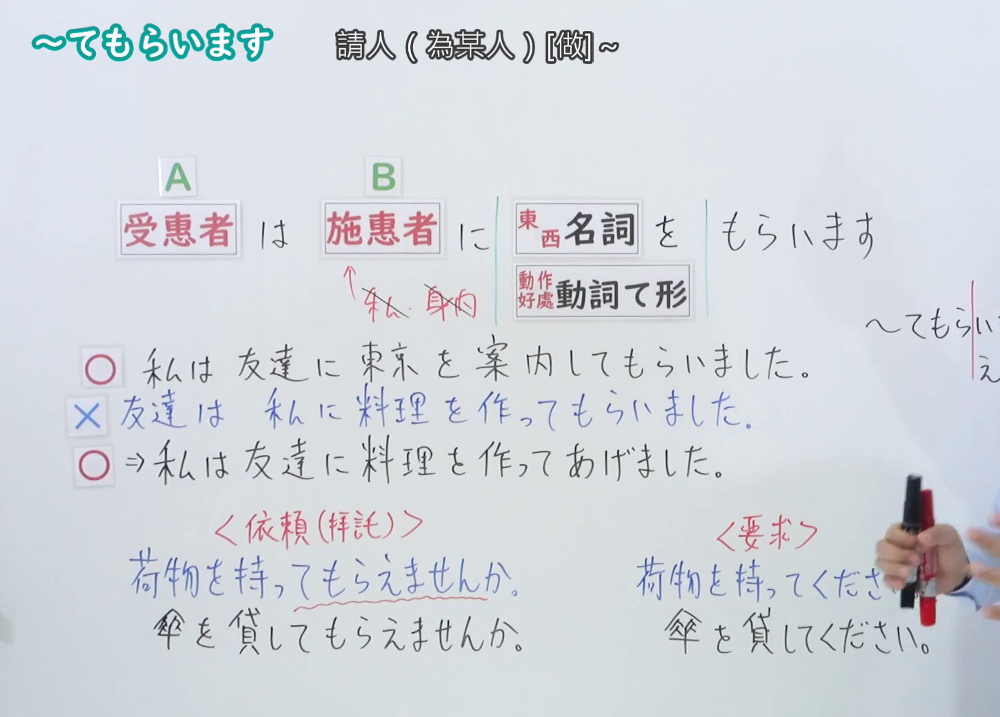
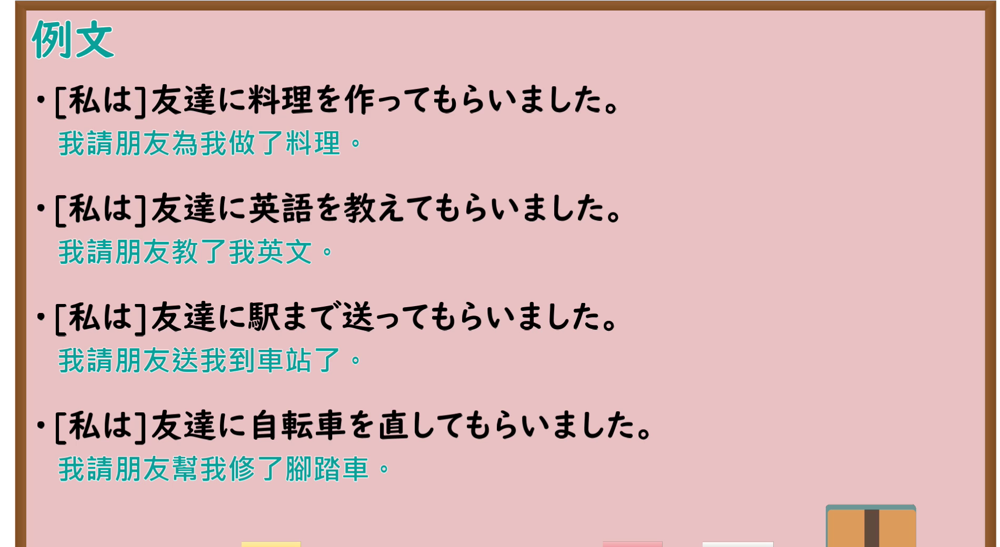

---
{
  "id": "N4-G-0035",
  "kind": "grammar",
  "level": "N4",
  "title": "～てもらいます（请……做……、得到……的帮助）",
  "card_revision": 1,
  "schema_version": 1,
  "source": {
    "lesson": "N4 第35个语法",
    "material": "出口日語原视频板书、YouTube 原 WebVTT（中文为主、日语为辅）与Hagoromo文型检索正文",
    "video": "https://www.youtube.com/watch?v=D6iY5oME9kA",
    "screenshot": "assets/grammar/n4/N4-G-0035-connection.png",
    "screenshot_seconds": 291.75,
    "screenshot_crop": {
      "x": 0,
      "y": 0,
      "width": 1450,
      "height": 1040
    }
  },
  "tags": [
    "てもらう",
    "てもらいます",
    "授受",
    "やりもらい",
    "恩恵",
    "N4"
  ],
  "confusions": [
    "～てくれる",
    "～てあげる",
    "～ていただく"
  ]
}
---

# N4 第35个语法：～てもらいます

# 视频学习资料整理

- 课程：[出口日語「～てもらいます」](https://www.youtube.com/watch?v=D6iY5oME9kA)
- 视频 ID：`D6iY5oME9kA`
- 视频时长：6分29秒

## 接续图

- 实际时间：4分51.75秒（291.75秒）
- 原图尺寸：1920×1080
- 裁切区域：左上角 `(0, 0)` 至右下角 `(1450, 1040)`；00:01 画面尚未补充助词「に」与受惠视点板书；选用 04:51 画面，黑板最上方完整保留「【Ｎ４文法】～てもらいます」醒目标题；板书已完整书写「動詞て形＋もらいます」「請[某人]做~；得到~的恩惠」「私／仲間は 他人に 動詞てもらいます」「田中さんに手伝ってもらいました／先生に教えてもらいました」、主语为受惠者的授受结构，老师让出板书区域。固定左上角 (0, 0)，裁切区域宽 1450、高 1040，去除右侧人物与边缘多余画面，充分保留底部全部例句板书。

## 例句图

- 实际时间：5分22.87秒（322.87秒）
- 原图尺寸：1920×1080
- 裁切区域：左上角 `(0, 0)` 至右下角 `(1900, 1040)`；提取自视频 05:22 处的例句黑板页面。固定左上角 (0, 0)，裁切区域宽 1900、高 1040，去除右侧与底部多余画面，完整保留全部四条例句及中文翻译。

# 核心

## 功能一：请他人做 A、得到他人做 A 的恩惠（授受动作：受惠）

**最上位意味カテゴリー：**

- **Vてもらう：** 人との関係（与人的关系）

**中位意味カテゴリー：**

- **Vてもらう：** 授受（授受）

**意味：**

- **Vてもらう：** 受給：行為（授受：行为）

**くわしい意味記述：**

- **Vてもらう：** 他人が自分，またはウチの人間のために行為を行い，それにより自分またはウチの人間が恩恵を受けたことを表す。（表示他人为了自己或己方人员进行某种行为，由此自己或己方人员获得了恩惠。）

**派生語：** 未列出

### 例句

1. 日本人の友達に作文を直してもらいました。

   （我请日本朋友帮我修改了作文。）

2. 引っ越しのとき、田中さんに手伝ってもらいました。

   （搬家的时候，我得到了田中先生的帮忙。）

3. 分からないところを先生に説明してもらいました。

   （我不懂的地方请老师给做了讲解。）

4. 兄に駅まで車で送ってもらいました。

   （我让哥哥开车送我到了车站。）

# 来源

- [出口日語原视频](https://www.youtube.com/watch?v=D6iY5oME9kA)
- [Hagoromo 文型検索「Vてもらう」](https://hagoromo-text.work/lookup?vid=176)（查询日期：2026-09-25）
