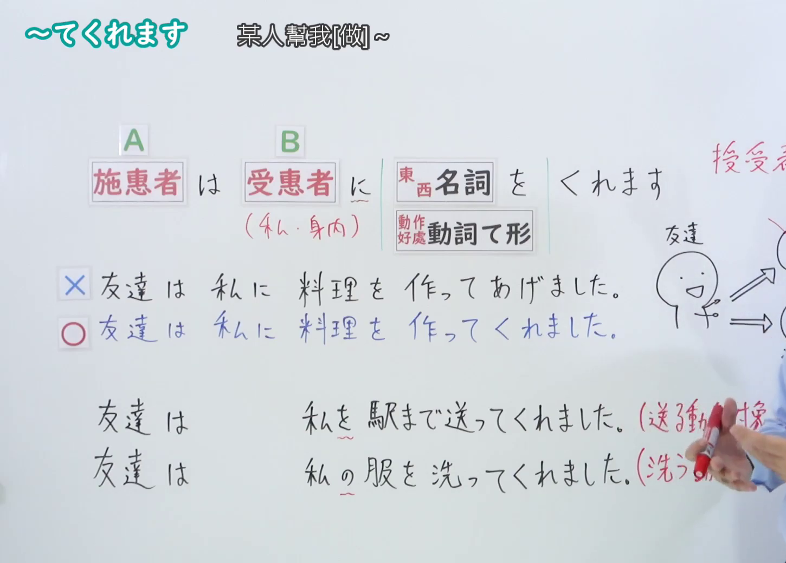
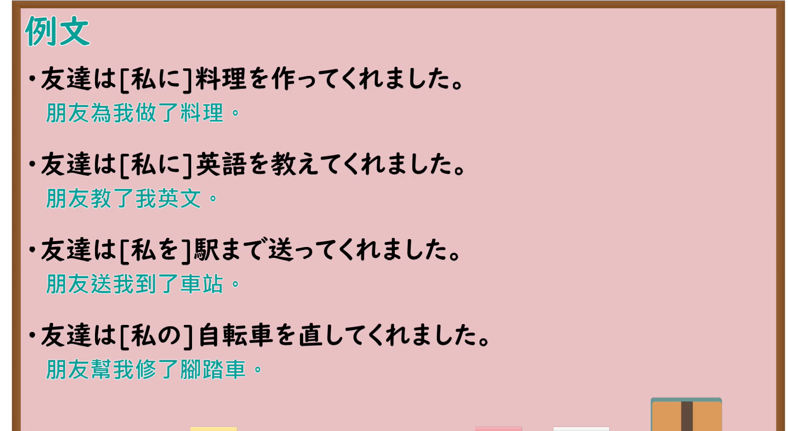

---
{
  "id": "N4-G-0036",
  "kind": "grammar",
  "level": "N4",
  "title": "～てくれます（为我/我们做……）",
  "card_revision": 1,
  "schema_version": 1,
  "source": {
    "lesson": "N4 第36个语法",
    "material": "出口日語原视频板书、YouTube 原 WebVTT（中文为主、日语为辅）与Hagoromo文型检索正文",
    "video": "https://www.youtube.com/watch?v=cCauUPmZgGk",
    "screenshot": "assets/grammar/n4/N4-G-0036-connection.png",
    "screenshot_seconds": 361.6,
    "screenshot_crop": {
      "x": 0,
      "y": 0,
      "width": 1450,
      "height": 1040
    }
  },
  "tags": [
    "てくれる",
    "てくれます",
    "授受",
    "やりもらい",
    "恩恵",
    "N4"
  ],
  "confusions": [
    "～てもらいます",
    "～てくださいます"
  ]
}
---

# N4 第36个语法：～てくれます

# 视频学习资料整理

- 课程：[出口日語「～てくれます」](https://www.youtube.com/watch?v=cCauUPmZgGk)
- 视频 ID：`cCauUPmZgGk`
- 视频时长：7分32秒

## 接续图

- 实际时间：6分01.60秒（361.60秒）
- 原图尺寸：1920×1080
- 裁切区域：左上角 `(0, 0)` 至右下角 `(1450, 1040)`；00:01 画面尚未补充与「～てもらいます」的视点对比板书；选用 06:01 画面，黑板最上方完整保留「～てくれます」大标题；板书已完整书写「動詞て形＋くれます」「為我/我們做~」「他人は 私／仲間に 動詞てくれます」「友達が駅まで送ってくれました／母がセーターを編んでくれました」「～てもらいますとの視点対比」、动作方向朝向说话人，老师让出板书区域。固定左上角 (0, 0)，裁切区域宽 1450、高 1040，去除右侧人物与边缘多余画面，充分保留底部全部例句板书。

## 例句图

- 实际时间：6分24.10秒（384.10秒）
- 原图尺寸：1920×1080
- 裁切区域：左上角 `(0, 0)` 至右下角 `(1900, 1040)`；提取自视频 06:24 处的例句黑板页面。固定左上角 (0, 0)，裁切区域宽 1900、高 1040，去除右侧与底部多余画面，完整保留全部四条例句及中文翻译。

# 核心

## 功能一：他人为我/我方做 A（授受动作：他人施惠）

**最上位意味カテゴリー：**

- **Vてくれる：** 人との関係（与人的关系）

**中位意味カテゴリー：**

- **Vてくれる：** 授受（授受）

**意味：**

- **Vてくれる：** 受給：行為（授受：行为）

**くわしい意味記述：**

- **Vてくれる：** 他人が自分，またはウチの人間のために行為を行い，それにより自分またはウチの人間が恩恵を受けたことを表す。（表示他人为了自己或己方人员进行某种行为，由此自己或己方人员获得了恩惠。）

**派生語：** 未列出

### 例句

1. 友達が空港まで車で迎えに来てくれました。

   （朋友开车来机场接我了。）

2. 雨が降ったとき、山田さんが傘を貸してくれました。

   （下雨的时候，山田先生借了雨伞给我。）

3. 誕生日に母が美味しいケーキを作ってくれました。

   （生日时妈妈为我做了美味的蛋糕。）

4. 親切な人が重い荷物を持ってくれました。

   （好心人帮我提了沉重的行李。）

# 来源

- [出口日語原视频](https://www.youtube.com/watch?v=cCauUPmZgGk)
- [Hagoromo 文型検索「Vてくれる」](https://hagoromo-text.work/lookup?vid=173)（查询日期：2026-09-25）
