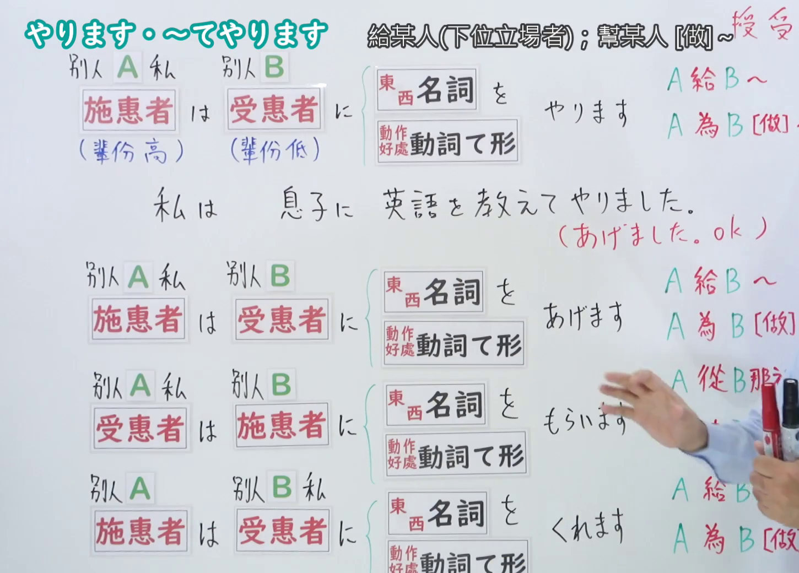
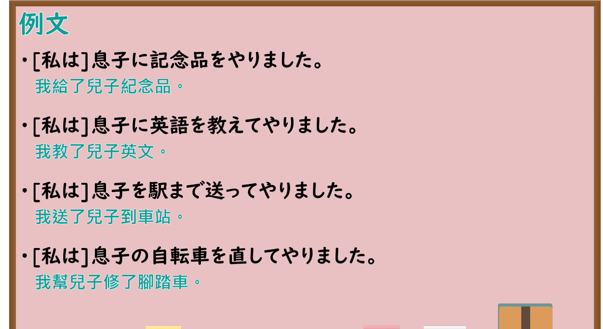

---
{
  "id": "N4-G-0037",
  "kind": "grammar",
  "level": "N4",
  "title": "～てやります（为……做……（对晚辈/下级/动植物））",
  "card_revision": 1,
  "schema_version": 1,
  "source": {
    "lesson": "N4 第37个语法",
    "material": "出口日語原视频板书、YouTube 原 WebVTT（中文为主、日语为辅）与Hagoromo文型检索正文",
    "video": "https://www.youtube.com/watch?v=LkWca8k34hE",
    "screenshot": "assets/grammar/n4/N4-G-0037-connection.png",
    "screenshot_seconds": 400.8,
    "screenshot_crop": {
      "x": 0,
      "y": 0,
      "width": 1450,
      "height": 1040
    }
  },
  "tags": [
    "てやる",
    "てやります",
    "授受",
    "目下",
    "動植物",
    "N4"
  ],
  "confusions": [
    "～てあげる",
    "～てさしあげる"
  ]
}
---

# N4 第37个语法：～てやります

# 视频学习资料整理

- 课程：[出口日語「～てやります」](https://www.youtube.com/watch?v=LkWca8k34hE)
- 视频 ID：`LkWca8k34hE`
- 视频时长：8分21秒

## 接续图

- 实际时间：6分40.80秒（400.80秒）
- 原图尺寸：1920×1080
- 裁切区域：左上角 `(0, 0)` 至右下角 `(1450, 1040)`；00:01 画面尚未补充对象限定与目上禁忌板书；选用 06:40 画面，黑板最上方完整保留「～てやります」大标题；板书已完整书写「動詞て形＋やります」「為[晚輩・動植物]做~」「犬を散歩に連れて行ってやります／花に水をやってやります」「対等～目下・動植物限定／目上には絶対使わない」、老师让出板书区域。固定左上角 (0, 0)，裁切区域宽 1450、高 1040，去除右侧人物与边缘多余画面，充分保留底部全部例句板书。

## 例句图

- 实际时间：7分05.68秒（425.68秒）
- 原图尺寸：1920×1080
- 裁切区域：左上角 `(0, 0)` 至右下角 `(1900, 1040)`；提取自视频 07:05 处的例句黑板页面。固定左上角 (0, 0)，裁切区域宽 1900、高 1040，去除右侧与底部多余画面，完整保留全部四条例句及中文翻译。

# 核心

## 功能一：为晚辈或动植物做 A（授受动作：对下级/动植物）

**最上位意味カテゴリー：**

- **Vてやる：** 人との関係（与人的关系）

**中位意味カテゴリー：**

- **Vてやる：** 授受（授受）

**意味：**

- **Vてやる：** 受給：行為（授受：行为）

**くわしい意味記述：**

- **Vてやる：** 話し手が，目下の人や動植物にある行為をするという意味。（表示说话人向晚辈、下级或动植物进行某种行为之意。）

**派生語：** 未列出

### 例句

1. 毎朝、庭の花に水をやってやります。

   （每天早晨，我都会给院子里的花浇水。）

2. 弟におもちゃを買ってやりました。

   （我给弟弟买了玩具。）

3. 犬を近くの公園へ散歩に連れて行ってやりました。

   （我带小狗去附近的公园散了步。）

4. 猫に美味しいエサを食べさせてやりました。

   （我给猫喂了美味的猫粮。）

# 来源

- [出口日語原视频](https://www.youtube.com/watch?v=LkWca8k34hE)
- [Hagoromo 文型検索「Vてやる」](https://hagoromo-text.work/lookup?vid=177)（查询日期：2026-09-25）
