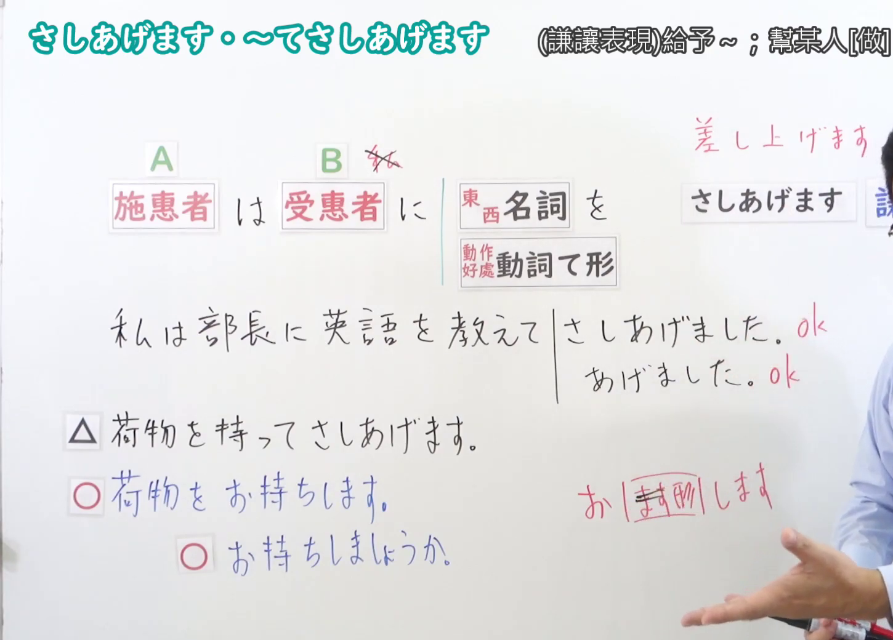

---
{
  "id": "N4-G-0038",
  "kind": "grammar",
  "level": "N4",
  "title": "～てさしあげます(差し上げます)（为您做……、为长辈做……）",
  "card_revision": 1,
  "schema_version": 1,
  "source": {
    "lesson": "N4 第38个语法",
    "material": "出口日語原视频板书、YouTube 原 WebVTT（中文为主、日语为辅）与Hagoromo文型检索正文",
    "video": "https://www.youtube.com/watch?v=FHunyRTP78M",
    "screenshot": "assets/grammar/n4/N4-G-0038-connection.png",
    "screenshot_seconds": 382.4,
    "screenshot_crop": {
      "x": 0,
      "y": 0,
      "width": 1450,
      "height": 1040
    }
  },
  "tags": [
    "てさしあげる",
    "差し上げます",
    "授受",
    "謙譲語",
    "敬語",
    "N4"
  ],
  "confusions": [
    "～てあげる",
    "～てやる"
  ]
}
---

# N4 第38个语法：～てさしあげます(差し上げます)

# 视频学习资料整理

- 课程：[出口日語「～てさしあげます(差し上げます)」](https://www.youtube.com/watch?v=FHunyRTP78M)
- 视频 ID：`FHunyRTP78M`
- 视频时长：7分58秒

## 接续图

- 实际时间：6分22.40秒（382.40秒）
- 原图尺寸：1920×1080
- 裁切区域：左上角 `(0, 0)` 至右下角 `(1450, 1040)`；00:01 画面尚未补充谦让语体系与配虑表达板书；选用 06:22 画面，黑板最上方完整保留「～てさしあげます」醒目标题；板书已完整书写「動詞て形＋さしあげます」「為[長輩・尊長]做~（謙譲表現）」「先生のお荷物を持ってさしあげます／駅までご案内してさしあげます」「〜てあげますの謙譲語／押し付けがましさへの配慮」、老师让出板书区域。固定左上角 (0, 0)，裁切区域宽 1450、高 1040，去除右侧人物与边缘多余画面，充分保留底部全部例句板书。

## 例句图

- 实际时间：6分45.85秒（405.85秒）
- 原图尺寸：1920×1080
- 裁切区域：左上角 `(0, 0)` 至右下角 `(1900, 1040)`；提取自视频 06:45 处的例句黑板页面。固定左上角 (0, 0)，裁切区域宽 1900、高 1040，去除右侧与底部多余画面，完整保留全部四条例句及中文翻译。

# 核心

## 功能一：为长辈/尊长做 A（授受谦让语）

**最上位意味カテゴリー：**

- **Vてさしあげる：** 人との関係（与人的关系）

**中位意味カテゴリー：**

- **Vてさしあげる：** 授受（授受）

**意味：**

- **Vてさしあげる：** 尊敬：行為の受給（尊敬：行为授受）

**くわしい意味記述：**

- **Vてさしあげる：** 「てあげる」の謙譲語。目上の人のために行為を行うときに，敬意を含めて言う時に使う。（“てあげる”的谦让语。为长辈进行某种行为时，包含敬意地表达时使用。）

**派生語：** 未列出

### 例句

1. 先生のお荷物をお持ちしてさしあげましょうか。

   （老师，我来为您提行李吧？）

2. お客様に会社のお茶をお入れしてさしあげました。

   （我为客户沏了公司的茶。）

3. 道に迷っていらっしゃるお年寄りを駅まで案内してさしあげました。

   （我为迷路的老人家带路带到了车站。）

4. 社長に最新の資料をお送りしてさしあげました。

   （我已经向社长发送了最新的资料。）

# 来源

- [出口日語原视频](https://www.youtube.com/watch?v=FHunyRTP78M)
- [Hagoromo 文型検索「Vてさしあげる」](https://hagoromo-text.work/lookup?vid=820)（查询日期：2026-09-25）
